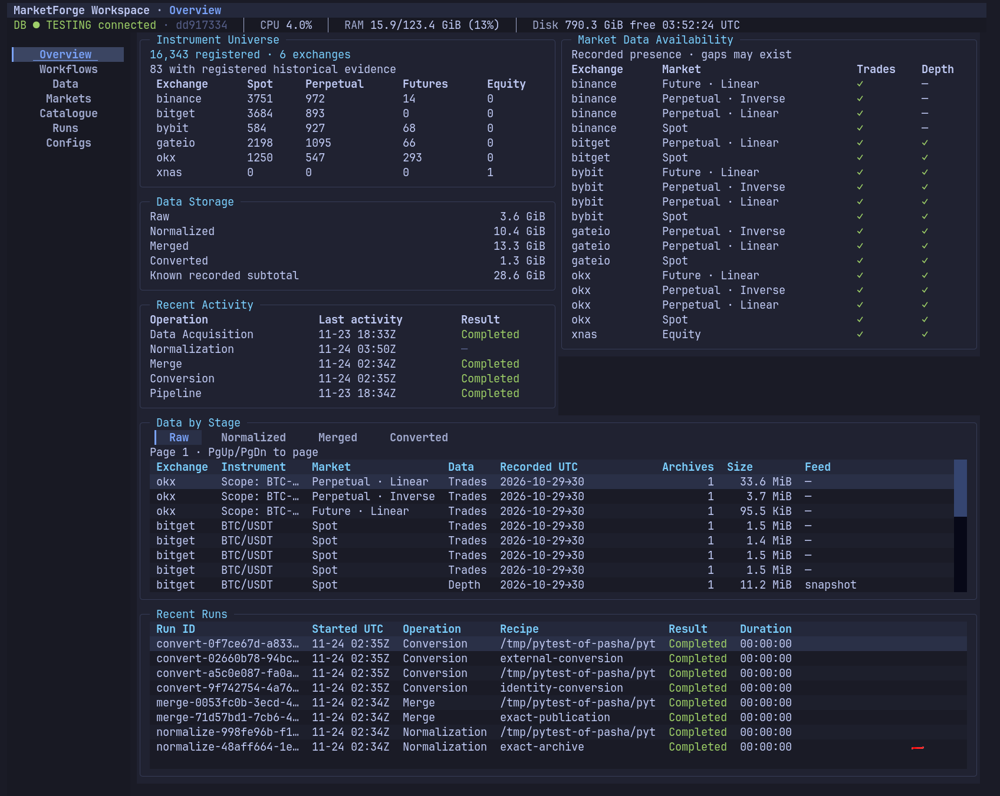

<div align="center">

**[Documentation](https://flowdrivenml.github.io/marketforge/)** · **[Quick Start](https://flowdrivenml.github.io/marketforge/getting-started/quickstart/)** · **[Roadmap](ROADMAP.md)** · **[Releases](https://github.com/flowdrivenml/marketforge/releases)**


**Quantitative research and financial engineering powered by high-performance market data infrastructure.**

*Spend less time engineering data. More time engineering strategies.*

[](https://github.com/flowdrivenml/marketforge/releases)
[](forge/pyproject.toml)
[](engine/Cargo.toml)


</div>



Researchers spend time finding market data, reconciling formats, and preparing datasets before they can test an idea. MarketForge automates that work on one machine. Run a complete historical workflow from one recipe, then inspect and read the resulting Parquet datasets in Python.

The [interactive Forge workspace](https://flowdrivenml.github.io/marketforge/workflows/forge-tui/) brings together historical pipelines, market discovery, acquisition, datasets, the instrument catalogue, run history, and configuration.

## Current capabilities

- Discover and acquire historical trades and L2 order-book data from supported exchange archives. Register external recordings in supported formats.
- Normalize and merge market events with the Rust Engine, with optional quote conversion on supported platforms.
- Run reusable historical recipes from the CLI or TUI, register verified outputs, and inspect retained execution evidence.
- Discover datasets and read selected events in Python with Jupyter, Arrow, and Polars.

## Explore your data in Python

After running the Quick Start, find the merged files in a notebook.

```python
from forge.datasets import MarketData

market = MarketData()
catalog = market.discover(metadata_only=True)
matches = catalog.find(exchange="bybit", symbol="BTCUSDT", operation="merge")
display(matches.summary())
```

Choose the publication from your run and paste its directory path. To find it, inspect the matching publication in Forge and use the directory containing its `manifest.json`.

```python
publication = market.open(input("Merged publication directory: ").strip())
display(publication.streams())
trades = publication.query(data_type="trades")
display(trades.head(10, columns=["event_timestamp_ns", "instrument_id"]))
```

[Python setup](https://flowdrivenml.github.io/marketforge/research/getting-started/) · [Dataset discovery](https://flowdrivenml.github.io/marketforge/research/discovery/) · [Jupyter notebooks](https://flowdrivenml.github.io/marketforge/research/notebooks/) · [Querying](https://flowdrivenml.github.io/marketforge/research/querying/) · [Python API](https://flowdrivenml.github.io/marketforge/research/python-api/)

## Project status

Historical workflows are operational. Current development focuses on live market infrastructure and historical-to-live bootstrap. Spectra feature engineering, feature optimization, machine learning, backtesting, and algorithmic infrastructure are planned. [Roadmap](ROADMAP.md)

## License

[Apache License, Version 2.0](LICENSE).
