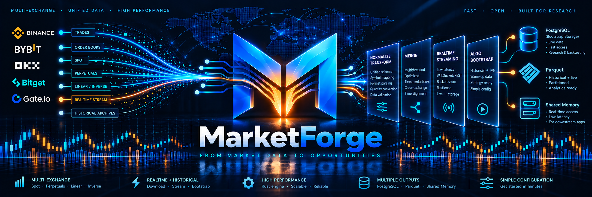

<div align="center">

  

  <br><br>

  <strong>High-performance market data infrastructure powered by Python & Rust.</strong>

  <br><br>

  
  
  

  <br><br>

  <em>From historical archives to real-time market data — one unified pipeline.</em>

</div>

---

MarketForge simplifies the acquisition, processing, and merging of cryptocurrency market microstructure data across multiple exchanges.

Discover instruments, download decades of historical tick data, and transform trades and order books into analysis-ready datasets — all through a simple CLI.

## Supported Exchanges

**Binance · Bybit · OKX · Bitget · Gate.io**

- **Markets:** Spot, perpetuals, linear & inverse futures
- **Data:** Tick trades & L2 order books
- **Storage:** Parquet, PostgreSQL & shared memory
- **Scale:** Thousands of instruments across multiple exchanges

## Installation

```bash
git clone https://github.com/flowdrivenml/MarketForge.git
cd MarketForge
python -m pip install -e .
```

```bash
marketforge --help
```

## Quick Start

Explore the available commands:

```bash
marketforge instruments --help
marketforge availability --help
marketforge plan --help
marketforge download --help
```

## Development Status

🚧 **Active development**

| Component | Status |
|-----------|--------|
| Multi-exchange downloads | ✅ Complete |
| Acquisition planning & discovery | ✅ Complete |
| Data processing & normalization | ✅ Complete |
| High-performance Rust merging | ✅ Complete |
| Cross-instrument quantity conversion | 🔨 In progress |
| Algorithm bootstrapping | 📋 Planned |
| Real-time market streaming | 📋 Planned |

### What's Next?

Seamlessly bridge historical and live market data, enabling trading algorithms to bootstrap from historical records and transition into real-time streaming.

**The goal:** From raw exchange data to research-ready and live-ready infrastructure in just a few commands.

---

<sub>MarketForge is an independent open-source project and is not affiliated with the supported exchanges.</sub>