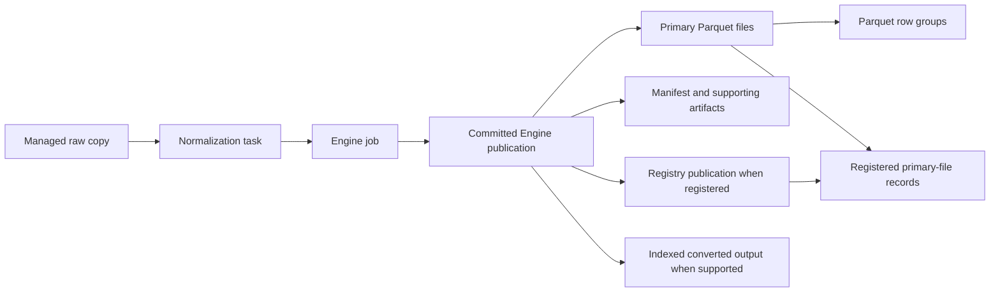

# The historical data model

MarketForge records both physical data and the relationships needed to interpret it. A source object can have a verified local copy, a processing job can read several inputs, and a publication can contain many primary files. Registry records connect published files to their identities and evidence.

## From a provider to managed raw bytes

| Object | What it represents |
| --- | --- |
| Provider or source | The distribution origin and registered source context. An external recorder or vendor can supply data for another execution venue. |
| Execution venue | The venue at which the market activity occurred. It belongs to the instrument identity. |
| Discovery request | A selection of source, product or instrument scope, and time. It yields source objects and discovery outcomes. |
| Remote archive or source object | An addressable object, often a compressed archive with selected members. Its nominal interval describes the advertised file scope. |
| Source revision | Retained evidence about the version discovered or acquired. A revised source object can have different bytes under the same source key. |
| Managed local raw copy | A registered local object bound to its origin, location, and byte fingerprint. Local bytes and an available, verified managed copy are separate observations. |
| External recording | User-supplied bytes registered with declared source, coverage, identity, and applicable interpretation. This uses the managed raw model while preserving the declared origin. |

Discovering a Bybit BTCUSDT archive establishes that the provider offered an object in the requested scope. A verified copy establishes availability of the recorded bytes. Normalization additionally needs a supported profile and resolved instrument and specification evidence. See [acquisition](../workflows/acquisition/index.md) and [registering external recordings](../workflows/acquisition/external-data.md).

## From an input selection to a job

| Object | What it represents |
| --- | --- |
| Recipe | Editable request. Preparation resolves its selectors against the current workspace and registry evidence. |
| Forge batch or collection | A managed submission or set of jobs with operation-specific bindings and reports. Normalization can submit a batch. Conversion can retain a collection of exact Rust job documents. |
| Engine job | Concrete processing request, with input and output bindings. Normalization jobs contain tasks. Merge jobs pin selected files. Conversion jobs bind complete merge publications and selected reference identities. |
| Task | A normalization work unit specifying physical input and interpretation. One archive can supply multiple selected members or tasks. Multiple tasks can contribute to a logical stream. |
| Logical stream | Observations for a resolved instrument and content type in their source context. One logical stream may span files. A combined file can carry several streams. |
| Resolved instrument and specification | Namespace-qualified identity and the applicable economic evidence used to interpret records, including quantity units or contract value where required. |

## From canonical data to a registered output

| Object | What it represents |
| --- | --- |
| Canonical event or row | An observation or its physical representation under the stage schema. A normalized depth event can span several canonical level rows. |
| Reconstruction record | A retained observation or state aid needed to replay dependent observations. Causal merged rows can be explicitly marked reconstruction-only. |
| Partition | A unit of output planning or layout, such as a timestamp range or a causal sequence range. It can contain several physical files and multiple streams. |
| Primary Parquet file | The physical event or level data described by a manifest. Its row groups are Parquet storage units, independent of the logical stream count. |
| Sidecar or supporting artifact | Evidence such as source ownership, event indexes, checkpoints, job settings, or checksums. The manifest and readers determine which ones are required. |
| Engine publication | One committed output with a manifest and required physical inventory. It can include multiple streams, instruments, venues, markets, partitions, and files, subject to the operation's compatibility checks. |
| Registry publication and file records | Database identities that associate a committed normalized or merged publication with its registered primaries. A publication ID addresses the group. A registered primary-file ID addresses one file. |
| Converted output reference | An exact work-index reference to verified converted output. Parts are numbered within that output. |

“Dataset” is an umbrella term in the CLI. In a prepared job or registry query, fields named `dataset_id` can refer to different kinds of identity. Read the field's contract before using it. [Identifier reference](identity.md) · [Publication formats](../reference/data-formats/publications.md)
