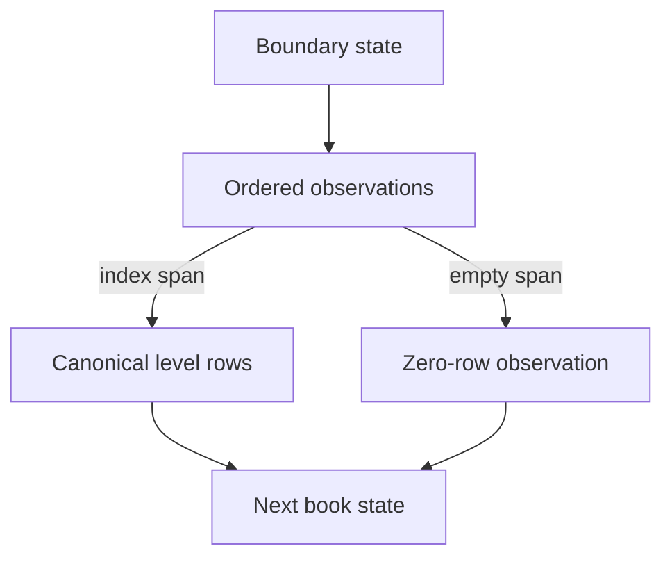

# Depth observations and reconstruction

A snapshot or bounded initial observation establishes the starting state allowed by the profile's declared scope. Updates change levels within that scope. Absolute operations set the level, while relative operations have source-specific change semantics. Read the profile and stored codes before interpreting zero quantities or resets.

The event index can establish an observation whose canonical row span is empty. It cannot fill in a missing observation. Reconstruction starts at the applicable initialization or carried boundary, follows source or causal order, and applies exact row spans. A segment identifies a separately reconstructable history. A bounded feed can establish only its declared levels, and a sequence domain can reset at an initialization. [Depth index and segment formats](../reference/publication-normalized.md) · [Verify the first Bybit snapshot](../getting-started/quickstart.md#verify-both-outputs)
