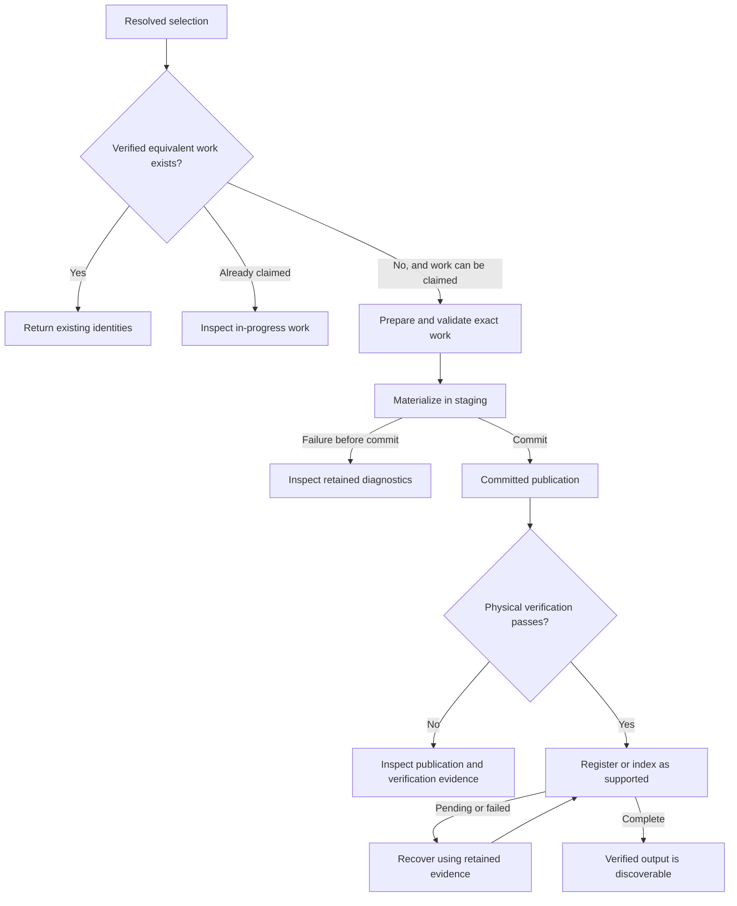

# Runs, publication, reuse, and recovery

A Forge run records an operation and action. Its result can describe a plan, a prepared request, a newly committed publication or an existing verified output. Read execution, verification, registration and reuse evidence separately.

The diagram shows common branches. Individual operations can perform checks at different points or return previously verified work during preparation.

| Outcome | What it establishes |
| --- | --- |
| Structurally valid recipe | Editable declaration passes its local schema and constraints |
| Resolved selection | Forge identified inputs under the selected registry and the requested scope |
| Prepared request | Concrete job, batch or collection is available to inspect |
| Engine validated | Engine checked the request and applicable inputs under its contract |
| Materialized staging | Processing wrote intermediate output. Commit remains a separate transition |
| Committed publication | Engine exposed the finished physical output under its publication contract |
| Physically verified output | Forge or the specified verifier confirmed the committed evidence it checks |
| Registered output | A supported operation associated verified output with registry publication and file records |
| Indexed work | The durable reuse index can associate the resolved work with retained output evidence |

Validation-only, preparation-only and operation-specific materialization-only modes intentionally stop at different boundaries. Artifacts from those stops exist only as documented by the operation. For example, a merge dry run reports prospective artifacts while a persisted generated job may still lack successful Rust validation.

## Read runs and attempts

A run ID identifies a logical Forge operation. Attempts record executions or resumptions under that identity. Pipeline stage work can have a child run with its own ID. Use indexed run history to inspect attempts, resources and children. Retained local artifacts can include the exact submission, intent, reports and diagnostic logs. Indexed history describes those artifacts. Local evidence can still matter when indexing or a later phase failed.

## Pipeline stage terminals

Window mode delegates Acquisition or an already-pinned Engine invocation to a
local stage worker. The original pipeline owns dependencies, verifies processing
results, and records registration or indexing. A launcher exit alone carries no
processing outcome. If the worker result is missing, the retained run and work
claim are the starting point for reconciliation. Terminal mode has no role in
the work identity. See [Pipeline stage windows](../workflows/pipeline.md#stage-windows).

## Reuse and recovery

Work identity includes resolved inputs, processing settings, operation semantics, registry and Engine compatibility evidence under the operation's contract. The resolver rechecks the existing output before returning it. Matching dates, names or directories are insufficient. Concurrent ownership can surface work already in progress. A reuse result points to the existing output's actual IDs and location. Normalization can also report reuse for part of a batch.

A committed publication can survive failed verification, registration or indexing. Determine the failed phase before retrying. Normalization and merge can recover registration from supported retained evidence. Conversion can recover eligible committed work into its durable index. Recovery can verify an existing result and finish its handoff without materializing it again. Keep the retained intent, exact dependencies and original registry bindings.

## Distinguish removal operations

| Change | Effect |
| --- | --- |
| Delete a recipe | Remove an editable declaration. Published data and retained submissions have their own lifecycle |
| Hide or remove run history | Changes inspection of orchestration records. Dependent evidence can remain protected |
| Supersede a publication | Record a canonical replacement where equivalence is established |
| Retire a publication | Remove it from ordinary active selection while retaining historical identity and evidence |
| Invalidate downstream output | Mark dependent output ineligible when its exact source contract cannot be satisfied |
| Delete physical files | Remove verified managed targets under the applicable ownership and dependency rules |

Pinned downstream references can need the original path, identity, or digest. A canonical selection can guide future work while historical evidence continues to record the original source. A testing registry does not establish exclusive ownership of physical storage. Logical retirement and reclaimed storage are separate outcomes. See [run inspection](../workflows/inspection/runs.md), [dataset inspection](../workflows/inspection/datasets.md), and [dataset maintenance](../reference/cli/datasets.md).

## Completed Pipeline with an incomplete history index

Pipeline stage verification and publication registration or conversion
indexing precede finalization of the parent execution-history attempt.
When the final index update fails, inspect the retained report and reconcile
the exact attempt using `mf runs reconcile --run-id RUN_ID --testing`.
Apply that same selector with `--apply` after reviewing the result. Forge
checks the original registry and attempt IDs and the retained report
fingerprint. Processing artifacts remain unchanged. [Pipeline recovery](../workflows/pipeline.md#processing-and-execution-history)
