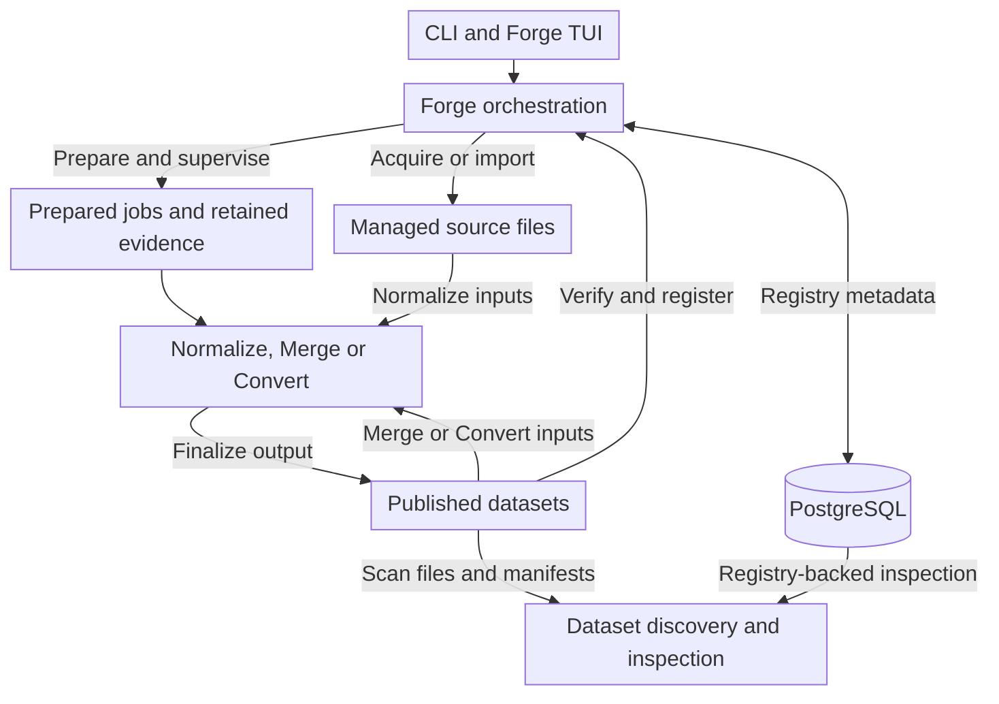
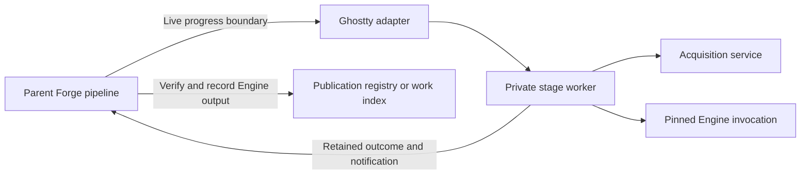
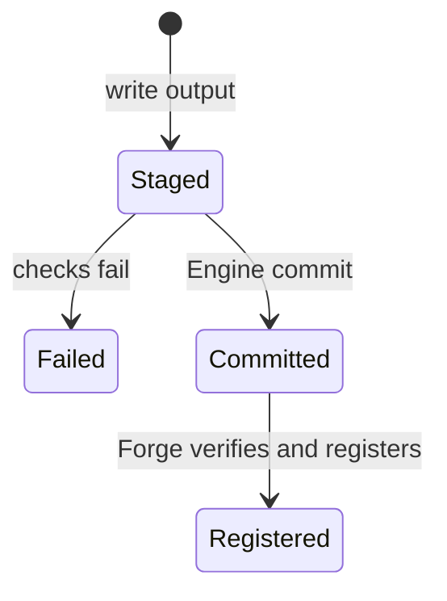

# System architecture

Follow the boundary between application decisions and event processing. Forge resolves what to process and records where it came from. The historical Engine interprets those inputs, produces physical output, and checks publication invariants. This division lets Engine processing use pinned filesystem inputs while Forge manages database-backed selection and registration.

Forge requests archive listings and downloads over HTTP, stores managed copies, and verifies Engine output. It is the database client for these historical operations. The Engine reads job documents and committed inputs from disk. The Python dataset API can open a committed publication directly and can enrich its views when the caller supplies registry records. [CLI dispatch](https://github.com/flowdrivenml/marketforge/blob/main/forge/cli/main.py) · [Python dataset API](../research/python-api.md)

| Boundary | Ownership and implementation |
| --- | --- |
| Request and orchestration | `forge/cli/main.py` parses commands and loads the application context. Services under `forge/historical/` resolve recipes, authorities and paths, supervise subprocesses, and retain reports. CLI JSON and exit status expose application outcomes. |
| Source archives | `forge/historical/archives/sources/` validates provider requests and listings. Storage services manage copies and hashes. Manually supplied archives enter through registration and import instead of provider discovery. |
| Catalogue and registry | `forge/shared/database/sql/core/` establishes metadata, provenance and file relationships. Catalogue and registration services resolve instrument and specification evidence. PostgreSQL stores metadata and paths, while files hold source bytes and committed output. |
| Configuration and profile interpretation | Forge validates recipe models and resolves configuration libraries. Rust compiles installed format profiles and validates job contracts before interpreting source records. |
| Historical processing | The Engine binaries dispatch into `engine/src/historical/` and reuse format, conversion and persistence code under `engine/src/shared/`. Engine errors surface through exit status and operation-specific diagnostics. |
| Discovery and inspection | `forge/datasets/discovery.py` reads manifest inventories and physical evidence. Dataset operations use Arrow for exact batches and offer Polars previews or supported lazy projections. Registry-backed terminal inspection follows a separate CLI path. |

The historical pipeline runs Acquisition, Normalization, and Merge with an optional Conversion stage. Normalize consumes pinned raw copies. Merge consumes registered normalized files. Conversion uses the exact registered merge with optional reference publications. The parent pipeline retains its plan and attempts and resumes from that evidence. [Pipeline guide](../workflows/pipeline.md) · [Prepared contracts](../reference/data-formats/prepared.md)

The separate Live binary loads live exchange and format configuration and runs its own application and stream graph. The normal start path restores definitions from PostgreSQL. Static validation exercises configuration without restoring that graph or contacting exchanges. Follow the entry point into `engine/src/live/application/` for runtime wiring and `engine/src/live/stream/` for processing. Live and management tests use their own Cargo features. [Live entry point](https://github.com/flowdrivenml/marketforge/blob/main/engine/src/bin/marketforge-live.rs) · [Cargo features](https://github.com/flowdrivenml/marketforge/blob/main/engine/Cargo.toml)

### Stage window boundary

`PipelineRun` retains the run context and uses the existing services to prepare
and claim work. The StageWindows coordinator in `historical/pipelines/terminal.py`
opens one isolated Ghostty instance. The private `stage_worker` module validates
the retained run and attempt, registry identity, and the prepared submission.
The parent shares its workspace lock file descriptions over a private Unix
socket. A bounded readiness and authorization exchange gates actual execution.

Acquisition writes the pipeline checkpoint from the worker and registers its child
under the existing parent run context. For Engine stages, the parent keeps the
stage checkpoint and opens the window at the existing supervision boundary,
after work reuse and recovery checks. The worker supervises the pinned command
and retains a structured outcome. The parent verifies and records the result
through the normal service, then releases the window. Socket closure signals
cancellation. A lost outcome leaves the existing evidence available for
reconciliation.

## Identity and evidence

An execution venue identifies the market that produced an event. A data provider supplies access to the archive. A provider or a recording can have its own symbol, object key and path. The catalogue relates an observed source scope to canonical identity and historical specification evidence. A family request may discover multiple concrete derivatives. Normalize each with the correct concrete identity and effective specification. Preserve provenance when two sources describe the same venue or symbol. [Catalogue workflow](../workflows/catalogue/index.md) · [Registration reference](../reference/registration.md)

| Concept | Consequence for implementation |
| --- | --- |
| Source object and local copy | A provider object's stable key and nominal interval establish discovery identity. A managed local copy adds location and hash evidence. Keep those identities separate from temporary download URLs and from the provider's current listing. |
| Instrument and stream | An instrument ID is namespace-qualified. A stream adds content and source context. A rank orders or identifies streams within a job or publication contract. Trades and depth can belong to the same instrument and remain separate streams. |
| Publication and primary file | One Engine publication can contain several primary files. Registration gives its publication and each registered file separate database IDs. Check which ID, namespace and member files a selector expects. |
| Source records and canonical rows | A raw record has provider-specific shape and units. One depth event can produce multiple canonical level rows, and some observations emit zero rows. Preserve indices and offsets that connect observations, events and rows. |
| Requested and observed time | Requested bounds are half-open where the contract specifies that form. Observed endpoints describe measured row timestamps, often inclusive. They cannot prove continuous coverage. A reconstruction event can sit outside the requested market interval where the physical contract permits it. |

For Bybit BTC perpetual data, acquisition locates files for the venue, instrument scope and feed. Normalization resolves identity, interprets trade timestamps and reconstructs depth using the selected profiles. A combined merge keeps the streams distinct in one timeline. Quote conversion can use a selected **trade** stream as a price reference while still converting rows from both trade and depth streams.

## Publication state

This diagram shows the publication and registration boundary for managed normalization and merge. A final directory and registered rows have separate commit points. Failure can leave diagnostic artifacts or staging, depending on the phase. A registration retry uses a supported retained receipt and verifies committed evidence again. See the operation-specific paths in [Historical operation lifecycles](operations.md) and the [publication format reference](../reference/data-formats/publications.md).

Read the component chapters for implementation details. [Forge](forge.md) · [Normalization Engine](normalize.md) · [Merge Engine](merge.md) · [Conversion Engine](convert.md)
