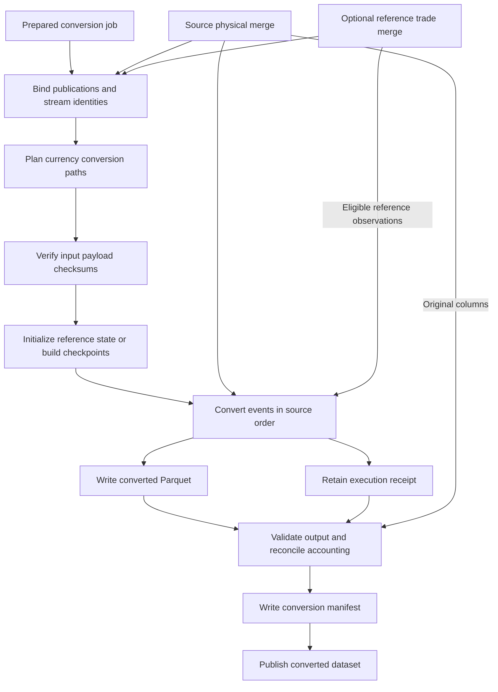
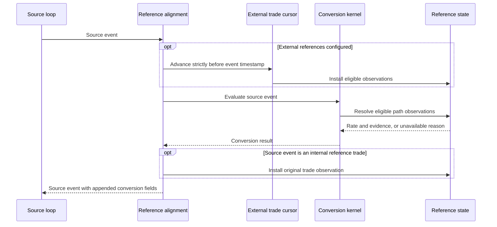

# Conversion Engine architecture



The conversion engine expresses selected market-data values in a target quote currency while preserving the original merged events.

It reads a physical merge publication, evaluates conversion paths against eligible reference trades, and appends target values together with the evidence used to calculate them. The output retains the original prices, quantities, identities, event order, and depth changes.

The implementation lives in `engine/src/historical/convert/`. Its historical execution code handles publication binding, Parquet input, temporal alignment, partition checkpoints, output construction, validation, and publication. Currency graphs, reference-state evaluation, and monetary arithmetic belong to the shared conversion domain.

The diagram shows the composed execution lifecycle. The caller coordinates preparation, content verification, materialization, receipt persistence, and publication through separate APIs.[^module][^prepared][^publication]

## What conversion changes

Conversion adds target values for two economic quantities:

| Source value | Added value |
| --- | --- |
| Event or level price | Price expressed in the target quote currency. |
| Quote quantity, when present | Quote quantity expressed in the target quote currency. |

Base quantities and contract quantities remain part of the preserved source data. A missing quote quantity remains missing; conversion does not derive it from other fields.

Other source fields, including mark prices, index prices, and implied volatility where present, are preserved. Their presence does not imply that conversion creates target versions of them.

For an illustrative direct reference:

```text
Native price:       100 USDT
Reference price:   0.999 USD per USDT
Target price:      99.9 USD
```

The original price remains available alongside the target price. Each successful non-identity conversion also records its currency path and the reference observations used.

A depth level receives the same kind of event-time valuation. Conversion does not reconstruct and reprice the entire book whenever a reference changes.[^schemas][^trade-kernel][^depth-kernel]

### Conversion preserves the event population

Every source event remains represented in the converted output.

An event whose target value cannot be calculated receives an unavailable status and null target values. An event outside the selected conversion scope in combined mode receives a skipped status.

Neither condition removes the original event.

A successfully published dataset can therefore contain unavailable or skipped conversions. Publication success means the output passed its applicable validation and accounting checks; the status counters describe conversion availability.[^statuses][^receipt][^publication]

## Module boundaries

Paths in this table are relative to `engine/src/historical/convert/`.

| Module | Responsibility |
| --- | --- |
| `planning/prepared.rs` | Bind a prepared job to physical publications and embedded stream metadata. |
| `planning/catalog.rs` | Resolve reference selection and provide the alternate catalogue-based resolution API. |
| `planning/planner.rs` | Adapt the historical job to the shared conversion planner. |
| `reference/reader.rs` | Read physical trade observations used as references. |
| `reference/external.rs` | Advance and restore an external reference cursor. |
| `execution/shared/` | Source readers, row-group partitions, common checkpoints, and trade reference prepasses. |
| `execution/trades/` | Trade conversion kernels, sequential materialization, and parallel workers. |
| `execution/depth/` | Depth valuation, external reference alignment, checkpoints, and workers. |
| `execution/combined/` | Mixed-event conversion, internal/external reference alignment, selection, and workers. |
| `output/schema/` | Appended Arrow fields, conversion rows, status codes, and batch construction. |
| `output/writers/` | Combined batch construction and the adapter to merge’s physical Parquet writer. |
| `output/validation/` | Physical validation, numeric checks, causal positions, and source preservation. |
| `output/publication/` | Execution receipts, manifests, reference provenance, and publication. |
| `progress/` | Phase reporting, partition counters, validation progress, and cooperative interruption. |

Several small modules are reexports rather than local implementations:

| Historical module | Implementation owner |
| --- | --- |
| `planning/graph.rs` | `shared::conversion::graph` |
| `reference/state.rs` | `shared::conversion::reference` |
| `reference/evaluation.rs` | `shared::conversion::evaluation` |
| `shared/decimal.rs` | `shared::conversion::decimal` |
| `trades/trade.rs` | `shared::conversion::trades` |
| `depth/depth.rs` | `shared::conversion::depth` |

Changes to path enumeration, reference-history semantics, decimal arithmetic, or the underlying monetary calculations belong in those shared modules. Historical adapters should remain responsible for translating persisted data into that domain.[^module][^shared]

## Execution entry points

The public APIs expose several stages of the lifecycle.

| API | Responsibility |
| --- | --- |
| `prepare_conversion_execution` | Validate and bind prepared publication evidence, resolve references, and construct the conversion plan. |
| `PreparedConversion::verify_content` | Hash source and external-reference payload files against their bound checksum inventories. |
| `materialize_trade_conversion` | Sequentially write converted trade output into staging. |
| `materialize_depth_conversion` | Sequentially write depth output using external trade references. |
| `materialize_combined_conversion` | Sequentially write combined output with internal and optional external references. |
| `execute_parallel_conversion` | Execute checkpointed trade partitions. |
| `execute_parallel_depth_conversion` | Execute checkpointed depth partitions. |
| `execute_parallel_combined_conversion` | Execute checkpointed combined partitions. |
| `publish_conversion` and the depth/combined variants | Validate staging, reconcile the receipt, verify source preservation, write the manifest, and publish. |

Progress-enabled variants expose the same operations with reporting and interruption checks.

`execute_conversion_sequential` has a different role: it evaluates reference availability and returns statistics. It does not materialize converted Parquet or publish a dataset.[^entrypoints]

### The caller composes the lifecycle

For a sequential trade conversion, the call sequence is:

```rust
let prepared = prepare_conversion_execution(&job)?;

prepared.verify_content(&job, &reporter)?;

let metrics = materialize_trade_conversion_with_progress(
    &job,
    &prepared.source,
    &prepared.plan,
    &staging,
    &parquet,
    &reporter,
)?;

ConversionExecutionReceipt::new(job.job_id, &metrics)?
    .write(&staging)?;

let publication = publish_conversion_with_progress(
    &job,
    &prepared.source,
    &staging,
    &reporter,
)?;
```

This example assumes the caller has loaded the job, selected a fresh staging path, and supplied Parquet settings and a reporter.

Materialization returns execution metrics. The caller creates the receipt from those metrics before requesting publication. Writing staged Parquet alone does not complete the publication workflow.[^trade-materialization][^receipt][^publication]

## Bind prepared inputs to physical evidence

`prepare_conversion_execution()` consumes a `ConvertJob` containing the source publication declaration and optional external-reference declaration.

The prepared job supplies stream identities and currency metadata. Execution binds those declarations to the physical merge evidence rather than performing database discovery.

For each publication, binding checks:

1. The SHA-256 of `manifest.json`.
2. The SHA-256 of `publication-checksums.json`.
3. The merge job identity and manifest entry in the checksum inventory.
4. Checksum entries for every declared primary file.
5. Physical file sizes, schemas, row counts, and row-group totals.
6. Normalized-parent declarations against retained merge input evidence.
7. Stream kind, rank, stream ID, publication ID, instrument ID, exchange, symbol, and available currency metadata.

The resulting `PreparedConversion` contains the source manifest, optional external manifest, conversion plan, and bound checksum inventories.

Prepared execution does not require reopening every original normalization directory or loading an external instrument catalogue. Its currency declarations come from the prepared bindings and are checked against the available publication evidence.[^prepared]

### Metadata binding and payload hashing are separate

`validate_conversion_input()` inspects the manifest, file inventory, Arrow schema, and Parquet footers. It does not scan every market row.

`PreparedConversion::verify_content()` performs the separate full-file hashing pass. It checks every primary file in the source and optional external publication against the bound inventory.

Calling `prepare_conversion_execution()` alone does not perform that full payload verification.

Maintain this distinction when adding a new entry point: a valid schema and matching publication metadata establish different facts from verified payload bytes.[^prepared][^readers]

### The alternate catalogue resolver

`resolve_conversion_catalog()` and `resolve_conversion_catalog_with_normalization_root()` provide a separate library route.

They resolve instruments through an `InstrumentCatalog` and normalized processing provenance, including compatibility handling for older processing-job layouts.

That route is useful when constructing conversion inputs from catalogue information. Its catalogue and normalization-root requirements are not prerequisites of the prepared execution API.[^catalogue]

## Source modes and reference selection

Reference prices come from explicitly selected trade streams.

| Source mode | Reference source |
| --- | --- |
| Trades | Selected trades inside the source publication. An external reference publication is rejected. |
| Depth | A separate trade-only physical merge. |
| Combined | Matching internal trade streams first, with external trade streams used where no internal match is selected. |

External reference publications must be trade-only physical merges.

Reference selection rejects missing requested instruments, duplicate selected reference stream IDs, and ambiguous external references that conflict with internal combined trade streams.

The prepared execution path also applies these restrictions:

- Trade conversion rejects unresolved planned streams.
- Depth conversion requires an external reference publication and at least one nonempty conversion path using reference edges.
- Combined conversion validates the separation between internal and external reference sets.

An entirely identity-only depth job therefore does not automatically bypass external-reference setup in the current prepared path.

The conversion kernels also require unambiguous source stream ranks. Treat stream rank as a validated binding, not a value that can be reassigned while reading rows.[^catalogue][^prepared][^reference-selection]

## Plan currency paths before evaluating events

`plan_conversion()` translates the historical configuration into inputs for the shared planner:

- Target quote currency.
- Resolved source instruments.
- Selected reference instruments.
- Instrument-kind selection.
- Maximum hop count.

The resulting `ConversionPlan` records each source stream’s identity-conversion status, selection status, and candidate currency paths.

A path describes how to express the source quote currency in the target quote currency. Each edge identifies a reference stream and its conversion direction.

Planning establishes that a route exists. It does not establish that the necessary observations will be available and fresh at every source event.[^planner]

### Path policy affects the available candidates

For `ConversionPathPolicy::Primary`, the historical wrapper truncates each stream’s candidate list to its first path before execution.

The event kernels then try the retained candidate paths in their supplied order. They stop after a path successfully evaluates and converts the required values.

If an attempted path fails evaluation or arithmetic, another retained path may be tried. Primary policy has already removed those alternatives.

This produces one conversion result per source event. It does not expand one event into a separate output row for every candidate path.[^planner][^trade-kernel][^depth-kernel]

### Preserve exact arithmetic through the shared domain

Target values use `Decimal256(76, 28)` in the output schema.

The numeric validation path reconstructs a rational conversion factor from the serialized reference prices and directions:

- A direct edge contributes its reference price.
- An inverse edge contributes the reciprocal.
- Multiple edges contribute to one combined numerator and denominator.

The stored `conversion_rate` is a decimal representation of that factor. Target values are calculated through the shared decimal operations using the path ratio.

Do not replace this with multiplication by an already rounded stored rate. Doing so can introduce an additional rounding step and produce different target values.

The shared decimal implementation owns the exact rounding and overflow policy.[^numeric-validation][^shared]

## Reference timing determines eligibility

A conversion uses observations that are eligible for the source event.

Reference evidence carries:

- Publication and stream identity.
- Event timestamp.
- Stream rank.
- Task ID.
- Event ordinal.
- Native reference price.

The event kernel passes its `ReferenceKey` and `max_staleness_ns` to the shared evaluator. Missing observations, stale observations, future observations, identity mismatches, and arithmetic failures remain distinct outcomes.

The original reference price is installed in state. Converted target values are not recursively fed back as reference observations.[^trade-kernel][^external-references]

### Evaluate internal trades before observing them

An internal trade reference becomes available after its own event has been evaluated.

This ordering prevents a trade from supplying its own newly observed price during its conversion.

### Advance external references strictly before the source timestamp

`ExternalReferenceCursor::advance_before()` consumes external observations whose timestamps are strictly less than the current source timestamp.

The first observation at or after that timestamp remains pending. Unselected external streams still advance the physical cursor position, but they do not update the selected reference state.

An external observation at exactly the source timestamp is therefore not eligible through this cursor.

Internal reference eligibility additionally follows the reference-key ordering enforced by evaluation and validation. A same-timestamp internal observation can precede a later event by its key; that differs from the external cursor’s strict timestamp rule.[^external-references][^reference-validation]



The diagram describes the ordering rule shared by the alignment and kernel layers. Publication and writing occur after the result is constructed.[^combined-kernel][^alignment]

## Preserve causal input order

Conversion inherits the source publication’s ordering contract.

For chronological input, `PhysicalConversionReader` checks nondecreasing reference keys.

For causal input, it validates:

- Contiguous `timeline_sequence`.
- Required timestamp and reconstruction fields.
- Agreement between `reconstruction_only` and membership in the requested interval.
- Depth-only use of out-of-interval reconstruction observations.

It does not sort causal events into timestamp order.[^readers]

### Retain enough reference history for timestamp regressions

A causal source can move backward in event time while progressing forward in timeline order.

Before processing such a source, the reader performs a timestamp-only scan. It measures the largest backward distance from the running timestamp high-water mark and initializes `ReferenceState` with that regression window.

This pass reads timestamps, not future reference prices. Actual reference prices still enter state during the ordered traversal.

When an external cursor encounters a permitted source timestamp regression, it does not rewind its files. Historical selection is handled by the retained shared reference state.

Changes to this behavior must keep the timestamp scan, state retention, external advancement, and checkpoint restoration consistent.[^readers][^external-references]

## Mode-specific conversion kernels

### Trades

`TradeConversionKernel` resolves the planned stream, validates its publication identity, constructs the event key, and evaluates conversion.

Its output is one of:

- Identity values with rate one.
- Converted values with a selected path and reference evidence.
- Unavailable values with a failure reason.

The optional quote quantity retains its nullability.

If the trade belongs to a selected reference stream, its original observation enters state after evaluation.[^trade-kernel]

### Depth

`DepthConversionKernel` evaluates one conversion path for the complete source observation and applies that path to the observation’s level changes.

The target changes remain positionally aligned with the original list.

Conversion is atomic at the observation level:

1. Attempt the selected path for all levels.
2. If a level fails arithmetic, discard that attempt.
3. Try another retained path where available.
4. If no path succeeds, emit null target values for every original level.

The optimized depth path writes into contiguous buffers. It records the buffer position before an attempt and rolls back appended values and validity bits if the attempt fails.

An observation with no level changes still receives conversion metadata and an empty target list.[^depth-kernel][^alignment]

### Target depth prices are event-time annotations

The kernel processes the changes in the current event. It does not maintain a second, independently keyed target-currency book.

A reference-rate change can therefore produce different target prices for later updates to the same native level. It does not generate synthetic updates for untouched levels.

Replay the original depth changes using their native side and price keys. Use the aligned target values as valuations of those changes at their event time.

A continuously repriced target-currency book would require a separate representation with explicit rules for revaluation and level identity.[^depth-kernel][^schemas]

### Combined events

`CombinedConversionKernel` dispatches each row to the trade or depth kernel while maintaining one reference alignment state.

It also implements conversion selection:

- Selected events receive identity, converted, or unavailable results.
- Unselected events receive `skipped`.
- An unselected trade can still update a selected internal reference after its own event is handled.

This allows a combined source to retain reference trades while converting only selected instruments or event populations.

The physical materializers and partition workers use the batch conversion path. Direct single-event helpers are separate code paths and should receive their own accounting coverage when extended, particularly for skipped depth events.[^combined-kernel]

## Partition by physical order

Conversion partitions the existing physical timeline into contiguous row-group ranges.

`build_conversion_partition_plan_with_count()` reads Parquet metadata and records:

- File and row-group indexes.
- Global starting row.
- Row count.
- Compressed byte size.

Partition balancing is based approximately on row counts while keeping row groups intact. Requested partition count is capped by the number of row groups.

The partitioner does not create independent time windows. A causal timeline can regress in timestamp, and reference state depends on the complete preceding source sequence.[^partitions]

### A checkpoint represents the preceding source prefix

Each worker must begin with the reference state that a sequential traversal would have established immediately before its first event.

The prepass captures that state at partition boundaries.

| Source mode | Checkpoint contents |
| --- | --- |
| Trades | Partition identity, number of preceding events, and reference-state snapshot. |
| Depth | Partition start row and timestamp, reference-state snapshot, and external observation position. |
| Combined | Partition start row and timestamp, reference-state snapshot, and optional external observation position. |

Checkpoints are captured before processing the boundary event.

For external references, the checkpoint position describes consumed observations. A pending observation is not silently counted as consumed; the resumed cursor must encounter it again when it becomes eligible.

These checkpoints initialize partition workers. They do not define a persisted recovery protocol for resuming an interrupted conversion run.[^checkpoints]

### The prepass must reproduce execution alignment

The trade prepass updates selected internal references in source order.

The depth prepass reads source timestamps and reproduces external-reference advancement.

The combined prepass reproduces both external advancement and internal trade updates. Its normal path projects the columns needed for that work, avoiding the full depth payload. A full-reader comparison entry point is also available.

A change to reference timing must update both the execution path and the matching prepass. Otherwise, partitions can start from a state that differs from sequential execution.[^checkpoints]

### Workers preserve deterministic output order

Each worker:

1. Validates its partition/checkpoint alignment.
2. Restores reference state and external cursor position.
3. Reads its assigned row groups.
4. Runs the same mode-specific kernel used by sequential materialization.
5. Writes partition output.
6. Returns metrics and row boundaries.

The coordinator sorts results by partition ID and verifies expected boundaries and totals.

Parallel and sequential executions should produce equivalent decoded events and conversion evidence. Their Parquet file boundaries and encoded bytes need not be identical.[^parallel]

## Resource behavior and interruption

The conversion executors use a bounded thread pool over a shared work queue.

Worker count is limited by the requested count and available partitions. The current execution code does not use normalization’s memory-budget admission system and does not spill checkpoint state to scratch.

Memory demand includes:

- Resident checkpoint snapshots.
- Per-worker reference state.
- Arrow input batches.
- Nested depth levels.
- Per-event conversion evidence.
- Output arrays and Parquet buffers.

The standard reader batch contains up to 65,536 event rows. Event count alone is not a bound on decoded bytes: one depth event can contain many level changes.

Treat worker count as a concurrency control, not a hard memory limit.[^parallel][^readers]

### Interruption is cooperative

The shared progress state carries an interruption flag. Readers, workers, validators, and publication code check it at work boundaries.

On a worker failure, parallel execution clears queued work, joins the worker threads, and returns an error. Already running work is not terminated as an unsafe thread operation.

Publication checks interruption immediately before the final rename.

An interruption can leave staging artifacts. It does not turn the in-memory reference checkpoints into reusable on-disk resume state.[^parallel][^progress][^publication]

## Output schemas

All output schemas begin with the complete source schema and append conversion fields.

| Source mode | Added target payload |
| --- | --- |
| Trades | Nullable `price_target` and `quantity_quote_target`. |
| Depth | Non-null `changes_target`, aligned with the original `changes` list. |
| Combined | `trade_target` or `depth_target`, according to the event kind. |

Combined trade rows contain a trade target struct and a null depth target. Combined depth rows contain a depth target list and a null trade target.

Unavailable values remain null inside the appropriate target payload. An unavailable depth event retains one target entry per original level; it does not shrink the list.[^schemas]

### Shared conversion metadata

Every mode appends these fields:

| Field | Meaning |
| --- | --- |
| `target_quote` | Requested target currency. |
| `conversion_status` | Identity, converted, unavailable, or supported skipped result. |
| `conversion_rate` | Decimal representation of the selected conversion factor. |
| `conversion_path` | Currency sequence for the chosen path. |
| `conversion_references` | Per-hop observations used by a successful conversion. |
| `conversion_failure` | Failure classification for an unavailable result. |

Reference entries retain the source dataset ID, stream ID, event timestamp, stream rank, task ID, event ordinal, conversion direction, and original reference price.

Direction code `0` represents direct conversion; code `1` represents inverse conversion.

Identity conversion uses rate one, an identity currency path, and no reference observations.[^schemas][^provenance]

### Status and failure codes

| Code | Status | Meaning |
| --- | --- | --- |
| `0` | Identity | The value already uses the target quote currency. |
| `1` | Converted | A candidate path and its eligible observations produced target values. |
| `2` | Unavailable | Target values could not be produced; a failure code explains why. |
| `3` | Skipped | A combined event was retained outside the selected conversion scope. |

Standalone trade and depth publication validators accept the first three statuses. Skipped behavior belongs to the combined conversion path.

| Code | Failure |
| --- | --- |
| `1` | Missing reference. |
| `2` | Stale reference. |
| `3` | Future reference. |
| `4` | Reference identity mismatch. |
| `5` | Arithmetic failure. |
| `6` | No conversion path. |

If candidate attempts all fail, the event retains the failure classification from the final attempt. This field is not a complete trace of every rejected candidate.

Some no-path conditions are rejected during preparation before any rows are written; others remain representable by the event kernels.[^statuses][^trade-kernel][^depth-kernel]

## Validation has several separate responsibilities

Publication combines physical inspection, execution accounting, and source preservation.

Each check establishes a different part of the result.

### Validate the written representation

Physical validators reopen converted Parquet and inspect the applicable schema, status representation, payload structure, ordering, reference evidence, and counts.

For causal output, timeline positions must remain contiguous across the dataset and reconstruction markers must remain valid for the event kind.

Depth and combined validation can run over files in parallel. Results are then checked in deterministic file order, including ordering or causal-position boundaries between files.[^validation]

### Validate target arithmetic where implemented

Numeric verification currently differs by mode.

| Mode | Numeric validation |
| --- | --- |
| Standalone trades | Checks identity equality, target nullability, positive stored rates, and reference chronology, staleness, and positive prices. |
| Depth | Reconstructs the path ratio from serialized reference evidence and checks the stored rate and every successful target level value. |
| Combined | Reconstructs the ratio and checks successful trade values and depth levels, together with event-kind payload structure. |

The standalone trade validator currently does not independently recompute non-identity target values or the stored conversion rate.

Depth and combined numeric validation check the calculation against the reference evidence written into the output. They do not reopen every reference dataset and independently locate each original reference observation.

Keep those scopes explicit when describing validation or extending its guarantees.[^numeric-validation][^reference-validation]

### Preserve original columns exactly

Every publication path runs full source-preservation validation.

The validator projects the original columns from converted output and compares them with the input physical merge. It includes nested trade and depth payloads and aligns rows across different file and batch boundaries.

It checks:

- Original field definitions and ordering.
- Every original decoded value.
- The expected appended-column count.
- Source event order.
- Missing and extra rows.

This establishes equality of decoded source data. It does not require identical Parquet encodings.

A prefix-comparison API exists for limited inspection, but publication uses full comparison.[^source-preservation]

### Reconcile the execution receipt

`ConversionExecutionReceipt` is persisted as `execution.json`.

It records event totals, conversion statuses, reference updates, files, row groups, and depth-level statistics where applicable.

Its accounting includes:

```text
events_read = events_written

events_written
    = identity_events
    + converted_events
    + unavailable_events
    + skipped_events
```

For depth-bearing output:

```text
levels_read
    = levels_converted
    + levels_unavailable
    + levels_skipped
```

Successful identity-valued levels are included in successful level accounting.

The publication functions compare receipt values with independently reread physical output and the source manifest. Parallel execution also compares worker reference-update totals with the prepass.

Reference updates and references checked are different metrics: one counts state changes during execution; the other counts serialized reference evidence inspected during validation.[^receipt][^parallel]

## Publish the converted dataset

The publication functions require completed staging output and its execution receipt.

Their sequence is:

1. Validate the job, source manifest, and staging/final path conditions.
2. Reopen and validate converted Parquet.
3. Load and reconcile `execution.json`.
4. Compare source and output event counts.
5. Perform full source-column preservation checks.
6. Build and validate the conversion manifest.
7. Write `manifest.json` in staging.
8. Check interruption.
9. Rename staging to the final destination without replacement.

The returned `ConversionPublication` identifies the final dataset and manifest and reports written event and file totals.[^publication]

### Publication contents

| Artifact | Purpose |
| --- | --- |
| Converted Parquet parts | Original source events plus target values and conversion evidence. |
| `execution.json` | Execution accounting reconciled against physical output. |
| `manifest.json` | Source identity, conversion configuration, validated statistics, file inventory, ordering, and integrity results. |

Sequential output writes parts directly under its output directory. Parallel output uses partition directories.

The manifest records relative file paths, physical sizes, row counts, and row-group counts. Its file entries do not contain output SHA-256 values.

Input checksum verification remains a separate guarantee from the metadata retained for newly written conversion files.[^manifest][^prepared]

### Format versions and reconstruction evidence

The conversion schema, conversion manifest, and execution receipt each currently use version `1`. They are separate contracts.

Causal source columns and reconstruction-event counts are retained. Causal timestamp bounds come from the source manifest rather than assuming that the first and last physical rows provide timestamp minima and maxima.

The conversion manifest refers to the input merge. It does not embed every upstream reconstruction artifact.

Converting a chronological depth clip does not supply initialization history that was already absent from that clip. Consumers still need its original reconstruction contract.[^manifest]

### Current publication implementation

Conversion uses its own `atomic_publish_directory()` helper.

The implementation currently supports Linux through a no-replace directory rename. Other platforms receive an explicit unsupported error. Cross-filesystem rename failure is propagated.

The helper provides atomic destination creation without overwriting an existing dataset. It does not currently perform the file and parent-directory synchronization sequence used by other historical publication paths.

The conversion publication functions also do not generate a new publication-checksum inventory. These guarantees should be described from the conversion implementation itself rather than inherited from normalization or merge.

Failures before rename can leave staging artifacts. Database registration and any higher-level run recovery remain responsibilities of the caller.[^atomic][^publication]

## Progress and diagnostics

`ConversionProgressReporter` separates lifecycle reporting from persisted execution evidence.

It exposes phases for source validation, partition planning, timestamp scanning, reference prepasses, physical conversion, validation, receipt reconciliation, source preservation, manifest construction, and commit.

Partition snapshots include event counts, conversion outcomes, reference activity, depth-level totals, and writer metrics.

These snapshots are monitoring data assembled from atomics. They are not a substitute for the execution receipt or final manifest.

Reported outcomes distinguish:

- Validated.
- Materialized but unpublished.
- Published.
- Failed.
- Interrupted.

A completed materialization phase means staged payloads were written. Publication validation and commit are still separate steps.[^progress]

### Diagnose the stage that owns the failure

| Symptom | Start with |
| --- | --- |
| Prepared publication pin mismatch | `planning/prepared.rs` and the declared source evidence. |
| Requested reference not found | `planning/catalog.rs` and reference identity selection. |
| Many unavailable rows | Failure codes, chosen paths, reference timing, and staleness. |
| Sequential/parallel disagreement | Boundary checkpoints, external cursor positions, and prepass alignment. |
| Incorrect depth target cardinality | Depth buffers, list offsets, and batch builders. |
| Original values changed | Source-preservation validation and source-array handling. |
| Receipt mismatch | Worker aggregation, status totals, level totals, and writer metrics. |
| Publication failure | Staging/final paths and the platform-specific atomic helper. |

Use event-level reference provenance to explain a conversion result. Aggregate counts can identify a pattern, but they do not identify which observation or path produced a particular value.

## Extending conversion

### Add a reference source or selection rule

Start with reference selection and publication binding.

Establish how the new source is identified, how its observations are ordered, and how its prices become eligible for an event.

Update sequential alignment and checkpoint prepasses together. Any source that can contribute observations at a partition boundary needs an explicit restore position and state contract.

### Change route selection or arithmetic

Change route enumeration and ordering in the shared conversion planner or graph.

Change monetary arithmetic in the shared decimal and trade/depth conversion modules.

Then verify the historical kernels, serialized path/reference evidence, and numeric validators against the new behavior. Preserve the difference between the exact evaluated ratio and its stored decimal representation.

### Extend converted fields

Update the schema, specialized builders, combined builder, validators, and consumers together.

Source-preservation callers currently encode the number of appended columns: eight for trades and combined output, seven for depth. A schema extension must update those checks deliberately.

Continue preserving original source columns so consumers can distinguish native values from derived values.

### Extend depth semantics

Maintain positional alignment with native changes and event-level atomicity.

If the feature requires a continuously valued target book, design its identity and revaluation rules explicitly. Appending a different target price to a later native update does not by itself provide that representation.

Test failures after some levels have already converted, because buffer rollback is part of the correctness boundary.

### Change partitioning or resource control

Preserve contiguous physical ownership and capture state before the first event in each partition.

Review checkpoint memory, reference-history retention, nested depth payload size, and per-worker writer buffers. A new worker-count heuristic should not be documented as memory admission unless it actually accounts for and reserves those resources.

### Strengthen publication or validation

Keep physical validation, source preservation, receipt reconciliation, and manifest construction consistent.

Adding output checksums, broader numeric verification, cross-platform publication, or stronger durability requires corresponding implementation and compatibility work. Those properties cannot be established by changing the manifest description alone.

## Testing conversion changes

The most valuable tests compare complete event semantics across the boundaries described above.

| Area | Required behavior to exercise |
| --- | --- |
| Prepared binding | Changed manifest pins, checksum inventories, stream bindings, currencies, and payload bytes are detected at the appropriate stage. |
| Path selection | Primary-path truncation and fallback candidates produce the intended result without expanding the event population. |
| Internal references | A trade cannot use its own newly observed price. |
| External references | Equal-time observations remain pending; strictly earlier eligible observations become available. |
| Staleness | Boundary ages, missing observations, and future observations remain distinguishable. |
| Causal input | Timestamp regressions preserve timeline positions and use eligible retained history. |
| Partition checkpoints | A reference update at the first row of a partition is processed exactly once. |
| Sequential equivalence | Parallel output preserves decoded values, statuses, paths, and reference evidence. |
| Projected prepasses | The combined projected prepass agrees with its full-reader comparison path. |
| Depth atomicity | A later level failure removes partial results from the attempted path. |
| Empty depth changes | Zero-level observations retain metadata and event counts. |
| Combined selection | Skipped events remain present, and skipped internal trades can still supply references. |
| Numeric validation | Altered target values are detected wherever independent numeric verification is implemented. |
| Source preservation | Mutations to original scalar or nested fields fail publication. |
| Receipt reconciliation | Incorrect status, level, file, or event totals fail before commit. |
| Interruption and publication | Interruption leaves no successful publication claim, and existing destinations remain untouched. |

Use decoded Arrow values and serialized conversion evidence for sequential/parallel comparisons. File sizes, compression results, and row-group boundaries are implementation details that can vary without changing the dataset’s meaning.

For a new feature, follow one event through prepared identity, reference eligibility, kernel evaluation, target payload construction, validation, receipt accounting, and publication. That trace reveals whether the feature is implemented consistently across the complete conversion path.

[^module]: [Conversion module and public exports](https://github.com/flowdrivenml/marketforge/blob/main/engine/src/historical/convert/mod.rs).

[^shared]: [Graph adapter](https://github.com/flowdrivenml/marketforge/blob/main/engine/src/historical/convert/planning/graph.rs), [reference-state adapter](https://github.com/flowdrivenml/marketforge/blob/main/engine/src/historical/convert/reference/state.rs), [evaluation adapter](https://github.com/flowdrivenml/marketforge/blob/main/engine/src/historical/convert/reference/evaluation.rs), and [decimal adapter](https://github.com/flowdrivenml/marketforge/blob/main/engine/src/historical/convert/shared/decimal.rs).

[^prepared]: [Prepared publication binding and content verification](https://github.com/flowdrivenml/marketforge/blob/main/engine/src/historical/convert/planning/prepared.rs).

[^catalogue]: [Catalogue resolution and prepared reference selection](https://github.com/flowdrivenml/marketforge/blob/main/engine/src/historical/convert/planning/catalog.rs).

[^planner]: [Historical conversion planner](https://github.com/flowdrivenml/marketforge/blob/main/engine/src/historical/convert/planning/planner.rs).

[^entrypoints]: [Execution exports](https://github.com/flowdrivenml/marketforge/blob/main/engine/src/historical/convert/execution/mod.rs) and [statistics-only sequential execution](https://github.com/flowdrivenml/marketforge/blob/main/engine/src/historical/convert/execution/executor.rs).

[^trade-materialization]: [Sequential trade materialization](https://github.com/flowdrivenml/marketforge/blob/main/engine/src/historical/convert/execution/trades/materialize.rs).

[^trade-kernel]: [Trade conversion kernel](https://github.com/flowdrivenml/marketforge/blob/main/engine/src/historical/convert/execution/trades/conversion.rs).

[^depth-kernel]: [Depth conversion kernel and buffer rollback](https://github.com/flowdrivenml/marketforge/blob/main/engine/src/historical/convert/execution/depth/conversion.rs).

[^combined-kernel]: [Combined conversion and selection](https://github.com/flowdrivenml/marketforge/blob/main/engine/src/historical/convert/execution/combined/conversion.rs).

[^reference-selection]: [Internal and external combined reference selection](https://github.com/flowdrivenml/marketforge/blob/main/engine/src/historical/convert/execution/combined/references.rs).

[^external-references]: [External reference advancement and restoration](https://github.com/flowdrivenml/marketforge/blob/main/engine/src/historical/convert/reference/external.rs) and [physical reference reading](https://github.com/flowdrivenml/marketforge/blob/main/engine/src/historical/convert/reference/reader.rs).

[^alignment]: [Depth reference alignment](https://github.com/flowdrivenml/marketforge/blob/main/engine/src/historical/convert/execution/depth/alignment.rs) and [combined reference alignment](https://github.com/flowdrivenml/marketforge/blob/main/engine/src/historical/convert/execution/combined/alignment.rs).

[^readers]: [Physical input validation, causal reading, and reference-history setup](https://github.com/flowdrivenml/marketforge/blob/main/engine/src/historical/convert/execution/shared/reader.rs).

[^partitions]: [Physical row-group partition planning](https://github.com/flowdrivenml/marketforge/blob/main/engine/src/historical/convert/execution/shared/partition.rs) and [partition reading](https://github.com/flowdrivenml/marketforge/blob/main/engine/src/historical/convert/execution/shared/partition_reader.rs).

[^checkpoints]: [Trade reference prepass](https://github.com/flowdrivenml/marketforge/blob/main/engine/src/historical/convert/execution/shared/prepass.rs), [common reference checkpoints](https://github.com/flowdrivenml/marketforge/blob/main/engine/src/historical/convert/execution/shared/checkpoints.rs), [depth checkpoints](https://github.com/flowdrivenml/marketforge/blob/main/engine/src/historical/convert/execution/depth/checkpoints.rs), and [combined checkpoints](https://github.com/flowdrivenml/marketforge/blob/main/engine/src/historical/convert/execution/combined/checkpoints.rs).

[^parallel]: [Parallel trade execution](https://github.com/flowdrivenml/marketforge/blob/main/engine/src/historical/convert/execution/trades/parallel.rs), [parallel depth execution](https://github.com/flowdrivenml/marketforge/blob/main/engine/src/historical/convert/execution/depth/parallel.rs), and [parallel combined execution](https://github.com/flowdrivenml/marketforge/blob/main/engine/src/historical/convert/execution/combined/parallel.rs).

[^schemas]: [Conversion schemas](https://github.com/flowdrivenml/marketforge/blob/main/engine/src/historical/convert/output/schema/schema.rs), [trade batch construction](https://github.com/flowdrivenml/marketforge/blob/main/engine/src/historical/convert/output/schema/trade.rs), [depth batch construction](https://github.com/flowdrivenml/marketforge/blob/main/engine/src/historical/convert/output/schema/depth.rs), and [combined batch construction](https://github.com/flowdrivenml/marketforge/blob/main/engine/src/historical/convert/output/writers/combined_writer.rs).

[^statuses]: [Status and failure constants](https://github.com/flowdrivenml/marketforge/blob/main/engine/src/historical/convert/output/schema/schema.rs).

[^provenance]: [Currency-path and reference-observation serialization](https://github.com/flowdrivenml/marketforge/blob/main/engine/src/historical/convert/output/publication/provenance.rs).

[^numeric-validation]: [Depth numeric validation](https://github.com/flowdrivenml/marketforge/blob/main/engine/src/historical/convert/output/validation/depth_numeric.rs) and [combined numeric validation](https://github.com/flowdrivenml/marketforge/blob/main/engine/src/historical/convert/output/validation/combined_numeric.rs).

[^reference-validation]: [Standalone trade validation](https://github.com/flowdrivenml/marketforge/blob/main/engine/src/historical/convert/output/validation/trades.rs), [depth validation](https://github.com/flowdrivenml/marketforge/blob/main/engine/src/historical/convert/output/validation/depth.rs), and [combined validation](https://github.com/flowdrivenml/marketforge/blob/main/engine/src/historical/convert/output/validation/combined.rs).

[^validation]: [Causal-position validation](https://github.com/flowdrivenml/marketforge/blob/main/engine/src/historical/convert/output/validation/causal.rs), [parallel depth validation](https://github.com/flowdrivenml/marketforge/blob/main/engine/src/historical/convert/output/validation/depth_parallel.rs), and [parallel combined validation](https://github.com/flowdrivenml/marketforge/blob/main/engine/src/historical/convert/output/validation/combined_parallel.rs).

[^source-preservation]: [Original-column preservation validation](https://github.com/flowdrivenml/marketforge/blob/main/engine/src/historical/convert/output/validation/source.rs).

[^receipt]: [Execution receipt and accounting reconciliation](https://github.com/flowdrivenml/marketforge/blob/main/engine/src/historical/convert/output/publication/receipt.rs).

[^manifest]: [Conversion manifest](https://github.com/flowdrivenml/marketforge/blob/main/engine/src/historical/convert/output/publication/manifest.rs).

[^publication]: [Conversion publication workflow](https://github.com/flowdrivenml/marketforge/blob/main/engine/src/historical/convert/output/publication/publication.rs).

[^atomic]: [Platform-specific no-replace publication](https://github.com/flowdrivenml/marketforge/blob/main/engine/src/historical/convert/output/publication/atomic.rs).

[^progress]: [Conversion progress and cooperative interruption](https://github.com/flowdrivenml/marketforge/blob/main/engine/src/historical/convert/progress/reporter.rs).

## Related development paths

- [System architecture](architecture.md) and [operation lifecycles](operations.md) place Conversion Engine in the historical workflow.
- [Prepared contract](../reference/data-formats/prepared-conversion.md) and [user workflow](../workflows/conversion.md) describe the public handoff.
- [Test selection](testing.md) and [diagnostics](debugging.md) cover verification and inspection.
