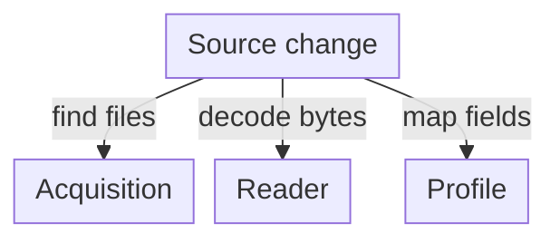
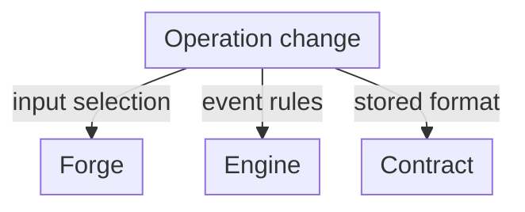

# Extension decision guide

| Intended change | Start at | Check the adjacent boundary |
| --- | --- | --- |
| Map fields or units already handled by a reader | [Format profiles](sources.md#change-a-format-profile) | Profile compiler and runtime interpretation |
| List or download a provider's historical archives | [Acquisition integration](sources.md#change-acquisition-discovery) | Scope identity, interval, managed registration |
| Decode a new physical representation | [Readers and parsing](sources.md#change-a-reader-or-engine-semantics) | Format classification, member selection, resource accounting |
| Change reconciliation, ordering, or depth semantics | [Reader and Engine guide](sources.md#change-a-reader-or-engine-semantics) | Canonical invariants and consumer behavior |
| Change input selection, preparation, or CLI behavior | [Forge orchestration](orchestration.md#change-forge-orchestration) | Pinned evidence, exit statuses and Engine loader |
| Change catalogue declarations or historical evidence | [Catalogue and registry](orchestration.md#change-catalogue-or-registry-behavior) | Historical resolution and migrations |
| Change a physical schema, manifest, or dataset reader | [Publication and reader contracts](orchestration.md#change-publications-or-dataset-readers) | Producers, validators and downstream readers |

## Source changes

Start at the first boundary that cannot express the change. A Bybit column rename in a supported CSV format belongs in the profile. An unexpected archive path belongs in discovery. A new archive codec or record encoding belongs at the reader boundary. [Source integration guide](sources.md)

## Operation and output changes

When the source already decodes correctly, trace what changes next. A new input selector belongs in Forge. Changed snapshot or delta behavior belongs in Engine interpretation and must agree with the profile contract. A changed persisted format requires work on producers and consumers. [Orchestration and persistence](orchestration.md) · [Compatibility review](compatibility.md)

MarketForge's source integrations are internal code with explicit dispatch. Installed profiles are data interpreted by the existing compiler and decoders. A new implementation capability needs wiring, tests, and documentation even when its configuration is expressed as a profile.
