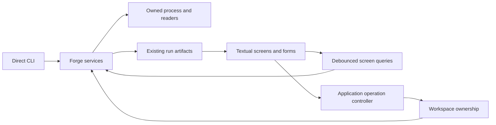

# Forge workspace architecture and action inventory

The workspace is a Textual client of Forge domain services. The direct CLI
continues to own its own parsing, presentation, JSON formatting, and exit
status. Workspace forms have an explicit catalogue of supported actions and
typed fields. Displayed shell commands are for interoperability.

Query workers are exclusive. Responses also carry a generation so an obsolete
response cannot replace current filters. Application-owned operations survive
navigation and retain the workspace lock through cleanup. Engine jobs use the
async historical supervisor and retained diagnostic logs. Synchronous tooling
with subprocesses uses a joined process-group bridge. Textual owns the terminal
while rendering.

The shell handles navigation, selection, and query generations. `resources.py`
adapts bounded query results to typed selections and `presentation.py` defines
resource-specific columns and contextual argument bindings. `inspection.py`
presents subject sections and tables with a separate raw evidence view.
`operation_view.py` renders structured snapshots and updates available actions
as the controller records results. Shared Tokyo Night styling lives in
`workspace.tcss`.

To add an action, define its fields, workspace area, and side-effect class in
`forge/tui/actions.py`. Connect it to a service in `workflows.py` or
`services.py`. Reuse existing request models and receipts. Add a parser
coverage assertion or an interaction test for new forms. There is no
shell or argparse dispatch from a widget.

## Supported actions

These rows are grouped by shared boundary. Forms expose the supported input
routes explicitly. The terminal-adapter options of direct CLI commands
such as per-command `--tui`, `--silent`, and JSON presentation remain CLI
options. Workspace views supply their own presentation.

| CLI family and actions | Workspace area | Main shared service boundary | Side effects and evidence |
| --- | --- | --- | --- |
| Pipeline validate, plan, run, resume, status | Workflows, Runs | Pipeline recipe loader, read-only plan, PipelineRun and retained report | Network and Engine only on run or resume. Snapshots and exact registration recovery evidence |
| Acquisition list, new, edit, validate, plan, map, download | Workflows, Recipes | Configuration library, archive plan and acquisition operation | Map updates discovery evidence. Download also verifies and registers local bytes |
| Acquisition import new, inspect, validate, plan, run | Workflows | Draft creation, freeze inputs, sample, run_import | Bounded explicit samples and raw import reports |
| Acquisition register new, edit, inspect, validate, plan, run | Workflows | Registration declaration and registration apply/validate | Registry-attached plans and registration evidence |
| Acquisition profiles list, sample, inspect, validate, add, register | Recipes & Profiles | Bounded sample, profile discovery, Rust validation and installed profile registration | Add and register publish the validated profile |
| Normalize new, validate, prepare, execute, run, register | Workflows, Runs | Batch preparation, async execution, publication verification and registration recovery | Prepared batches and execution intents stay distinct |
| Merge new, validate, prepare, run, register | Workflows, Runs | Source selection, direct or derived preparation, async execution and registration | Direct and derived source routes, exact file selection and pinned input evidence |
| Convert new, validate, prepare, run | Workflows | Conversion recipes, production validation, prepared collections and async execution | Three source-recipe routes, no conversion registration |
| Datasets list, find, show, streams, lineage, coverage, verify, schema, head, migrate-registration, refresh-summary | Data | DatasetRequest, retained publication query, bounded Parquet inspection and migration | Registry file and publication identities stay separate. Sampling and verification are explicit |
| Storage coverage, list, show, verify, reconcile, prune, delete | Data | StorageFilters, registry browsing, maintenance and saved cleanup plans | Verify and reconcile may mutate state. Cleanup applies the reviewed digest |
| Markets sync, refresh, list, show | Markets | Collected metadata service and stored observation queries | Network only for sync and refresh |
| Markets rank new, validate, build, list, show, update, delete | Markets | Ranking policy, snapshots, workflow and reviewed snapshot deletion | Build uses retained observations. Update refreshes sources. Deletion recomputes eligibility |
| Catalog exchange, instrument and specs add, list, show, validate | Catalog | Declaration models and testing catalogue | Add is the mutation. General editing and deletion are outside the backend |
| Runs list, show, logs, report | Runs | Retained report/log inspection | External liveness stays unknown |
| Engine status, build | System | Managed inventory, build planning and installation | Dry-run shows the plan. Builds own Cargo and preserve approved installations |
| Database status, migrate, backup, restore | System | Testing identity, migrations and guarded backup utilities | Restore uses a fresh explicitly named disposable database |
| Init, doctor, config show | System | Initialization services, live prerequisite evidence, effective settings | Init can collect and write. Doctor and configuration are inspections |

The retired `acquisition import format new` compatibility command remains
a CLI error and is omitted from working actions. The `tui` launcher is the
workspace entry point. The inventory test compares supported parser leaf
actions with the explicit form catalogue. Bounded tests exercise form
validation, navigation during work, query generations, cancellation and
workspace ownership. The guarded PostgreSQL integration enters the
pipeline through a Textual form, then verifies its retained preparation
and runs the real Engine and registration paths. Destructive and remote
operations are tested through their established service fixtures.
