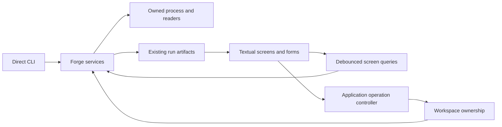

# Forge workspace architecture and action inventory

The workspace is a Textual client of Forge domain services. The direct CLI
continues to own its own parsing, presentation, JSON formatting, and exit
status. Workspace forms have an explicit catalogue of supported actions and
typed fields. Displayed shell commands are for interoperability.

Query workers are exclusive. Responses also carry a generation so an obsolete
response cannot replace current filters. Application-owned operations survive
navigation and retain the workspace lock through cleanup. Engine jobs use the
async historical supervisor and retained diagnostic logs. Synchronous tooling
with subprocesses uses a joined process-group bridge. Textual owns the terminal
while rendering.

The shell handles navigation, selection, and query generations. `resources.py`
adapts bounded query results to typed selections and `presentation.py` defines
resource-specific columns and contextual argument bindings. `inspection.py`
presents subject sections and tables with a separate raw evidence view.
`operation_view.py` renders structured snapshots and updates available actions
as the controller records results. Shared Tokyo Night styling lives in
`workspace.tcss`.

To add an action, define its fields, workspace area, and side-effect class in
`forge/tui/actions.py`. Connect it to a service in `workflows.py` or
`services.py`. Reuse existing request models and receipts. Add a parser
coverage assertion or an interaction test for new forms. There is no
shell or argparse dispatch from a widget.

## Supported actions

These rows are grouped by shared boundary. Forms expose the supported input
routes explicitly. The terminal-adapter options of direct CLI commands
such as per-command `--tui`, `--silent`, and JSON presentation remain CLI
options. Workspace views supply their own presentation.

| CLI family and actions | Workspace area | Main shared service boundary | Side effects and evidence |
| --- | --- | --- | --- |
| Pipeline validate, plan, run, resume, status | Workflows, Runs | Pipeline recipe loader, read-only plan, PipelineRun and retained report | Network and Engine only on run or resume. Snapshots and exact registration recovery evidence |
| Acquisition list, new, edit, validate, plan, map, download | Workflows, Recipes | Configuration library, archive plan and acquisition operation | Map updates discovery evidence. Download also verifies and registers local bytes |
| Acquisition import new, inspect, validate, plan, run | Workflows | Draft creation, freeze inputs, sample, run_import | Bounded explicit samples and raw import reports |
| Acquisition register new, edit, inspect, validate, plan, run | Workflows | Registration declaration and registration apply/validate | Registry-attached plans and registration evidence |
| Acquisition profiles list, sample, inspect, validate, add, register | Recipes & Profiles | Bounded sample, profile discovery, Rust validation and installed profile registration | Add and register publish the validated profile |
| Normalize new, validate, prepare, execute, run, register | Workflows, Runs | Batch preparation, async execution, publication verification and registration recovery | Prepared batches and execution intents stay distinct |
| Merge new, validate, prepare, run, register | Workflows, Runs | Source selection, direct or derived preparation, async execution and registration | Direct and derived source routes, exact file selection and pinned input evidence |
| Convert new, list, show, validate, prepare, run | Workflows | Conversion recipes, managed Engine validation, prepared collections and execution | Upstream recipe routes and exact merged-publication binding. Compatible reference streams and target currency are editable in the TUI |
| Convert config show, get, schema, validate | Workflows | Managed converter runtime inspection | Configs → Convert offers typed and validated draft updates |
| Datasets list, find, show, streams, lineage, coverage, verify, schema, head, migrate-registration, refresh-summary | Data | DatasetRequest, retained publication query, bounded Parquet inspection and migration | Registry file and publication identities stay separate. Sampling and verification are explicit |
| Storage coverage, list, show, verify, reconcile, prune, delete | Data | StorageFilters, registry browsing, maintenance and saved cleanup plans | Verify and reconcile may mutate state. Cleanup applies the reviewed digest |
| Markets sync, refresh, list, show | Markets | Collected metadata service and stored observation queries | Network only for sync and refresh |
| Markets rank new, validate, build, list, show, update, delete | Markets | Ranking policy, snapshots, workflow and reviewed snapshot deletion | Build uses retained observations. Update refreshes sources. Deletion recomputes eligibility |
| Catalog exchange, instrument and specs add, list, show, validate | Catalogue | Declaration models and the selected PostgreSQL registry | Draft reviews check dependencies and conflicts. Add uses the existing immutable identity and specification revision rules. |
| Runs list, show, logs, report | Runs | Retained report/log inspection | External liveness stays unknown |
| Engine status, build | Command palette | Managed inventory, build planning and installation | Dry-run shows the plan. Builds own Cargo and preserve approved installations |
| Database status, migrate, backup, restore | Command palette | Testing identity, migrations and guarded backup utilities | Restore uses a fresh explicitly named disposable database |
| Init, doctor, config show | Command palette | Initialization services, live prerequisite evidence, effective settings | Init can collect and write. Edit Forge application settings opens the application draft editor |

The retired `acquisition import format new` compatibility command remains
a CLI error and is omitted from working actions. The `tui` launcher is the
workspace entry point. The inventory test compares supported parser leaf
actions with the explicit form catalogue. Bounded tests exercise form
validation, navigation during work, query generations, cancellation and
workspace ownership. The guarded PostgreSQL integration enters the
pipeline through a Textual form, then verifies its retained preparation
and runs the real Engine and registration paths. Destructive and remote
operations are tested through their established service fixtures.

## Registry-backed workflow handoffs

Workspace view state owns the current cursor, query, sort, page and selection
basket. Switching registry environments reopens the Textual workspace with a
fresh application context after terminating workers. The launch loop carries
over only the selected area and view. Background queries retain the latest
version and discard an older response if a newer query started.

Exact archive selection stores registry-scoped evidence hashes and optional
compiled profile pins. Preparation re-resolves each retained archive through
Forge and checks the exact local-copy identities during execution. The batch
planner groups inputs by content and submits schema v4 jobs to Rust.
Family-scoped discovery retains its request-based route.

Direct Merge recipes list registry primary-file IDs in precedence order and
pin reviewed publication membership and registry identity. The derived route
uses normalization recipe discovery. Both enter the same preparation,
validation, execution and registration services.

Conversion uses a catalogue currency picker and paged external publication
search. Reference selection uses shared registry binding and stream
projections. Preparation and execution share the standalone converter
services. Indexed conversion references are work keys in the selected registry.

Application settings derive constraints from the Pydantic model. Runtime
fields use the Rust schema. Pipeline editing shares runtime composition and
stage validators with preparation. Draft edits preserve supported TOML
formatting, validate candidates and check live file identity at apply time.

Pipeline window mode delegates ownership descriptors to the stage launcher.
Workers send operation snapshots and retain stage results. Publication and
run maintenance use the CLI services and their durable reviewed plans.

The run adapter consumes shared report and log projections. Full log access
uses bounded range reads or explicit byte-preserving export. The clipboard
adapter sanitizes terminal controls and credential fields, enforces a size
cap, and calls desktop and tmux providers in a worker. Textual sends the
OSC 52 fallback.

Textual Pilot covers navigation, settings, recipe forms and exact copying.
The disposable PostgreSQL fixture drives archive, normalized and merged
publication handoffs through the Engine services. See [Testing](testing.md)
for database and Engine setup.

## Configuration Explorer

The main workspace embeds one shared editor under Configs. General and the four runtime tabs retain their own drafts, search filters, expanded groups, and selection. Field help opens on demand from the field table. Environment switching stays global and routes through the existing registry confirmation.

The explorer projects Rust runtime schemas and the Pydantic application
settings model into fields. Textual retains one draft per file and delegates
validation and replacement to the shared runtime and composition services.
Runtime metadata is refreshed when the managed executable identity changes.
A preview binds the candidate bytes and the inspected configuration identity.

The field documentation contract is an explicit `setting-<dotted-path>` anchor
on the component reference page. Pipeline locators also include the stage
prefix, for example `setting-merge.resources.workers`. Update the reference
when adding a field. The explorer coverage test checks the installed schemas
against the reference entries.

## Textual visual design

Use the Tokyo Night roles in `forge/shared/terminal/palette.py` for Rich
renderables. `forge/tui/design.py` configures the Textual theme for native
widgets. `forge/tui/workspace.tcss` declares the matching palette and surface
tokens used by the workspace and standalone screens. Keep the native theme,
TCSS roles, and Rich accents synchronized when changing the palette.

- Use the application background for reading surfaces and a slightly elevated
  background for panels, field controls, table headers, and dialogs. Use quiet
  outlines where they clarify grouping. Keep dashboard height driven by content.
- Use bold cyan for headings, blue for selected navigation and primary actions,
  and foreground text for values. Use the secondary text token for labels and
  hints. Reserve the darker muted token for unavailable or disabled information.
- Keep navigation, tabs, and action bars one row tall. Use one cell of horizontal
  padding for controls. Use a blue indicator for the selected tab or area, and a
  brighter surface with underlining for keyboard focus.
- Reuse `Results` for resource tables and `RecordTable` for inspector records.
  Use `Cell` projections for width budgets and right-align numeric values. Use
  ellipses for long cells and expose exact values in the inspector or clipboard.
  Keep semantic Rich colors legible in the selected row.
- Reuse `Form` for typed fields, `Confirm` for a review, and `Inspection` for
  structured results. Forms keep field errors next to their inputs and overlay
  actions in a bounded scrollable dialog. Use `variant="primary"` for the main
  action, `classes="tertiary"` for lower-emphasis controls, and
  `destructive=True` for a destructive `Confirm`.
- Preserve the recorded status label when applying colors. Use green for
  successful evidence, cyan for active processing, yellow for pending changes
  or actionable warnings, and red for failures. Verification and registration
  remain separate fields. Use the shared success notification marker for a
  successful action and retain durable outcomes in existing inspectors.
- Keep loading, no matches, and errors distinct. Retain a populated table during
  refresh. Use fixed-height, repaint-only updates for the monitoring bar.
  Preserve scrolling on dense tabs and wide evidence tables, and check the
  workspace at 80×24 and a wide terminal with Textual Pilot.
