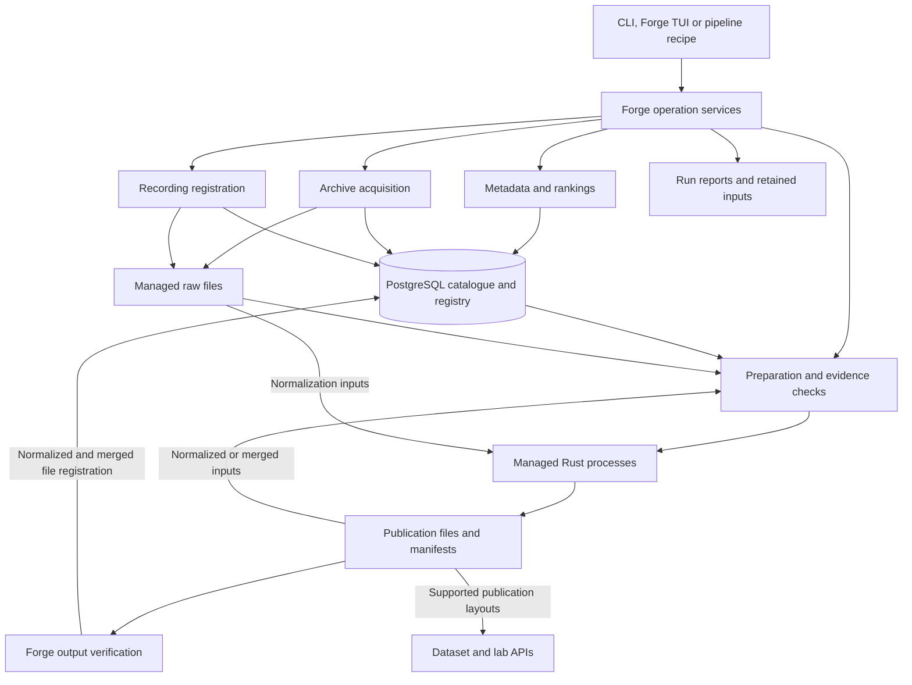
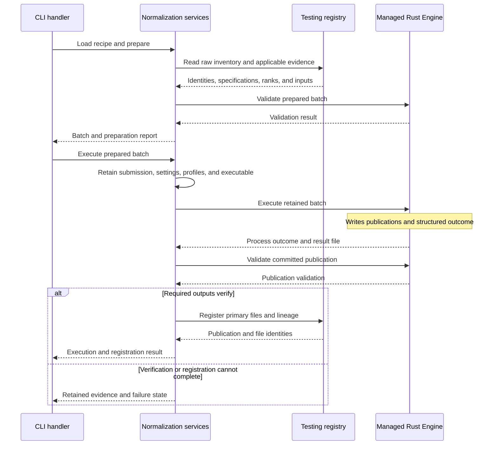
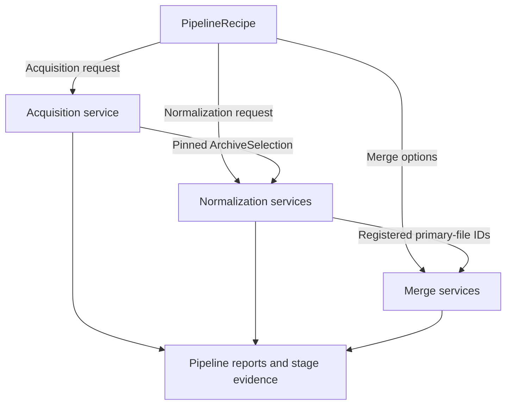
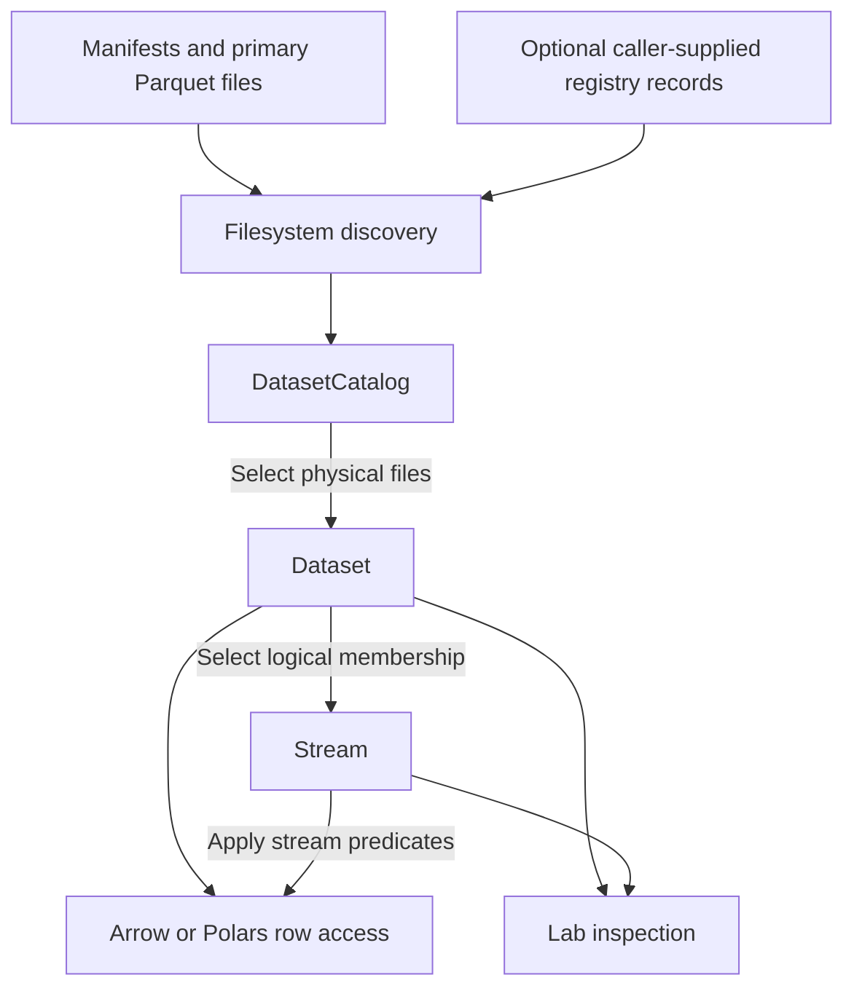

# Forge architecture



Forge is MarketForge’s Python application layer. It connects user requests, market metadata, managed files, PostgreSQL records, and Rust processing jobs.

The diagram shows the main relationships. Each operation follows the applicable path through the system. Acquisition produces managed raw inputs; normalization produces canonical publications; merge consumes registered normalized files; conversion consumes merged publications and their interpretation evidence. Forge prepares these operations, invokes the appropriate Engine executable, and records their outcomes.

The implemented historical pipeline composes acquisition, normalization, and merge. Standalone commands also expose these operations individually. Conversion has its own preparation and execution workflow.

This page explains where each responsibility lives, how the components cooperate, and which parts to inspect when extending Forge. Source paths are relative to the repository root.

## The application boundaries

Forge owns the surrounding application workflow: selecting work, resolving identities and historical evidence, retaining execution inputs, managing subprocesses, checking results, and maintaining registry state.

The Rust Engine owns the processing behavior exposed through its execution contracts. For normalization, this includes interpreting source records and producing canonical data. Forge invokes Rust validation when it needs the authoritative interpretation of a profile, prepared batch, or completed publication.

PostgreSQL stores identities, declarations, source inventory, observations, publication records, and lineage. The filesystem stores source bytes, configuration, prepared inputs, execution evidence, and publication artifacts.

These boundaries determine where a change belongs:

| Intended behavior | Primary owner |
|---|---|
| Interpret CLI arguments and select an operation | `forge/cli/` |
| Resolve a recipe into concrete registered inputs | The relevant historical operation |
| Discover exchange archives | `forge/historical/archives/` |
| Collect current instrument metadata or statistics | `forge/markets/` |
| Bind a recording to historical identity and interpretation | `forge/historical/registration/` |
| Decode a new source representation or change normalization semantics | Rust Engine, with corresponding Forge contract changes where required |
| Verify and register normalized or merged output | Historical operation services and `forge/datasets/registration.py` |
| Read supported publications in Python | `forge/datasets/` |
| Coordinate acquisition, normalization, and merge | `forge/historical/pipelines/` |

The boundaries are implemented through ordinary Python calls, typed models, database transactions, files, and subprocess contracts. Contributors should follow the concrete service calls when tracing behavior. There is no universal operation class that implements every workflow.

## Repository map

The Python project is configured by `forge/pyproject.toml`. Both `mf` and `marketforge` invoke `forge.cli.main:main`.[^entry]

| Package | Responsibility | Useful starting points |
|---|---|---|
| `forge/cli/` | Command registration, argument handling, result presentation, and exit status | `main.py`, `commands/` |
| `forge/startup/` | Application settings, workspace paths, and consoles | `context.py` |
| `forge/catalog/` | Manual exchange, instrument, and specification declarations | `models.py`, `service.py` |
| `forge/markets/` | Current metadata, observations, collection completeness, and rankings | `service.py`, `repository.py`, `providers/`, `ranking/` |
| `forge/historical/archives/` | Remote archive discovery, acquisition, caching, and managed-copy registration | `operation.py`, `discovery.py`, `sources/`, `storage/` |
| `forge/historical/imports/` | Local source inspection and copying into managed raw storage | `formats.py`, `service.py` |
| `forge/historical/registration/` | Bind local recordings to catalogue, specification, and profile evidence | `models.py`, `service.py` |
| `forge/historical/profiles/` | Discover, validate, and install Rust profiles | `service.py` |
| `forge/historical/metadata/` | Historical specifications, canonical identities, family evidence, and inference | `service.py`, `policy.py`, `resolution.py`, `discovery.py` |
| `forge/historical/normalization/` | Select raw inputs, prepare batches, execute Rust, and register verified output | `batch.py`, `mapping.py`, `execution.py`, `datasets.py` |
| `forge/historical/merge/` | Select normalized files and prepare, execute, verify, and register merges | `config.py`, `discovery.py`, `service.py` |
| `forge/historical/conversion/` | Discover merged inputs, establish conversion evidence, and execute standalone JSON jobs | `recipes.py`, `contract.py`, `service.py`, `execution.py` |
| `forge/historical/pipelines/` | Coordinate the fixed acquisition, normalization, and merge workflow | `config.py`, `service.py`, `planning.py`, `dashboard.py` |
| `forge/historical/engine/` | Build, identify, verify, and supervise managed Engine executables | `managed.py`, `process.py` |
| `forge/storage/` | Browse, verify, reconcile, and clean up managed raw storage | `browsing.py`, `service.py`, `cleanup.py`, `dependencies.py` |
| `forge/datasets/` | Publication registration, registry inspection, filesystem discovery, and Python row access | `registration.py`, `catalog.py`, `dataset.py`, `parquet.py` |
| `forge/orchestration/` | Common run-artifact paths and retained-run inspection | `artifacts.py`, `inspection.py` |
| `forge/shared/` | Configuration, database access, HTTP, concurrency, ownership, paths, and terminal rendering | The corresponding subpackage |
| `forge/lab/inspection/` | Dataset inspection and bounded profiling | `profile.py` |

Some package names reserve space without implementing a subsystem. In the current source tree, `forge/features/`, `forge/tui/`, `forge/shared/storage/`, and the evaluation, optimization, tracking, and training packages under `forge/lab/` are empty.

Implemented presentation code lives in `forge/shared/terminal/` and operation-specific modules such as `forge/historical/pipelines/dashboard.py`.

## Startup and command dispatch

### Application context

`build_context()` constructs an immutable `ApplicationContext` containing:

- Validated application settings.
- Resolved project and data paths.
- The selected settings-file path.
- A normal-output console.
- An error/progress console.

Startup resolves configuration and prepares presentation objects. Database connections, HTTP clients, workspace ownership, and Engine processes are opened by the operations that need them.[^startup]

This keeps configuration-only commands usable without first opening external resources.

An explicit application configuration path is resolved relative to the caller’s working directory. Storage paths inside that configuration are resolved relative to the workspace. A missing default configuration uses application defaults; a missing explicitly selected configuration is an error.

### CLI handlers

`forge/cli/main.py` builds the root `argparse` parser. Most command families expose a `configure(parser)` function that registers actions and assigns a `service_handler`.

The handler receives the parsed arguments and `ApplicationContext`. It loads the operation’s input, invokes the appropriate service, presents the result, and returns an exit status.

Some acquisition, configuration, and database actions retain explicit dispatch branches in `main()`. Follow the existing dispatch for the command being changed.

A new command should normally keep these responsibilities separate:

| Responsibility | Placement |
|---|---|
| Command name, flags, and argument relationships | CLI configuration |
| Recipe or declaration validation | The relevant model and loader |
| Input selection and application behavior | Operation service |
| Database queries and transactions | Existing repository, registry, or service boundary |
| Human-readable output | Terminal renderer or operation display |
| Structured result | Service result and CLI JSON emission |

This separation lets another workflow call the service directly. The pipeline uses that ability to compose operations without launching nested `mf` commands.

Runtime errors handled by `main()` can be emitted as JSON on stderr. Argument-parser errors follow the parser’s own path. Operation handlers also determine their own success, partial-result, and failure statuses, so contributors should inspect the relevant handler before changing exit behavior.[^entry]

### CLI help

1. Register the command with its family’s `configure(parser)` function or in
   `forge/cli/main.py`. Provide a concise, user-facing `help=` description when
   registering it. Use `description=` for behavior that needs more detail.
2. Assign top-level commands to a group in `forge/cli/help_content.py`. Newly
   registered commands without a group appear in **Other Commands**. Nested
   commands appear under their registered parent.
3. Add concise argument help to the parser action. The renderer reads operands,
   choices, defaults, repeatability and mutual exclusion from argparse.
4. Add a few examples to `EXAMPLES` where they help discovery. Use the complete
   command path, put root options before it, and prefer read-only, plan or
   dry-run forms for operations that can modify data.
5. Review root, family and action help at 80 columns and through a pipe.
   The [CLI help regression tests](testing.md) traverse the parser and parse
   the curated examples. The TUI action inventory also checks parser parity.

`forge/cli/help.py` renders help through the shared Rich console. Argparse
continues to own argument parsing, validation and usage errors.

### Explicit initialization

Building an application context and running initialization are different operations.

The `init` command explicitly creates application directories, applies testing-database migrations, collects supported market metadata, attempts historical enrichment, and refreshes standard rankings. Its implementation calls the underlying services directly and retains stage outcomes.

It is a useful example of application composition, but its API-backed catalogue population does not replace manual catalogue registration for other venues and recordings.[^initialization]

## Configuration and workspace paths

Forge has several configuration boundaries:

| Configuration | Purpose |
|---|---|
| Application settings | Storage root, presentation, and HTTP defaults |
| Operation recipe | The requested work, selection, interval, and operation-specific policy |
| Engine runtime settings | Processing resources and supported runtime policies |
| Format profile | The interpretation of recorded source fields |
| Prepared JSON | Concrete execution inputs and their resolved identity or publication evidence |

`forge/shared/config/models.py` defines strict application settings. Unknown fields and unintended type conversions are rejected.

Operation models extend the project’s settings conventions while defining their own contracts. Changing application settings does not automatically change a normalization recipe or Engine job schema.[^configuration]

### Path resolution

`ProjectPaths` resolves the project root from an explicit argument, `MARKETFORGE_PROJECT_ROOT`, or an enclosing workspace. A recognized workspace contains `forge/pyproject.toml` and an `engine/` directory.

Constructing `ProjectPaths` does not create directories.

| Location | Resolution |
|---|---|
| Managed executables | `<project-root>/.bin/` |
| Application settings | `<project-root>/data/.config/forge/marketforge.toml` |
| Managed configuration libraries | `<project-root>/data/.config/` |
| Managed raw files | `<data-root>/raw/` |
| Dataset publications | `<data-root>/datasets/` |
| Run artifacts | `<data-root>/runs/` |

Changing `storage.data_root` relocates data and run storage. Configuration libraries remain under the project root’s `data/.config/`.

Use `ProjectPaths` and the existing configuration-library helpers when adding a command. Reconstructing these paths independently can make a feature behave differently when the data root changes.[^paths]

## Catalogue, observations, and historical identity

Three kinds of evidence participate in Forge’s identity handling:

1. Catalogue declarations identify venues and instruments.
2. Current observations describe information retrieved at a particular time.
3. Historical evidence establishes the interpretation applicable to a processing interval.

They have different responsibilities and lifetimes.

### Manual catalogue declarations

`forge/catalog/models.py` defines exchange, instrument, and specification declarations. `catalog/service.py` validates their relationships, persists them, reuses equivalent declarations, and rejects conflicts.

Instrument insertion also establishes a persisted historical authority mapping through the database schema. Contributors must distinguish the catalogue instrument’s database identity from the canonical historical identity serialized into processing inputs.[^catalogue]

| Identity | Meaning |
|---|---|
| Provider-native publisher or instrument identifier | An identifier interpreted within its source namespace and applicable context |
| Catalogue instrument ID | The PostgreSQL identity of a catalogue instrument record |
| Historical canonical instrument ID | The identity used under a declared processing namespace |
| Stream identity | The logical data stream represented by processing or publication evidence |
| Engine publication ID | The identifier written by an Engine operation |
| Database publication ID | The registry identity of a publication |
| File dataset ID | The registry identity of one primary output file |

Resolve these identities through the existing authority and registration code. A numerical match between two identity domains does not establish equivalence.

### Historical specifications and families

`forge/historical/metadata/` connects retained catalogue information to historical processing.

Its responsibilities include:

- Establishing or reusing canonical authority.
- Selecting applicable historical specification evidence.
- Recording inference assumptions and source evidence.
- Resolving supported family membership.
- Checking that retained identity evidence still matches the source bytes and installed interpretation.

Historical specification resolution must cover the actual processing input. Normalization can select whole archives extending beyond the requested interval, so the required validity may be wider than the user’s selection.

Current observations alone do not establish historical applicability.

Family handling adds another boundary: observing instruments in an archive establishes an observed population. It does not prove that the archive contains every historical member of that family.

For supported family discovery, Forge invokes the Engine’s nonprocessing resolution contract. This is a deliberate use of the authoritative source interpreter to establish identity evidence without running normalization.[^historical-metadata]

When adding metadata behavior, preserve the distinction between explicit declarations, verified evidence, and inference. Record assumptions through the existing policy and evidence structures.

## Current market metadata and rankings

`forge/markets/` collects current instrument metadata and market observations. This subsystem is separate from historical archive discovery.

`markets/providers/public.py` translates upstream responses into `Instrument` and `Observation` models. `markets/capabilities.py` identifies supported collection scopes. `markets/service.py` coordinates collection, while `markets/repository.py` persists the results.[^markets]

### Collection completeness

Metadata collection establishes the instruments observed in a particular collection scope. Retained catalogue history remains available even when an instrument is absent from a later current selection.

Statistics collection uses a successfully established metadata scope and checks instrument identity. Ambiguous, duplicate, or missing selected identities prevent that scope from being treated as complete.

Observations are retained as evidence. The collector advances the latest-value view after the scope succeeds. This allows the implementation to preserve observations from unsuccessful attempts without presenting an incomplete scope as a completed refresh.

A change to provider parsing therefore needs to consider pagination, units, instrument identity, and collection completeness together.

### Rankings

Ranking calculation and statistics refresh have separate entry points.

`markets/ranking/service.py` builds rankings from retained metadata and observations. It stores the snapshot, entries, exclusions, and conversion evidence within its publication workflow.

`markets/ranking/workflow.py` pins standard policy builds to one new refresh and records independent publication outcomes. See the [Markets CLI reference](../reference/cli/markets.md) for collection, snapshot inspection and maintenance contracts.

Turnover and grouped volume have different comparison semantics. A grouped volume result is not automatically a valid global ordering across unrelated assets.

Normalization preparation reads stored ranking positions when available and uses deterministic identity ordering for unranked streams or absent ranking evidence. Current ranking information should retain its interpretation as current prioritization evidence.[^rankings]

### Extending market collection

Adding current metadata support requires reviewing:

- Capability declarations.
- Endpoint selection and pagination.
- Instrument and observation translation.
- Unit interpretation.
- Exact contract identity.
- Scope completion and publication behavior.
- Relevant provider and collection tests.

Adding an archive downloader does not automatically provide these capabilities. A venue may support one workflow before another.

## Historical archive acquisition

`forge/historical/archives/` turns an archive request into discovered source objects and verified managed copies.

Its main responsibilities are divided as follows:

| Module | Responsibility |
|---|---|
| `config.py` | Validate the acquisition request |
| `sources/base.py` | Define the source protocol and shared discovery helpers |
| `sources/exchanges.py` | Implement supported exchange discovery |
| `discovery.py` | Coordinate discovery and reusable scan evidence |
| `registry.py` | Persist source-object and scan information |
| `planning.py` | Inspect registry/cache evidence without acquisition |
| `operation.py` | Coordinate the complete acquisition operation |
| `storage/acquire.py` | Reserve, reuse, acquire, and recover managed copies |
| `storage/files.py` | Perform the physical file operations |

### The source interface

The archive source boundary is defined by `ArchiveSource`:

```python
class ArchiveSource(Protocol):
    version: str

    def validate(self, request: ArchiveRequest) -> None: ...

    def discover(
        self,
        request: ArchiveRequest,
        interval: AcquisitionInterval,
    ) -> AsyncIterator[DiscoveredArchive]: ...
```

The production implementation uses explicit exchange dispatch in `ExchangeSource`. Discovery support is registered in code.

A discovered object describes the actual archive scope and a stable source-object identity. Temporary signed URLs are locations from which bytes can be retrieved; they are not sufficient object identities.[^acquisition]

### Discovery evidence

A successful discovery scan establishes reusable scan membership. A completed refresh can supersede overlapping older scan evidence.

A failed or cancelled refresh may retain observations, but it must not replace the previously completed coverage with an incomplete result.

Acquisition planning reads available registry and cache evidence. Discovery and local-byte verification remain separate checks.

### Managed file acquisition

The acquisition service first attempts to reuse a verified managed copy.

A new transfer reserves its identity, streams to a temporary file, validates the container, computes and records size/hash evidence, publishes the file, and completes registry state.

The implementation retains enough evidence to recover certain interrupted publication steps. An incomplete transfer without verified evidence is treated differently from a fully written, validated file whose final registration was interrupted.

Container validation checks the physical archive and rejects common error responses. Market-data interpretation remains a later responsibility.

### Adding an archive source

Start with `ArchiveSource` and a nearby implementation in `ExchangeSource`. Then inspect the orchestration code that selects adapters, budgets work, and allocates coordination resources.

An extension may require changes to:

- Request validation.
- Exchange dispatch.
- Supported scope declarations.
- Discovery identity and interval handling.
- Shared HTTP budgets.
- Operation allowlists or coordination assumptions.
- Fixtures for pagination, malformed responses, and stable source identity.

Return `DiscoveredArchive` values through the existing discovery flow so that scan membership, caching, managed-copy reuse, and recovery retain their established behavior.

## Manual recordings and the shared raw-data model

Manual recordings and downloaded archives converge on the same managed raw-storage model.

The current schema separates:

| Record | Responsibility |
|---|---|
| `historical.raw_sources` | Source identity and provider provenance |
| `historical.raw_objects` | Stable source-object identity |
| `historical.local_archives` | A managed physical copy, its hash, size, and state |
| `historical.raw_interpretations` | Interpretation revisions for supplied objects |
| `historical.raw_bindings` | The association between a copy and an interpretation |

Compatibility views retain older names such as `remote_archives` and `external_archives`, and some Python symbols still use that vocabulary. These names should not be interpreted as separate physical storage systems.[^raw-model]

### Importing bytes and establishing interpretation

`forge/historical/imports/` inspects and copies local files. Its copying implementation reuses physical-file and recovery primitives shared with acquisition.

`forge/historical/registration/` establishes the evidence needed to interpret those files.

Registration preflight combines:

- A concrete canonical instrument.
- Applicable historical specifications.
- An installed and Rust-validated profile.
- Quantity-encoding compatibility.
- Source inventory and bounded sample checks.
- Optional publisher and native-instrument evidence.

The resulting binding is retained with the managed source.

The legacy raw-import route can preserve bytes without establishing a verified normalization binding. Normalization checks that the required binding exists and is ready.

A file’s checksum identifies its bytes. Its interpretation also depends on identity, specifications, and profile evidence. Reusing verified bytes under a new interpretation therefore requires an explicit binding.[^registration]

### Adding a recording layout

If an existing Rust reader and profile contract can express the source, the extension may consist of catalogue declarations, a profile, registration evidence, and meaningful verification.

A new binary representation or unsupported record semantic also requires Engine work.

Keep recording support independent of API collection unless the workflow actually needs an upstream service.

## Profiles and the Rust interpretation boundary

`forge/historical/profiles/service.py` manages profile discovery, validation, and installation.

Python checks local file properties, TOML syntax, declared identity, and namespace consistency. Semantic validation stages the candidate alongside installed profiles and invokes the managed normalization executable.

This lets Rust check both the candidate interpretation and its compatibility with the profile catalogue.

Installation freezes the submitted bytes, verifies that the source did not change, and publishes them under the declared profile identity. An equivalent compiled interpretation can be reused. A conflicting interpretation under the same installed identity is rejected.[^profiles]

This boundary matters when extending the schema:

- Python profile inspection must remain consistent with the supported naming and discovery rules.
- Rust remains authoritative for interpretation semantics.
- Preparation and execution must retain the relevant interpretation evidence.
- Tests must establish how a source example is interpreted.

Avoid adding a second Python implementation of normalization semantics merely to make a profile validation command more convenient.

## Normalization from recipe to registered files

Normalization connects most of Forge’s historical components.



### Preparation

`historical/normalization/batch.py` coordinates preparation. `mapping.py` resolves each selected archive, and `contract.py` serializes the Engine-facing job structure.

Preparation checks managed input state, physical size and checksum, requested scope, canonical identity, applicable specifications, and profile bindings where required.

It selects complete overlapping raw inputs. The requested interval does not turn preparation into a row-trimming operation.

The preparation transaction reads a consistent database snapshot. It groups work by canonical content type, assigns identities and stream ranks, and constructs the batch.

Normal preparation retains the batch and report and invokes Rust’s production batch validator. Dry-run preparation resolves the plan without publishing those artifacts or performing that final file-based validation step.[^normalization]

### Execution

`historical/normalization/execution.py` creates an execution directory and retains:

- The exact submitted batch.
- Runtime settings.
- Profile files and fingerprints.
- A copied executable and its checksum.
- Raw-input checksum evidence.
- Execution intent.
- Structured Engine outcomes and logs.

Where preparation evidence exists, execution checks that the submitted batch, runtime, profiles, and executable still agree with it.

This prevents a prepared request from silently changing interpretation between preparation and execution.

The synchronous `execute()` wrapper delegates to `execute_async()`. Pipeline callers use the asynchronous entry point and can provide a child execution directory, frozen historical configuration, a pinned executable, lifecycle reporting, and expected raw inputs.

### Verification and registration

Execution success, publication verification, and registration are separate states.

Forge checks the structured Engine result against the submitted jobs, validates committed publications, and compares publication identity, inventory totals, and retained processing evidence.

`historical/normalization/datasets.py` then coordinates registration. `datasets/registration.py` writes the publication and primary-file records together with supported raw-input or parent-file lineage.

Registration can remain pending or fail after files have been committed. Retained execution and registration evidence allows the supported recovery path to revalidate completed output and attempt registration.[^publication-registration]

### Extending normalization

Choose the module according to the behavior being changed:

| Change | Starting point |
|---|---|
| Recipe fields and validation | `normalization/config.py`, `recipes.py` |
| Registered-input selection | `normalization/batch.py` |
| Identity and historical evidence resolution | `normalization/mapping.py`, `historical/metadata/` |
| Serialized Engine job fields | `normalization/contract.py`, `batch.py`, corresponding Rust contract |
| Process lifecycle or retained execution evidence | `normalization/execution.py` |
| Publication verification | `normalization/datasets.py` |
| Primary-file registration and lineage | `datasets/registration.py` |
| Source decoding or canonical record semantics | Rust Engine and relevant profile contract |

A recipe extension may affect several of these boundaries. Trace its value from parsing to the Engine input and then to the evidence needed for verification.

## Merge and conversion have separate workflows

### Merge

Managed merge consumes registered normalized primary files.

Its direct recipe identifies file dataset IDs. A derived recipe can select inputs through a retained normalization declaration and associated evidence.

`historical/merge/service.py` resolves those files, verifies publication fingerprints and ownership, establishes the stream identities, assigns ranks, and writes the Engine job.

Execution retains the job, runtime, and executable. After Rust completes, Forge verifies the merged publication and registers its primary files with parent-dataset lineage.[^merge]

Contributors should preserve the distinction between a publication and the files selected from it. Several file dataset IDs may belong to one publication.

The merge preparation and verification code is the place to change input selection or publication evidence. Timeline construction and record-processing semantics belong to the Engine contract and implementation.

### Conversion

Conversion prepares quote-currency conversion work from registered merged publications and the required reference-stream evidence.

The implementation separates:

| Module | Responsibility |
|---|---|
| `recipes.py` | User recipe and fingerprinted upstream declaration |
| `discovery.py` | Select compatible registered merged publications |
| `registry.py` | Read publication and lineage records |
| `evidence.py` | Verify committed source and interpretation evidence |
| `contract.py` | Define the standalone Engine JSON job |
| `service.py` | Assemble jobs and retained preparation evidence |
| `execution.py` | Execute and verify prepared conversion jobs |

An upstream recipe reference identifies the intended source workflow. It does not run missing acquisition, normalization, or merge operations.

Preparation emits a collection document and one standalone JSON job per selected merge publication. The Engine job embeds publication bindings, stream identities, currencies, conversion policy, resources, input paths, and output destination.

An external instrument-catalogue file is not required by that standalone job interface. If the optional preparation catalogue exists, Forge checks its consistency with historical evidence.

Conversion operates on whole selected merge publications. Selection must satisfy the workflow’s scope rules; it does not introduce arbitrary row clipping.

The current Forge execution flow runs the prepared jobs sequentially and stops after a failure. Converted-publication registration and conversion resume are not implemented in this workflow. Its receipts explicitly represent registration as unavailable.[^conversion]

## The historical pipeline

The pipeline composes existing services through explicit handoffs.



`PipelineRecipe` translates one interval and request set into acquisition, normalization, and merge inputs.

`PipelineRun` owns the stage state, retained evidence, and recovery decisions. It calls the services directly.

The current sequence is fixed:

- Acquire the requested archives.
- Prepare, execute, verify, and register normalization.
- Prepare, execute, verify, and register merge.

### Exact stage handoffs

Acquisition returns an `ArchiveSelection` containing the acquired identities and checksum evidence.

Normalization preparation receives that selection explicitly. Execution checks the expected raw-file hashes.

The next stage receives the registered normalized primary-file IDs. Merge therefore consumes the output of this pipeline run through concrete registry identities.

These handoffs are the central pipeline contract. Extending the pipeline should preserve an explicit account of what each stage produced and what the next stage consumed.[^pipeline]

### Planning and retained execution state

Pipeline planning reads available registry evidence and checks managed Engine availability. Exact acquired files, normalization jobs, and merge file identities are resolved at later stages.

A planned result is therefore an assessment of available prerequisites, not a completely frozen execution plan.

Execution retains the submitted recipe, resolved application settings, runtime configuration, profiles, executables, acquired selection, preparation evidence, and child execution receipts.

`orchestration/artifacts.py::RunArtifacts` supplies common paths such as:

- `submitted.toml`
- `resolved-plan.json`
- `report.json`
- `events.jsonl`
- `steps/<stage>/<attempt>/`

The pipeline state machine lives in `historical/pipelines/service.py`. The `orchestration/` package provides supporting artifact and inspection utilities.

### Resume

Resume validates retained evidence and requires the original workspace, storage root, and testing-registry identity.

It can reuse completed acquisition, reconcile committed outputs with registration, or create a fresh processing attempt from retained inputs.

It does not continue a partially written Parquet file from an arbitrary row offset. A retry may require fresh job identities and output destinations.

Changes to pipeline recovery must account for both publication state and registry state. An Engine process may have committed output before Forge finished recording the surrounding workflow.

### Current extension boundaries

The pipeline contract uses archive acquisition requests. It does not currently expose external recording registration, equity `source_key` selection, conversion, arbitrary stage ordering, or a general task graph.

Adding a stage requires explicit changes to:

- Recipe validation.
- Service invocation and input handoff.
- Persisted stage state.
- Artifact ownership.
- Failure and retry behavior.
- Status reporting.
- Integration coverage.

Also inspect receipt discovery when connecting workflows. Some source-derived merge and conversion discovery paths recognize standalone execution-directory layouts. Pipeline receipts use nested stage-attempt directories, so those paths should not be assumed interchangeable.

## Managed Engine executables

`forge/historical/engine/managed.py` defines approved targets for normalization, merge, and conversion.

The managed build workflow constructs the appropriate Cargo invocation, builds and checks the executable, installs it under `.bin/`, and records installation evidence.

`resolve()` verifies the installed executable against that evidence before an operation uses it.

Execution services often retain a private executable copy so that the bytes used by an operation remain identifiable throughout its lifetime.

Build metadata records useful revision information, but it is not a complete source snapshot.[^engine]

### Subprocess ownership

`historical/engine/process.py` provides asynchronous supervision for noninteractive child processes.

It owns the child process group, drains output streams into bounded logs, and terminates and reaps the process when cancellation requires it.

`joined_io()` ensures that blocking filesystem work has finished before the caller releases ownership.

Execution paths are not completely uniform: standalone interactive processing and conversion also use the existing synchronous process runner. Inspect the caller before changing cancellation or terminal behavior.

When adding a new Engine operation, establish its target, input contract, validation, execution outcome, artifact verification, and registration behavior explicitly.

## Storage administration

Two storage-related package areas serve different purposes.

`historical/archives/storage/` implements managed-copy acquisition, physical publication, and recovery.

`forge/storage/` exposes application-level browsing and maintenance over those managed copies.

| Module | Responsibility |
|---|---|
| `browsing.py` | Read-only inventory browsing |
| `registry.py` | Selection and pagination queries |
| `coverage.py` | Nominal coverage aggregation |
| `service.py` | Inventory verification and reconciliation |
| `cleanup_plans.py` | Reviewed cleanup-plan contracts |
| `cleanup.py` | Preview and apply cleanup |
| `dependencies.py` | Concrete lineage and prepared-input dependencies |
| `managed_files.py` | Checked physical inspection and removal |

Verification can change registry state when a file is missing or corrupt. Reconciliation can recover a supported reservation state.

Cleanup rechecks registry identity, dependencies, and physical file evidence before applying a reviewed action. It records per-target outcomes because filesystem removal and database changes do not form one globally rollbackable transaction.[^storage]

Dependency checks establish the managed dependencies the implementation can inspect. They do not prove that an unrelated external script has no reference to a file.

A storage extension should use the common registry and managed-file mechanisms so that downloaded and manually supplied data retain consistent maintenance behavior.

## Dataset registration and Python consumption

The `datasets` package contains both write-side registration and read-side inspection. These have separate entry points.

### Registration

`datasets/registration.py::register_files()` receives verified publication evidence and an existing database connection.

It establishes a shared publication record, a dataset identity for each primary file, and supported contribution links to raw inputs or parent files.

The caller owns the surrounding transaction boundary.

### Registry inspection

`datasets/inspection.py` queries registered metadata and lineage for terminal inspection.

This is a database-backed view of registered state.

### Filesystem and notebook API

`datasets/catalog.py::MarketData` provides the filesystem-oriented entry point.



`DatasetCatalog` selects physical files using established metadata.

`Dataset` represents a physical file or a supported publication grouping.

`Stream` adds a selected logical membership and the corresponding row predicates.

Selecting a file because it contains a matching instrument does not filter every row in that file. Use the stream-selection boundary when row-level membership matters.[^datasets]

Filesystem discovery does not query PostgreSQL automatically. Optional registry records are supplied by the caller.

Discovery uses publication and file evidence. It is not universally limited to Parquet footers: establishing causal-merge membership can read relevant columns in bounded batches.

`MarketData` resolves its own paths rather than loading the CLI’s application settings. Code using a custom data root should pass the intended root explicitly.

### Lab inspection

`forge/lab/inspection/` builds on dataset handles and provides schema, column, row-group, timestamp, comparison, and bounded profiling facilities.

Metadata inspection and explicit row reads have different costs. Preserve that distinction when extending notebook representations or inspection methods.

A rich display should not unexpectedly perform an unbounded data scan.[^lab]

## Shared infrastructure

### Database access and transactions

Database credentials are resolved through the shared loader. Testing and production credentials use distinct keys.

The testing connection helper checks the configured database name, the connected database name, and the database-purpose marker before yielding a connection.

Connections are opened with autocommit enabled; callers establish transactions for operations requiring a consistent or atomic database boundary.

Migrations validate applied migration history and checksums and apply pending changes under database coordination.[^database]

When extending a service, identify who owns the connection and transaction. Functions that accept a connection should preserve their caller’s transaction model.

### Workspace ownership

`WorkspaceOwnership` acquires nonblocking exclusive locks for the project and data roots.

Ownership is explicit. Constructing `ApplicationContext` does not acquire it, and a helper does not automatically establish ownership for every caller.

Operation entry points must establish the required ownership boundary before calling services that rely on it. Pipeline child services must also cooperate with the ownership already held by their parent.

Lock files remain in place; releasing ownership closes the held handles.[^ownership]

### HTTP and bounded work

Shared HTTP infrastructure provides request pacing, concurrency limits, retry behavior, cooldown handling, bounded buffered responses, and streaming downloads.

Tasks communicating with the same upstream during an operation should reuse the configured client and budget.

A failed streaming body is handled by the acquisition layer together with its partial file. It must not be treated as an automatically replayable buffered response.

`shared/async_work.py::bounded_map()` uses a fixed worker population and bounded queues. Results arrive as work completes. Callers that need deterministic order must establish it explicitly.

These helpers make concurrency and resource behavior part of the service contract.[^http]

### Presentation

Terminal renderers consume operation results and progress information.

The shared console configuration provides consistent color and output behavior. Operation-specific displays interpret the relevant progress model.

Pipeline presentation owns one dashboard while its child services execute. Business decisions and durable stage state remain in `PipelineRun`.

When adding a progress field, update the service event or report model first and then the renderer. Terminal availability should not determine whether an operation produces useful structured evidence.

## Extending Forge by following one complete behavior

A useful extension starts with the observable result and follows it through the actual boundaries.

### Add a CLI capability

Start with a neighboring command module and its `configure()` function.

Define argument validation, load the relevant model, and call a service that can also be used outside the CLI. Keep result formatting and exit policy in the handler or renderer.

Verify both structured output and the relevant error path. If the operation mutates state, establish ownership and transaction boundaries explicitly.

### Add an archive or metadata provider

Decide which capability is being added.

Archive discovery requires `ArchiveSource` behavior and its acquisition integration.

Current metadata requires provider translation, capability declarations, instrument identity handling, unit interpretation, and collection-completeness behavior.

If both capabilities are needed, implement and verify both paths. Their scope models and supported products can differ.

### Add a profile or recording interpretation

Determine whether the installed Rust contract can express the representation and semantics.

If it can, contribute the profile, declarations, registration example, and verification.

If it cannot, trace the necessary contract change through Rust validation, Forge inspection, preparation evidence, execution snapshots, and tests.

### Change preparation

Follow the value through:

1. Recipe validation.
2. Registered-input selection.
3. Identity and specification resolution.
4. Serialized Engine input.
5. Preparation evidence.
6. Execution verification.
7. Relevant downstream consumers.

A new recipe field is complete only when its effect on the prepared work and retained evidence is defined.

### Change output or registration

Identify the producer, publication validator, registry mapping, lineage consumers, and Python readers.

For a manifest or canonical-schema change, inspect the corresponding Engine contract as well as Forge’s evidence readers.

A field can be valid in a newly written file while remaining unsupported by a discovery or inspection path. Verify the intended consumers directly.

### Change pipeline behavior

Start with `PipelineRecipe` and `PipelineRun`.

Define the stage’s accepted input, produced evidence, completion condition, and recovery behavior before adding presentation.

Use typed or otherwise explicit handoffs comparable to `ArchiveSelection` and `RegisteredFiles`. Avoid replacing a concrete handoff with a broad filesystem or registry search that can select unrelated work.

## Verification at architectural boundaries

Choose tests according to the responsibility being changed.

| Boundary | Existing test locations |
|---|---|
| Startup, configuration, and paths | `forge/tests/integration/startup/`, `forge/tests/unit/shared/` |
| Archive adapters and source identity | `forge/tests/unit/historical/archives/test_sources.py`, `test_source_regressions.py` |
| Discovery scans and managed-copy recovery | `forge/tests/integration/historical/archives/` |
| Manual declarations and registration | `forge/tests/integration/catalogue/test_registration.py` |
| Profile installation and Engine integration | `forge/tests/unit/historical/engine/` |
| Historical inference and family discovery | `forge/tests/unit/historical/metadata/` |
| Normalization preparation and execution | `forge/tests/unit/historical/normalization/` |
| Merge selection and execution evidence | `forge/tests/unit/historical/merge/` |
| Conversion contracts and preparation | `forge/tests/unit/historical/conversion/test_conversion.py` |
| Pipeline composition | `forge/tests/integration/cli/test_pipeline.py` |
| Market identity and collection behavior | `forge/tests/unit/markets/`, `forge/tests/integration/markets/` |
| Ranking publication | `forge/tests/integration/markets/ranking/` |
| Dataset registration and readers | `forge/tests/integration/datasets/`, `forge/tests/unit/datasets/` |
| Storage maintenance | `forge/tests/integration/storage/`, `forge/tests/unit/storage/` |
| Complete registered-data workflow | `forge/tests/integration/forge_workflow/test_workflow.py` |

The Python development configuration includes pytest, pytest-asyncio, Ruff, and Pyright. Pytest declares markers for integration, database, network, Engine, and terminal-dependent checks.

Fixtures have different requirements and isolation mechanisms. Some database tests roll back a transaction; other workflow tests create committed records or disposable schemas and perform targeted cleanup. Inspect the fixture used by the test being extended.[^testing]

Verification should establish the intended boundary:

- A model test establishes input acceptance and rejection.
- A preparation test establishes the selected inputs and serialized contract.
- An execution test establishes process and evidence handling.
- A registration test establishes identities and lineage.
- A data test establishes exact values or reconstructed state.
- A workflow test establishes that the relevant components cooperate.

For market data, expected behavior often requires exact timestamps, decimal values, instrument identities, ordering evidence, or reconstructed book states. Explain why the fixture contains the values that make those assertions meaningful.

## Implementation references

[^entry]: [Project configuration](https://github.com/flowdrivenml/marketforge/blob/main/forge/pyproject.toml) and [CLI entry point](https://github.com/flowdrivenml/marketforge/blob/main/forge/cli/main.py).

[^startup]: [Application context](https://github.com/flowdrivenml/marketforge/blob/main/forge/startup/context.py).

[^initialization]: [Explicit initialization workflow](https://github.com/flowdrivenml/marketforge/blob/main/forge/cli/commands/initialization.py).

[^configuration]: [Application models](https://github.com/flowdrivenml/marketforge/blob/main/forge/shared/config/models.py), [settings loader](https://github.com/flowdrivenml/marketforge/blob/main/forge/shared/config/loader.py), and [configuration-library resolution](https://github.com/flowdrivenml/marketforge/blob/main/forge/shared/config/library.py).

[^paths]: [Project path resolution](https://github.com/flowdrivenml/marketforge/blob/main/forge/shared/paths.py).

[^catalogue]: [Catalogue declarations](https://github.com/flowdrivenml/marketforge/blob/main/forge/catalog/models.py), [catalogue service](https://github.com/flowdrivenml/marketforge/blob/main/forge/catalog/service.py), and [historical authority schema](https://github.com/flowdrivenml/marketforge/blob/main/forge/shared/database/sql/core/0013_unified_forge.sql).

[^historical-metadata]: [Historical metadata service](https://github.com/flowdrivenml/marketforge/blob/main/forge/historical/metadata/service.py), [resolution](https://github.com/flowdrivenml/marketforge/blob/main/forge/historical/metadata/resolution.py), [inference policy](https://github.com/flowdrivenml/marketforge/blob/main/forge/historical/metadata/policy.py), and [Engine-assisted discovery](https://github.com/flowdrivenml/marketforge/blob/main/forge/historical/metadata/discovery.py).

[^markets]: [Market collection](https://github.com/flowdrivenml/marketforge/blob/main/forge/markets/service.py), [persistence](https://github.com/flowdrivenml/marketforge/blob/main/forge/markets/repository.py), [public providers](https://github.com/flowdrivenml/marketforge/blob/main/forge/markets/providers/public.py), and [capabilities](https://github.com/flowdrivenml/marketforge/blob/main/forge/markets/capabilities.py).

[^rankings]: [Ranking service](https://github.com/flowdrivenml/marketforge/blob/main/forge/markets/ranking/service.py), [refresh workflow](https://github.com/flowdrivenml/marketforge/blob/main/forge/markets/ranking/workflow.py), and [normalization batch planning](https://github.com/flowdrivenml/marketforge/blob/main/forge/historical/normalization/batch.py).

[^acquisition]: [Source protocol](https://github.com/flowdrivenml/marketforge/blob/main/forge/historical/archives/sources/base.py), [exchange dispatch](https://github.com/flowdrivenml/marketforge/blob/main/forge/historical/archives/sources/exchanges.py), [discovery](https://github.com/flowdrivenml/marketforge/blob/main/forge/historical/archives/discovery.py), [operation coordination](https://github.com/flowdrivenml/marketforge/blob/main/forge/historical/archives/operation.py), and [managed acquisition](https://github.com/flowdrivenml/marketforge/blob/main/forge/historical/archives/storage/acquire.py).

[^raw-model]: [Unified raw-data schema](https://github.com/flowdrivenml/marketforge/blob/main/forge/shared/database/sql/core/0013_unified_forge.sql).

[^registration]: [Managed registration](https://github.com/flowdrivenml/marketforge/blob/main/forge/historical/registration/service.py), [local copying](https://github.com/flowdrivenml/marketforge/blob/main/forge/historical/imports/service.py), and [registered normalization inputs](https://github.com/flowdrivenml/marketforge/blob/main/forge/historical/normalization/selection.py).

[^profiles]: [Profile discovery, validation, and installation](https://github.com/flowdrivenml/marketforge/blob/main/forge/historical/profiles/service.py).

[^normalization]: [Batch preparation](https://github.com/flowdrivenml/marketforge/blob/main/forge/historical/normalization/batch.py), [archive mapping](https://github.com/flowdrivenml/marketforge/blob/main/forge/historical/normalization/mapping.py), [job serialization](https://github.com/flowdrivenml/marketforge/blob/main/forge/historical/normalization/contract.py), and [execution](https://github.com/flowdrivenml/marketforge/blob/main/forge/historical/normalization/execution.py).

[^publication-registration]: [Publication verification and registration coordination](https://github.com/flowdrivenml/marketforge/blob/main/forge/historical/normalization/datasets.py) and [primary-file registration](https://github.com/flowdrivenml/marketforge/blob/main/forge/datasets/registration.py).

[^merge]: [Merge service](https://github.com/flowdrivenml/marketforge/blob/main/forge/historical/merge/service.py) and [derived selection](https://github.com/flowdrivenml/marketforge/blob/main/forge/historical/merge/discovery.py).

[^conversion]: [Conversion recipe](https://github.com/flowdrivenml/marketforge/blob/main/forge/historical/conversion/recipes.py), [standalone job contract](https://github.com/flowdrivenml/marketforge/blob/main/forge/historical/conversion/contract.py), [preparation](https://github.com/flowdrivenml/marketforge/blob/main/forge/historical/conversion/service.py), [discovery](https://github.com/flowdrivenml/marketforge/blob/main/forge/historical/conversion/discovery.py), and [execution](https://github.com/flowdrivenml/marketforge/blob/main/forge/historical/conversion/execution.py).

[^pipeline]: [Pipeline recipe](https://github.com/flowdrivenml/marketforge/blob/main/forge/historical/pipelines/config.py), [planning](https://github.com/flowdrivenml/marketforge/blob/main/forge/historical/pipelines/planning.py), [stage execution and recovery](https://github.com/flowdrivenml/marketforge/blob/main/forge/historical/pipelines/service.py), and [run-artifact paths](https://github.com/flowdrivenml/marketforge/blob/main/forge/orchestration/artifacts.py).

[^engine]: [Managed Engine targets and installation](https://github.com/flowdrivenml/marketforge/blob/main/forge/historical/engine/managed.py) and [asynchronous process supervision](https://github.com/flowdrivenml/marketforge/blob/main/forge/historical/engine/process.py).

[^storage]: [Storage maintenance](https://github.com/flowdrivenml/marketforge/blob/main/forge/storage/service.py), [cleanup](https://github.com/flowdrivenml/marketforge/blob/main/forge/storage/cleanup.py), and [dependency inspection](https://github.com/flowdrivenml/marketforge/blob/main/forge/storage/dependencies.py).

[^datasets]: [Filesystem catalogue](https://github.com/flowdrivenml/marketforge/blob/main/forge/datasets/catalog.py), [discovery](https://github.com/flowdrivenml/marketforge/blob/main/forge/datasets/discovery.py), [dataset and stream handles](https://github.com/flowdrivenml/marketforge/blob/main/forge/datasets/dataset.py), and [Parquet row access](https://github.com/flowdrivenml/marketforge/blob/main/forge/datasets/parquet.py).

[^lab]: [Dataset inspection and bounded profiling](https://github.com/flowdrivenml/marketforge/blob/main/forge/lab/inspection/profile.py).

[^database]: [Credential resolution](https://github.com/flowdrivenml/marketforge/blob/main/forge/shared/database/credentials.py), [testing connection guards](https://github.com/flowdrivenml/marketforge/blob/main/forge/shared/database/testing.py), and [migrations](https://github.com/flowdrivenml/marketforge/blob/main/forge/shared/database/migrations.py).

[^ownership]: [Workspace ownership](https://github.com/flowdrivenml/marketforge/blob/main/forge/shared/ownership.py).

[^http]: [Configured HTTP clients](https://github.com/flowdrivenml/marketforge/blob/main/forge/shared/http/configured.py), [HTTP request and streaming behavior](https://github.com/flowdrivenml/marketforge/blob/main/forge/shared/http/client.py), and [bounded asynchronous work](https://github.com/flowdrivenml/marketforge/blob/main/forge/shared/async_work.py).

[^testing]: [Python tooling and test configuration](https://github.com/flowdrivenml/marketforge/blob/main/forge/pyproject.toml), [shared integration fixture](https://github.com/flowdrivenml/marketforge/blob/main/forge/tests/integration/conftest.py), [pipeline integration](https://github.com/flowdrivenml/marketforge/blob/main/forge/tests/integration/cli/test_pipeline.py), and [full workflow integration](https://github.com/flowdrivenml/marketforge/blob/main/forge/tests/integration/forge_workflow/test_workflow.py).

## Related development paths

- [System architecture](architecture.md) and [operation lifecycles](operations.md) place Forge in the historical workflow.
- [Prepared contract](../reference/prepared-forge.md) and [user workflow](../workflows/pipeline.md) describe the public handoff.
- [Test selection](testing.md) and [diagnostics](debugging.md) cover verification and inspection.

## Registry context for an extension

CLI dispatch and the TUI select an environment before a registry-backed service runs. The shared resolver selects one credential key and validates the actual database name, purpose, and UUID before yielding a connection. A workflow can pin that UUID across stages. Keep numeric file and publication IDs scoped to that identity when adding a selector or a recovery path.

Use the [database selection tests in the repository](https://github.com/flowdrivenml/marketforge/blob/main/forge/tests/unit/shared/test_database_environment.py) for purpose mismatches, and the [testing guide](testing.md) to choose an integration fixture. Keep local artifact inspection independent of the registry where the operation already supports it.
