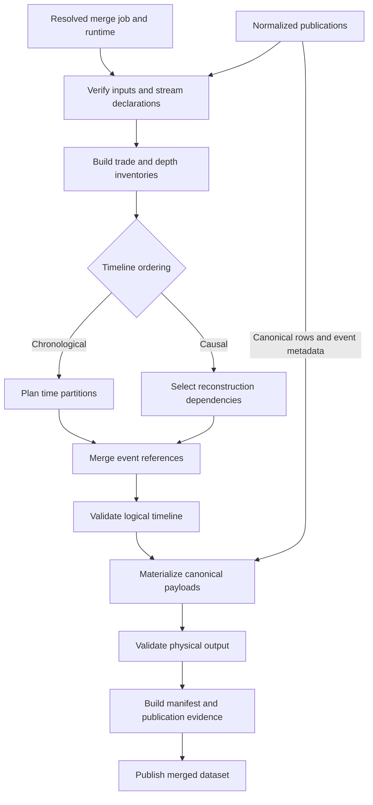
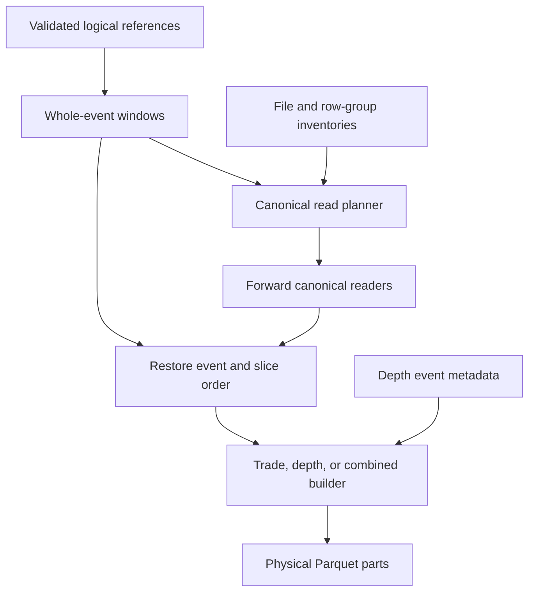
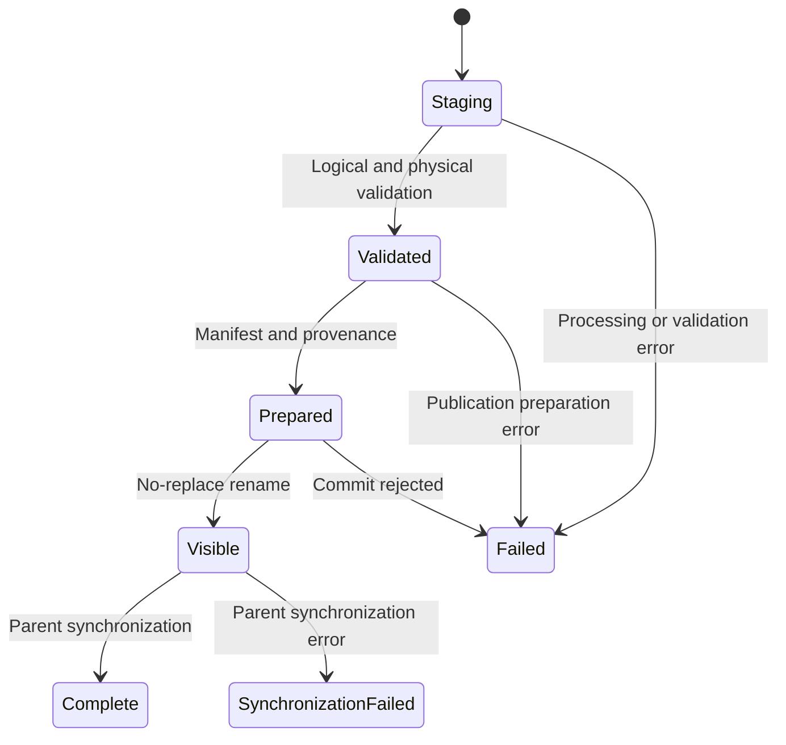

# Merge Engine architecture



The merge engine turns selected canonical trade and depth publications into a materialized event dataset. It establishes an event order, retains source provenance, preserves depth reconstruction information, and publishes validated Parquet output.

The implementation lives in `engine/src/historical/merge/`. The diagram shows the unified executor, which supports trade-only, depth-only, and combined output.

Its central design is the separation between **logical merging** and **physical materialization**:

- Logical merging decides which events belong in the output and their order. It writes references to canonical input rows.
- Physical materialization resolves those references, copies the canonical values into the output schema, and preserves the established event order.

This separation lets ordering work with compact event metadata while materialization organizes reads around physical files and row groups.[^executor]

## Responsibilities and boundaries

Merge consumes completed normalization publications. Its inputs already contain canonical market data, instrument identity, source ownership, and the evidence needed to interpret their layout.

The caller supplies a resolved `MergeJob`. The job and submission types belong to `historical::job`; merge consumes their validated values and verifies the corresponding filesystem publications.

Within that boundary, merge owns:

| Responsibility | What merge establishes |
| --- | --- |
| Input verification | Selected files belong to the declared publications and satisfy the applicable identity, path, size, and checksum checks. |
| Stream resolution | Selected files map to compatible concrete streams with consistent declared ranks. |
| Event selection | Events satisfy the requested interval and, for causal depth, include required reconstruction dependencies. |
| Event ordering | Output follows the selected chronological or causal contract. |
| Materialization | References resolve to the expected canonical rows and become physical event payloads. |
| Output validation | Written files satisfy schema, ordering, reference, and accounting requirements. |
| Publication | Validated files and retained execution evidence are committed to a fresh destination. |

Catalogue lookup, archive acquisition, raw-format decoding, profile interpretation, and database registration belong to other parts of MarketForge.

Merge also reuses infrastructure rather than implementing every mechanism locally. The event queue comes from `shared::merge`; canonical schemas come from shared persistence; resource accounting comes from shared historical infrastructure; scheduling and publication primitives are reused from normalization.[^module][^inputs]

### Merge does not repeat normalization

Trade merging reads canonical event positions and timestamps. It does not run normalization’s native trade-ID reconciliation again.

Depth merging consumes committed observations, initialization boundaries, and reconstruction segments. Its boundary handling has specific rules for retaining or omitting initialization events; those rules do not provide general duplicate detection for arbitrary market observations.

Combined output interleaves trade and depth events. It does not automatically associate each execution with a particular book update or join the two into paired records.[^streams][^ordering][^schemas]

## The data model

Several identities and units appear throughout the implementation. Keep them distinct when extending the module.

| Term | Meaning |
| --- | --- |
| Input publication | A committed normalization dataset with its manifest, primary files, and auxiliary evidence. |
| Registered file | A file selected through the submitted job. Its catalogue identity is separate from the Engine publication identity. |
| Source task | The normalization task that contributed a canonical row range or depth observation sequence. |
| Logical stream | A compatible market-data stream identified by committed stream and instrument metadata. |
| Stream rank | The declared priority used to order available events from different streams when timestamps tie. |
| Event reference | A publication/task address, event ordinal, and canonical row span. |
| Canonical row | One normalized trade row or one normalized depth level-change row. |
| Physical merge row | One materialized market event. A depth row can contain multiple level changes. |
| Logical partition | A unit of work that creates part of the ordered reference timeline. |
| Materialization partition | A unit of work that turns a contiguous portion of that timeline into physical payloads. |

In timeline records, `dataset_id` identifies the input Engine publication. It is not the registered file ID from a file-based submission.

An event ordinal also has a narrower meaning than a native exchange identifier. For trades, the reference ordinal follows the task’s canonical row position. For depth, it identifies an indexed observation. Neither should be interpreted as a native trade ID or a globally comparable exchange sequence.[^references][^streams]

### Events and canonical rows have different counts

A trade reference addresses exactly one canonical row. A depth reference addresses zero or more canonical level-change rows.

| Observation | Physical merge rows | Referenced canonical rows |
| --- | ---: | ---: |
| One trade | 1 | 1 |
| One depth observation with 20 level changes | 1 | 20 |
| One depth observation without level changes | 1 | 0 |

An empty depth change list still represents an observation. It can carry a timestamp, sequence information, or a reconstruction boundary.

This distinction also changes the meaning of familiar metric names. In merge, `events_written` counts materialized event rows. It must not be interpreted as normalization’s count of emitted depth level rows.[^schemas][^physical-validation]

## Code organization

Paths in this table are relative to `engine/src/historical/merge/`.

| Module | Responsibility |
| --- | --- |
| `core/` | Event-reference abstractions, stream interfaces, merge keys, and K-way queue integration. |
| `execution/shared/` | Input resolution, logical resource estimates, shared publication paths, and sequential depth-reference execution. |
| `execution/parallel/` | Parallel depth-reference execution and result validation. |
| `execution/unified/` | Production orchestration, concrete stream resolution, and ranked logical partition execution. |
| `partition/` | Time partition planning, task selection, and logical partition workers. |
| `trades/` | Trade ownership inventories, timestamp cursors, and logical trade streams. |
| `depth/` | Event-index inventories, cursors, boundary relations, checkpoints, and chronological or causal depth streams. |
| `output/` | Logical timeline schemas, writers, reference validation, and reference-oriented manifests. |
| `materialize/planning/` | Physical work plans, whole-event windows, canonical read plans, and resource estimates. |
| `materialize/readers/` | Canonical file and row-group addressing, forward readers, decoders, and alternative cache APIs. |
| `materialize/builders/` | Trade, depth, and combined physical schemas, batch construction, and Parquet writing. |
| `materialize/validation/` | Physical file validation, global accounting, and reconstruction metadata. |
| `materialize/publication/` | Physical manifests, final layout preparation, and committed-publication validation. |
| `progress/` | Phase events, partition progress, and validation progress. |

Most submodules are internal. `mod.rs` exposes selected types and functions as the public library surface.[^module]

### Execution entry points

The exported executors serve different purposes.

| Entry point | Result |
| --- | --- |
| `execute_unified_merge_job` | A validated physical publication containing trades, depth, or both. |
| `execute_unified_merge_job_with_progress` | The same execution path with phase and partition reporting. |
| `execute_merge_job` | A sequential depth-reference timeline. File-based submissions are rejected by this entry point. |
| `execute_parallel_merge_job` | A parallel depth-reference timeline with its reference-oriented manifest. |

Use the unified executor as the starting point when tracing the production physical-publication workflow.

Lower-level exports such as partition workers, cursors, builders, and validators provide reusable components. Calling one of them does not establish the full publication contract by itself.[^entrypoints]

## Resolve inputs before planning work

`execution/shared/resolver.rs` converts the job’s selected publications into `ResolvedMergeInput` values.

A resolved input contains the publication directory, parsed normalization manifest, selected canonical files, and applicable auxiliary files.

For explicit file submissions, resolution checks:

1. The publication and manifest resolve to the expected paths.
2. The manifest identifies the requested Engine dataset.
3. The manifest fingerprint matches the submitted evidence.
4. Each selected file is a primary manifest member.
5. File size and SHA-256 match the submitted selection.
6. File paths remain inside the publication.
7. Duplicate references, including duplicate physical files on Unix, are rejected.
8. Required depth auxiliaries satisfy their applicable size and checksum checks.

These checks happen before merge relies on row offsets or stream ownership.

The legacy dataset-oriented path can resolve a publication without an explicit file submission and has different verification behavior. Its fallback location must not be treated as the managed storage contract for file-based Forge workflows.[^inputs]

### Resolve ownership from committed evidence

`ResolvedMergeInput::selected_streams()` identifies the committed stream that owns each selected canonical file.

`execution/unified/stream_resolver.rs` then loads the retained processing job and compares:

- Publication and processing-job identities.
- Source-task membership.
- Stream identity.
- Exchange, instrument, symbol, and instrument specification.
- Submitted content type and stream rank.
- Instrument namespace evidence where present.

For an explicit submission, selected files cannot silently redefine the stream to which they belong.

Compatible trade publications may share a declared stream rank. Distinct logical streams cannot share that rank. The current resolver also requires additional reconstruction guarantees before a depth stream can span publications.[^stream-resolution]

### Current input restrictions

These restrictions are part of the current execution contract.

| Input | Current requirement |
| --- | --- |
| Canonical content | Trade and depth publications are supported. Combined canonical inputs are rejected. |
| Modern trade publications | Protocol version 4 or later must declare `event_timestamp_ns` ordering. |
| Trade ownership | Modern trade inputs with disjoint source ranges or repeated source-task ownership entries are rejected. |
| Depth file selection | Every primary part belonging to the selected depth stream must be supplied. |
| Depth across publications | One depth stream cannot currently span publications without validated reconstruction across that boundary. |
| Modern segmented depth | Protocol version 4 or later requires causal ordering. |
| Older depth layouts | Replay requires one compatible concrete stream per publication. |

Causal ordering does not bypass the trade ownership or native-order restrictions.

Extending one of these cases requires changes to the evidence model, inventories, replay behavior, and validators. Removing the admission check alone would leave the later stages without the guarantees they depend on.[^stream-resolution]

## Output mode and timeline ordering

Output mode and ordering are independent choices.

**Output mode** describes the physical payload:

- `trades`
- `depth`
- `combined`

The unified executor derives the mode from the selected stream kinds.

**Timeline ordering** describes how events enter the timeline:

- Chronological ordering.
- Causal ordering.

The term “unified” refers to the shared execution path for trade and depth events. It does not imply that every accepted input is timestamp-sorted or that every output uses the same ordering contract.[^executor]

### Chronological ordering

Chronological execution expects its source streams to provide events in an order compatible with chronological merging.

`KWayEventMerger` maintains one available head per stream. It selects the next head, advances that source, and continues.

The ranked production path orders available events by timestamp and stream priority. Within a stream, the cursor preserves the established source order. Task IDs and task-local ordinals do not provide a new ordering across source boundaries.

Some lower-level constructors use a fuller `MergeKey` containing task and ordinal components. Preserve that distinction when modifying the shared ordering code.

The K-way merger is not a general sorting stage for arbitrary disordered input. Its correctness depends on the source stream contract.[^ordering]

### Causal ordering

Causal execution preserves the supplied order of each source stream.

Only the current head of a stream is eligible for selection. A later event becomes available after its predecessor has been selected. If that later event has an earlier timestamp, the merged timeline can regress in timestamp while still preserving the required source order.

Causal output records this order explicitly through `timeline_sequence`.

Here, causal ordering means preserving replay dependencies and source order. It does not establish economic causation between exchanges or prove which trade caused a particular book update.[^ordering][^causal]

## Build inventories that preserve source positions

Inventories connect logical task ownership to physical files. They are more than lists of Parquet paths.

### Trade inventories and cursors

`trades/inventory.rs` builds a `TradeTaskInventory` for each contributing source task.

Its file contributions retain:

- The physical file and part position.
- The file-local starting row.
- The number of rows owned by the task.
- The task-local canonical row offset.
- Observed timestamp bounds.

A shared Parquet part may contain contributions from multiple tasks. The inventory preserves those slices rather than assigning the entire file to one task.

`TradeCursor` projects the event timestamp column needed for logical merging. Where usable page indexes exist, it can narrow reads while retaining original row positions. Missing or unsuitable index statistics fall back to scanning; they do not justify excluding rows.

Exact event selection uses the half-open interval `[start_ns, end_ns)`.

`TradeStream` maps physical positions back to task-local references and validates timestamp progression. Its ranked constructor can combine compatible contributions from multiple publications, but it rejects ambiguous task overlap. Across publications, even a shared observed timestamp boundary is rejected by the current task-range check.[^streams]

### Depth inventories and cursors

Depth requires both canonical level rows and the observation index that explains how those rows form events.

A `DepthTaskInventory` includes canonical file slices together with:

| Artifact | Role |
| --- | --- |
| `events.parquet` | Observation order, event metadata, and canonical row spans. |
| `segments.json` | Initialization points and reconstruction segments. |
| `boundary.json` | Source identity, coverage, and boundary-state evidence. |

The inventory also retains source event ranges and the row base needed to translate stream-level canonical offsets into task-local references.

`DepthEventCursor` reads selected event-index ranges. For native-order histories, it cannot assume that the first timestamp beyond the requested end means every later event is outside the interval.

`visit_depth_events()` checks event ordinals, canonical coverage, initialization segments, bounds, and final totals. Timestamp regressions are recorded separately from those structural checks.[^depth-inventory]

## Depth selection follows reconstruction dependencies

A depth update is meaningful only in the context of the preceding state.

### Causal selection retains complete dependency prefixes

For each reconstruction segment containing a requested observation, `CausalDepthStream` retains:

1. The segment initialization.
2. Every subsequent dependency.
3. The last requested event in that segment, determined by its event-index position.

This can include observations whose timestamps lie outside the requested interval.

For example, consider this illustrative source sequence and a requested interval of `[10:01:00, 10:01:30)`:

| Source position | Event timestamp | Observation | Included as |
| --- | --- | --- | --- |
| 0 | 09:59:00 | Initialization | Reconstruction dependency |
| 1 | 10:02:00 | Update | Reconstruction dependency |
| 2 | 10:01:10 | Update | Requested observation |

All three observations are required to preserve the source’s state progression. Sorting them by timestamp or removing the second observation changes the state seen by the third.

Out-of-interval depth events carry `reconstruction_only = true`. Their original timestamps remain unchanged. Initialization events inside the requested interval are ordinary selected events and do not receive that marker merely because they initialize a book.

Zero-change observations remain part of the dependency sequence.

The causal path carries initialization events through the timeline. It does not run the older timestamp-based checkpoint-selection algorithm or infer a replacement initialization when committed evidence is missing.[^causal]

### Chronological boundary handling

The chronological depth path compares adjacent source-task boundaries and classifies their relationship.

| Relationship | Meaning |
| --- | --- |
| `VerifiedContinuation` | Matching sequence, comparable coverage, and matching recorded state fingerprint establish continuation. |
| `IndependentInitialization` | An initialization establishes a new independently replayable history without proving continuity. |
| `SequenceGap` | The available sequence evidence advances without establishing the required continuation relationship. |
| `StateMismatch` | Boundary-state evidence is incompatible. |
| `Unverifiable` | Available evidence is insufficient to establish the relationship. |

A verified continuation can allow the next task’s redundant initial checkpoint to be omitted. The omitted reference is retained in `MergeSkippedInitialization`.

Independent histories and uncertain boundaries retain their initialization evidence. State mismatch fails the chronological stream.

This is a narrowly defined initialization rule. It must not be expanded into general event deduplication based only on equal timestamps, equal books, or similar-looking records.[^boundaries]

### Compatibility behavior differs between older executors

The older chronological depth components do not all apply the same regression policy.

`DepthStream` rejects timestamp regressions and applicable sequence regressions. `PartitionDepthStream` counts and skips timestamp regressions while producing chronological output.

The depth-only parallel result exposes a dropped-regression count. `UnifiedPartitionResult` does not expose that same counter.

Modern segmented depth avoids this chronological path by requiring causal ordering. When maintaining older paths, account for their existing omission behavior explicitly; do not assume every exported executor either preserves every observation or rejects every regression.[^legacy-depth]

## Plan logical work

Chronological execution divides the requested interval into deterministic, contiguous, non-overlapping partitions.

`plan_merge_partitions()` derives the requested count from the worker and partitioning settings, caps it by the available nanoseconds, and distributes the remainder without gaps.

`plan_unified_partition_inputs()` assigns source tasks using overlap between their inclusive observed bounds and each half-open partition.

Observed bounds help select work. They do not prove continuous market coverage within the interval.[^partitions]

### Causal execution uses a different partition boundary

Causal ordering uses one logical partition covering the requested interval.

This preserves one forward ordering pass while selecting depth dependencies by source position. Arbitrary timestamp partitions would break that dependency model.

Physical materialization can still run in parallel. After the logical timeline is validated, `split_causal_materialization_plan()` assigns contiguous logical output files to separate physical workers.

Consequently, logical partition count and materialization partition count can differ. A physical partition of causal output represents a contiguous portion of the established timeline, rather than an independent timestamp interval.[^executor][^materialization-plans]

### Admit work before starting workers

Logical partitions use the shared budgeted scheduler.

Admission estimates account for active stream readers, baseline processing memory, writer buffers, and file descriptors. Empty time partitions still reserve the resources required to create and finalize their writer.

Materialization uses a separate resource plan and budget for its phase. Requested worker count is an upper bound; resource admission determines how many partitions can run together.

These estimates are cooperative reservations. They are not operating-system RSS limits.

The current logical resource estimate requests zero scratch bytes even though merge writes staging files. Resource admission therefore must not be described as a disk-usage cap for the entire publication.

Partition failures propagate through the collected results. These interfaces do not promise immediate cancellation of every sibling worker when one partition fails.[^resources]

## Write and validate the logical timeline

A `UnifiedTimelineRecord` records an event address and the metadata needed to interpret it.

| Fields | Purpose |
| --- | --- |
| `event_timestamp_ns`, `stream_rank`, `event_kind` | Event time, stream priority, and trade/depth classification. |
| `dataset_id`, `task_id`, `event_ordinal` | Source publication, source task, and event position. |
| `canonical_row_offset`, `canonical_row_count` | The addressed canonical row span. |
| `event_boundary`, `source_operation` | Depth initialization and operation metadata. |
| Causal position fields | Timeline sequence, reconstruction marker, and retained indexed receive-time and sequence metadata. |

The canonical row span is half-open:

```text
[canonical_row_offset, canonical_row_offset + canonical_row_count)
```

A zero-length depth span is valid.

`UnifiedTimelineWriter` buffers references, writes Parquet parts, and tracks event counts and observed timestamp bounds. A writer error marks the writer failed; it cannot later finalize as a successful writer.[^references]

### Validate the files that were written

Logical validation reopens the staged Parquet output.

It checks paths, exact schema, file sizes, footer counts, decoded counts, stream membership, event kinds, and source references.

`UnifiedReferenceValidator` additionally verifies that:

- Every publication/task pair exists in the inventory.
- Trade references contain exactly one canonical row.
- Canonical spans remain within task bounds.
- Event ordinals increase within each publication/task.
- Canonical row spans do not overlap or regress.

Chronological validation checks partition membership and nondecreasing timestamp/rank order.

Causal validation checks contiguous timeline positions, correct reconstruction markers, and initialization before depth source updates. Only depth events may appear outside the requested interval.

These checks establish the consistency of the selected logical timeline. Their event counts become the expected counts for physical materialization.[^logical-validation]

## Materialize canonical payloads



`MaterializationPartitionWorker` coordinates physical reading and output construction.

It owns a canonical read planner, grouped decoder, depth metadata resolver, stream identities, and registered canonical files. For each window, it resolves the referenced rows, builds the selected physical schema, and submits the resulting batch to the writer.[^materialization-worker]

### Keep events whole

`MaterializationWindowBuilder` groups references using an event-count limit and a canonical-row target.

A depth event remains intact even if its number of changes exceeds the ordinary row target. The target therefore controls batching but is not an absolute maximum size for an individual window.

Any resource or batching change must account for unusually large single events instead of silently splitting their identity across output rows.[^materialization-window]

### Separate read order from event order

Canonical references can cross files and row groups.

`CanonicalRowIndex` maps task-local row spans to file-local slices. `CanonicalRowGroupIndex` maps those slices to row groups. `CanonicalReadPlanner` groups reads by physical location while retaining each slice’s original event position.

`GroupedCanonicalDecoder` reads those groups and restores the original event and slice order before batch construction.

For example, references can arrive in the order `A0, B0, A1`, while physical reading groups the two reads from file A. The resulting event order must still be `A0, B0, A1`.

Read locality is an implementation concern; it cannot redefine the timeline.[^canonical-reads]

### The production decoder uses forward cursors

The active materialization worker uses persistent forward file cursors with LRU eviction.

The decoder remembers each file’s high-water position even after eviction. Reopening an evicted cursor does not authorize reading backward through an already consumed source range.

A replacement cursor can be opened before an existing cursor is evicted, which is reflected in the file-descriptor allowance.

The module also exports `CanonicalRowGroupCache` and `CanonicalReferenceResolver`. These are separate reusable APIs. They are not the active read strategy inside `MaterializationPartitionWorker`.

Changes to ordering, ownership ranges, or read grouping must preserve the production decoder’s forward-position assumptions.[^canonical-reads]

## Physical output schemas

Materialization preserves canonical Arrow values and their types, including decimal values. It does not perform another economic normalization or currency conversion.

| Mode | Physical representation |
| --- | --- |
| Trades | One row per trade, containing canonical trade columns and provenance. |
| Depth | One row per depth observation, containing identity, provenance, event metadata, and a non-null `changes` list. |
| Combined | One row per event, containing shared identity, provenance, `event_kind`, and exactly one populated `trade` or `depth` struct. |

The depth `changes` list contains the canonical level-change fields. An event without level changes has an empty list.

For combined output, trade-specific fields belong inside the `trade` struct and depth-specific fields belong inside the `depth` struct. Consumers must select the payload using the event kind.

Every mode retains source provenance:

- `stream_rank`
- `dataset_id`
- `task_id`
- `event_ordinal`
- `canonical_row_offset`
- `canonical_row_count`

Causal physical output additionally carries `timeline_sequence` and `reconstruction_only`.[^schemas]

### Preserve metadata for zero-row depth events

A depth observation without level changes has no canonical level row from which to recover its metadata.

The materialization path therefore uses the validated event reference and retained source identity. Causal depth receives indexed time and sequence metadata through the logical record; chronological depth resolves the corresponding event-index metadata.

Dropping an empty change list or attempting to derive all metadata from its first level would lose valid observations.[^materialization-worker][^schemas]

### Canonical schema changes affect multiple builders

The schema helpers currently treat the first six canonical columns as shared event identity and the remaining columns as payload.

A canonical schema change must review that positional assumption alongside:

- Specialized trade and depth builders.
- The combined builder.
- Reader projections.
- Physical validators.
- Schema-version handling.
- Downstream consumers.

Adding a canonical field is therefore not confined to editing one Arrow schema declaration.[^schemas]

## Validate the physical dataset

`PhysicalParquetWriter` owns row-group buffering, compression, part rotation, and writer accounting.

Row-group and file settings are targets. Flush boundaries, Arrow memory estimates, encoding, and writer behavior affect actual sizes. They do not create strict upper bounds on every physical file.

After writers finish, physical validation reads the resulting Parquet files and checks:

- Expected filenames, file counts, and directory ownership.
- Exact schema and required values.
- Trade/depth payload structure.
- Decoded row counts against footer counts.
- Event order and interval semantics.
- Canonical row counts and event-kind totals.
- Agreement with partition and writer results.

Global validation then checks the combined partition inventory and the relevant ordering rules across partition boundaries.

For causal output, `timeline_sequence` remains contiguous across the complete physical publication.[^physical-validation]

### Accounting invariants

The publication distinguishes event rows from referenced canonical rows:

```text
events_written = trade_events + depth_events

canonical_rows = sum(canonical_row_count for every materialized event)

reconstruction_events <= depth_events
```

For causal output, `depth_events` includes reconstruction-only observations. The number of depth observations inside the requested market interval is:

```text
depth_events - reconstruction_events
```

The unified executor also compares logical and physical totals. Materialization must preserve the selected logical event population.

These validations check structure, ordering, and accounting. They do not independently reprocess raw archives or reconstruct every order book as a second implementation.[^physical-validation][^executor]

## Reconstruction availability

Chronological clipping can produce a physical dataset whose first selected update depends on an initialization outside the requested interval.

The chronological path therefore records both physical checkpoints and initial reconstruction availability.

| Availability | Meaning |
| --- | --- |
| `available` | A suitable physical initialization establishes state at the requested start. |
| `prior_external` | Initial reconstruction depends on an earlier canonical checkpoint outside the physical interval. |
| `unavailable` | The required starting state is not established for the requested start. |

An initialization first available later inside the interval does not establish state for earlier requested observations.

Causal output handles this differently: selected initialization and dependency events are materialized within the timeline. Its manifest uses that inline reconstruction model and requires the older checkpoint, initial-reconstruction, boundary-link, and skipped-initialization collections to remain empty.

Having materialized payload values and having complete initial reconstruction state are separate properties. Consumers must follow the publication’s ordering and reconstruction contract.[^checkpoints]

## Publication lifecycle

The unified executor creates fresh sibling staging with separate logical and physical areas.

Logical references are written first. Physical materialization writes into a separate timeline. Both stages must complete their validation before publication preparation.



### Prepare the final layout

`prepare_physical_publication()` moves the validated physical timeline into the publication layout, writes the physical manifest, and removes the intermediate logical timeline.

The unified executor then retains the job, runtime, input fingerprints, and partition results and writes publication checksums.

The resulting publication contains:

| Path | Purpose |
| --- | --- |
| `manifest.json` | Physical schema, ordering, streams, counts, file inventory, and reconstruction metadata. |
| `timeline/partition-…/part-….parquet` | Materialized event payloads in publication order. |
| `merge-job.json` | Submitted file-based job or the applicable resolved legacy job. |
| `merge-runtime.json` | Effective merge resource, partitioning, and Parquet settings. |
| `merge-input-checksums.json` | Retained input manifest fingerprints. |
| `merge-partitions.json` | Physical partition results used for subsequent verification. |
| `publication-checksums.json` | Checksums for publication files and retained execution evidence. |

The logical reference timeline is an intermediate artifact of the unified execution path. It is removed during successful publication preparation.[^publication]

### Keep protocol versions separate

The physical manifest and the physical Arrow schema have independent versions.

The current physical publication uses:

| Contract | Version |
| --- | ---: |
| Physical merge manifest | 1 |
| Chronological physical schema | 1 |
| Causal physical schema | 2 |

Reference-oriented manifests and timeline schemas have their own version constants. They must not be interpreted as the physical publication format merely because their files are also named `manifest.json` or contain a timeline.[^physical-manifest]

### Commit and failure behavior

`MergeCommitPaths` derives a sibling staging directory and delegates publication to the shared normalization commit primitive.

Commit uses a same-filesystem, no-replace directory rename followed by parent-directory synchronization. Existing output is not overwritten, and there is no copy fallback.

An error during parent synchronization can occur after the final directory becomes visible. Callers must inspect the resulting filesystem state rather than assuming every error means the destination is absent.

Failures after staging begins can leave intermediate or partially prepared output. Staging is not an operational resume checkpoint, and this module does not define a general resume-from-staging protocol.

The unified executor returns `Result<UnifiedMergeExecutionResult>`. It does not create a normalization-style failed-job result for every failure, and successful filesystem publication is separate from subsequent catalogue registration.[^commit][^executor]

### Validate an existing publication

`validate_committed_merge()` reopens the saved manifest and execution evidence, checks their identities, reruns physical validation, and compares the observed output with the retained manifest.

Depending on the saved format and ordering, it also verifies runtime or physical payload checksum evidence.

This validates the committed merge publication. It does not reopen every original raw archive or repeat normalization.

The retained output path is part of the verification contract. Moving a publication to a different directory is not transparent to this validator.[^publication]

## Progress and diagnostics

`MergeProgressReporter` reports named execution phases and partition outcomes without owning processing decisions.

A `PartitionKey` contains both the phase and partition ID. This keeps a logical partition and a materialization partition with the same numeric ID distinct.

Lifecycle events use an optional channel. Atomic partition counters and replaceable validation progress support polling without producing an event for every row.

A disconnected progress consumer does not make processing fail.

Progress metrics also retain separate units. Inputs verified, logical events, materialized events, reconstruction observations, and canonical rows are different quantities. Completing a progress phase does not substitute for output validation or publication.

When progress reporting is disabled, the unified executor can emit stage timings when `MARKETFORGE_PROFILE` is set. Those timings help locate expensive phases; they do not replace output verification.[^progress][^executor]

## Extending merge

Choose the module that owns the behavior being changed, then follow the resulting contract through validation and publication.

### Support another canonical input layout

Start with input resolution and the appropriate inventory builder.

The new layout must establish:

- Which committed publication owns each file.
- Which source task owns each referenced row or observation.
- How task-local offsets map to physical positions.
- Which event and reconstruction metadata are authoritative.
- Which checks bind that evidence to the selected files.

Update stream admission and reference validation alongside the reader. Avoid making an unsupported layout appear supported by substituting guessed ownership or timestamp bounds.

### Support more trade overlap or ownership patterns

Begin with `trades/inventory.rs`, `trades/stream.rs`, and the restrictions in `execution/unified/stream_resolver.rs`.

The current stream implementation expects unambiguous ordered task contributions. Supporting disjoint or repeated ownership requires a representation that preserves those contributions through cursors, logical references, forward materialization, and validators.

If the proposed behavior requires identifying duplicate or conflicting native trades, define that responsibility explicitly. The existing merge cursor does not possess normalization’s full trade-identity reconciliation machinery.

### Extend depth replay

Work through the complete dependency path:

- Depth inventory and event-index validation.
- Source stream selection.
- Initialization and segment handling.
- Logical timeline metadata.
- Materialization of zero-row and nonzero-row events.
- Physical validation and reconstruction evidence.

For a depth stream spanning publications, establish how ownership and initialization remain valid across the publication boundary. Matching a stream ID alone is insufficient.

Any new selection algorithm must preserve every dependency needed for a selected state, including dependencies whose timestamps lie outside the requested interval.

### Add an event kind or physical field

An event kind crosses several boundaries: the reference enum, stream classification, timeline schema, materialization dispatch, physical schema, counters, and validators.

A field change must preserve values in both specialized and combined output. Review nullable payload construction and the shared-column assumptions in `builders/schema.rs`.

Update schema compatibility deliberately. A reader should reject an unsupported representation rather than interpret it through an older schema by accident.

### Improve read performance

Start with `CanonicalReadPlanner`, `GroupedCanonicalDecoder`, and the forward readers.

An optimization must preserve:

- Original physical row positions.
- Task-local reference meaning.
- Event order after grouped reads.
- Slice order within a depth event.
- Exact interval selection.
- Forward-read guarantees across cursor eviction.

Evaluate cache and cursor changes with interleaved streams, references crossing files, and events crossing row groups. Faster contiguous reads alone do not establish correctness for mixed workloads.

### Change concurrency or publication

Concurrency changes belong in the phase planners, resource estimators, and scheduler integration. Account for complete events, writer buffers, retained metadata, and descriptor replacement behavior.

Publication changes must keep the manifest, retained job/runtime evidence, checksum inventory, and committed validator consistent.

Preserve the distinction between replay checkpoints and resumable execution state. The presence of depth reconstruction checkpoints does not make a partially completed merge resumable.

## Testing merge changes

Tests should verify observable contracts across stage boundaries.

The module contains focused unit tests at these locations:

| Source location | Existing focus |
| --- | --- |
| `core/ordering.rs` | Timestamp ordering and merge-key tie behavior. |
| `partition/shared/partition.rs` | Deterministic partitions, exact interval coverage, non-overlap, and half-open membership. |
| `execution/shared/resources.rs` | Resource estimates, invalid settings, overflow, and growth with stream count. |
| `output/writers/timeline.rs` | Reference schema and event-reference preservation. |
| `materialize/builders/schema.rs` | Canonical field preservation and nested depth/combined schema structure. |
| `materialize/readers/inventory.rs` | Cross-file spans, zero-row references, bounds, and overflow. |
| `materialize/readers/reader.rs` | Reader batch-size validation. |

Use these as focused entry points, then exercise the public unified executor for behavior that spans planning, writing, validation, and publication.[^tests]

For new behavior, select the relevant end-to-end cases:

| Change | Evidence the test should establish |
| --- | --- |
| Ordering | Equal timestamps preserve declared stream priority; source-task IDs do not accidentally reorder a ranked stream. |
| Causal replay | Timestamp regressions retain source order and produce contiguous timeline positions. |
| Interval selection | Initialization and out-of-interval dependencies remain available for requested depth observations. |
| Depth cardinality | Multiple-change and zero-change observations each retain one physical event row. |
| File selection | Partial trade selections preserve original offsets; unsupported partial depth selections fail. |
| Read planning | Grouped physical reads restore the original event order across files and row groups. |
| Materialization | Specialized and combined output preserve canonical values and nullability. |
| Reconstruction | A checkpoint available later in the interval does not become proof of state at the interval start. |
| Resource behavior | Work exceeding admission limits fails predictably; cursor eviction preserves forward positions. |
| Validation | Altered schemas, invalid references, inconsistent counts, and corrupted retained evidence are rejected. |
| Publication | Existing destinations remain untouched, and failures preserve enough state to distinguish staging failure from a visible post-rename result. |

Compare decoded semantics, provenance, and ordering rather than assuming two valid executions must produce byte-identical Parquet files.

The most useful integration test follows one event through the complete lifecycle: committed ownership, logical reference, physical payload, manifest accounting, and committed-publication validation.

[^module]: [Merge module and public exports](https://github.com/flowdrivenml/marketforge/blob/main/engine/src/historical/merge/mod.rs).

[^executor]: [Unified merge executor](https://github.com/flowdrivenml/marketforge/blob/main/engine/src/historical/merge/execution/unified/executor.rs).

[^entrypoints]: [Sequential depth-reference executor](https://github.com/flowdrivenml/marketforge/blob/main/engine/src/historical/merge/execution/shared/executor.rs) and [parallel depth-reference executor](https://github.com/flowdrivenml/marketforge/blob/main/engine/src/historical/merge/execution/parallel/executor.rs).

[^inputs]: [Publication and selected-file resolution](https://github.com/flowdrivenml/marketforge/blob/main/engine/src/historical/merge/execution/shared/resolver.rs).

[^stream-resolution]: [Concrete stream resolution and compatibility checks](https://github.com/flowdrivenml/marketforge/blob/main/engine/src/historical/merge/execution/unified/stream_resolver.rs).

[^streams]: [Trade inventories](https://github.com/flowdrivenml/marketforge/blob/main/engine/src/historical/merge/trades/inventory.rs), [trade cursors](https://github.com/flowdrivenml/marketforge/blob/main/engine/src/historical/merge/trades/cursor.rs), and [trade streams](https://github.com/flowdrivenml/marketforge/blob/main/engine/src/historical/merge/trades/stream.rs).

[^ordering]: [Event-reference keys](https://github.com/flowdrivenml/marketforge/blob/main/engine/src/historical/merge/core/event.rs) and [K-way event merging](https://github.com/flowdrivenml/marketforge/blob/main/engine/src/historical/merge/core/kway_event.rs).

[^causal]: [Causal depth selection](https://github.com/flowdrivenml/marketforge/blob/main/engine/src/historical/merge/depth/causal_stream.rs) and [unified partition execution](https://github.com/flowdrivenml/marketforge/blob/main/engine/src/historical/merge/partition/unified/partition_executor.rs).

[^depth-inventory]: [Depth inventories](https://github.com/flowdrivenml/marketforge/blob/main/engine/src/historical/merge/depth/inventory.rs), [depth cursors](https://github.com/flowdrivenml/marketforge/blob/main/engine/src/historical/merge/depth/cursor.rs), and [event-index validation](https://github.com/flowdrivenml/marketforge/blob/main/engine/src/historical/merge/depth/event_validation.rs).

[^boundaries]: [Boundary classification](https://github.com/flowdrivenml/marketforge/blob/main/engine/src/historical/merge/depth/boundary.rs) and [chronological depth streams](https://github.com/flowdrivenml/marketforge/blob/main/engine/src/historical/merge/depth/stream.rs).

[^legacy-depth]: [Partitioned depth streams](https://github.com/flowdrivenml/marketforge/blob/main/engine/src/historical/merge/depth/partition_stream.rs), [depth partition results](https://github.com/flowdrivenml/marketforge/blob/main/engine/src/historical/merge/partition/shared/partition_executor.rs), and [unified partition results](https://github.com/flowdrivenml/marketforge/blob/main/engine/src/historical/merge/partition/unified/partition_executor.rs).

[^partitions]: [Time partition planning](https://github.com/flowdrivenml/marketforge/blob/main/engine/src/historical/merge/partition/shared/partition.rs) and [unified input selection](https://github.com/flowdrivenml/marketforge/blob/main/engine/src/historical/merge/partition/unified/partition_input.rs).

[^materialization-plans]: [Materialization plan construction](https://github.com/flowdrivenml/marketforge/blob/main/engine/src/historical/merge/materialize/planning/plan.rs) and [parallel materialization](https://github.com/flowdrivenml/marketforge/blob/main/engine/src/historical/merge/materialize/shared/parallel.rs).

[^resources]: [Logical resource estimates](https://github.com/flowdrivenml/marketforge/blob/main/engine/src/historical/merge/execution/shared/resources.rs), [logical admission](https://github.com/flowdrivenml/marketforge/blob/main/engine/src/historical/merge/execution/unified/parallel.rs), and [materialization resource estimates](https://github.com/flowdrivenml/marketforge/blob/main/engine/src/historical/merge/materialize/planning/resources.rs).

[^references]: [Logical timeline records and schema](https://github.com/flowdrivenml/marketforge/blob/main/engine/src/historical/merge/output/writers/unified_timeline.rs) and [logical timeline writer](https://github.com/flowdrivenml/marketforge/blob/main/engine/src/historical/merge/output/writers/unified_writer.rs).

[^logical-validation]: [Logical output validation](https://github.com/flowdrivenml/marketforge/blob/main/engine/src/historical/merge/output/validation/unified_output_validation.rs) and [canonical reference validation](https://github.com/flowdrivenml/marketforge/blob/main/engine/src/historical/merge/output/validation/unified_reference_validation.rs).

[^materialization-worker]: [Materialization partition worker](https://github.com/flowdrivenml/marketforge/blob/main/engine/src/historical/merge/materialize/planning/partition.rs) and [depth metadata resolution](https://github.com/flowdrivenml/marketforge/blob/main/engine/src/historical/merge/materialize/builders/depth_metadata.rs).

[^materialization-window]: [Whole-event materialization windows](https://github.com/flowdrivenml/marketforge/blob/main/engine/src/historical/merge/materialize/planning/window.rs).

[^canonical-reads]: [Canonical read planning](https://github.com/flowdrivenml/marketforge/blob/main/engine/src/historical/merge/materialize/planning/planner.rs), [grouped decoding](https://github.com/flowdrivenml/marketforge/blob/main/engine/src/historical/merge/materialize/readers/decoder.rs), and [canonical readers](https://github.com/flowdrivenml/marketforge/blob/main/engine/src/historical/merge/materialize/readers/reader.rs).

[^schemas]: [Physical schemas](https://github.com/flowdrivenml/marketforge/blob/main/engine/src/historical/merge/materialize/builders/schema.rs), [trade builder](https://github.com/flowdrivenml/marketforge/blob/main/engine/src/historical/merge/materialize/builders/trade_builder.rs), [depth builder](https://github.com/flowdrivenml/marketforge/blob/main/engine/src/historical/merge/materialize/builders/depth_builder.rs), and [combined builder](https://github.com/flowdrivenml/marketforge/blob/main/engine/src/historical/merge/materialize/builders/combined_builder.rs).

[^physical-validation]: [Physical writer](https://github.com/flowdrivenml/marketforge/blob/main/engine/src/historical/merge/materialize/builders/writer.rs), [partition validation](https://github.com/flowdrivenml/marketforge/blob/main/engine/src/historical/merge/materialize/validation/validate.rs), and [global physical validation](https://github.com/flowdrivenml/marketforge/blob/main/engine/src/historical/merge/materialize/validation/global_validate.rs).

[^checkpoints]: [Canonical checkpoint selection](https://github.com/flowdrivenml/marketforge/blob/main/engine/src/historical/merge/depth/checkpoint.rs), [physical checkpoints](https://github.com/flowdrivenml/marketforge/blob/main/engine/src/historical/merge/materialize/validation/checkpoints.rs), and [initial reconstruction availability](https://github.com/flowdrivenml/marketforge/blob/main/engine/src/historical/merge/materialize/validation/reconstruction.rs).

[^publication]: [Publication preparation and committed verification](https://github.com/flowdrivenml/marketforge/blob/main/engine/src/historical/merge/materialize/publication/publish.rs) and [execution provenance](https://github.com/flowdrivenml/marketforge/blob/main/engine/src/historical/merge/execution/unified/executor.rs).

[^physical-manifest]: [Physical merge manifest](https://github.com/flowdrivenml/marketforge/blob/main/engine/src/historical/merge/materialize/publication/manifest.rs).

[^commit]: [Merge staging and commit paths](https://github.com/flowdrivenml/marketforge/blob/main/engine/src/historical/merge/execution/shared/commit.rs) and [shared publication implementation](https://github.com/flowdrivenml/marketforge/blob/main/engine/src/historical/normalize/executor.rs).

[^progress]: [Merge phases and progress reporting](https://github.com/flowdrivenml/marketforge/blob/main/engine/src/historical/merge/progress/reporter.rs).

[^tests]: Inline tests in [merge ordering](https://github.com/flowdrivenml/marketforge/blob/main/engine/src/historical/merge/core/ordering.rs), [partition planning](https://github.com/flowdrivenml/marketforge/blob/main/engine/src/historical/merge/partition/shared/partition.rs), [resource estimates](https://github.com/flowdrivenml/marketforge/blob/main/engine/src/historical/merge/execution/shared/resources.rs), [timeline records](https://github.com/flowdrivenml/marketforge/blob/main/engine/src/historical/merge/output/writers/timeline.rs), [physical schemas](https://github.com/flowdrivenml/marketforge/blob/main/engine/src/historical/merge/materialize/builders/schema.rs), [canonical row inventories](https://github.com/flowdrivenml/marketforge/blob/main/engine/src/historical/merge/materialize/readers/inventory.rs), and [reader configuration](https://github.com/flowdrivenml/marketforge/blob/main/engine/src/historical/merge/materialize/readers/reader.rs).

## Related development paths

- [System architecture](architecture.md) and [operation lifecycles](operations.md) place Merge Engine in the historical workflow.
- [Prepared contract](../reference/data-formats/prepared-merge.md) and [user workflow](../workflows/merge.md) describe the public handoff.
- [Test selection](testing.md) and [diagnostics](debugging.md) cover verification and inspection.
