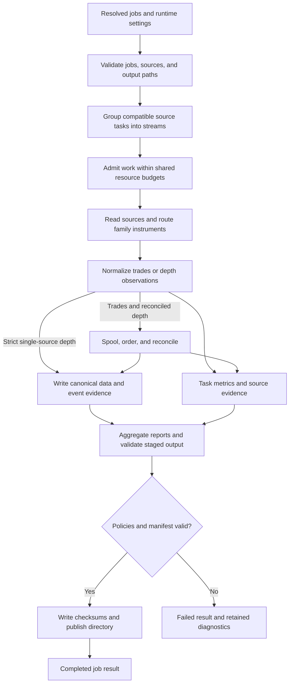
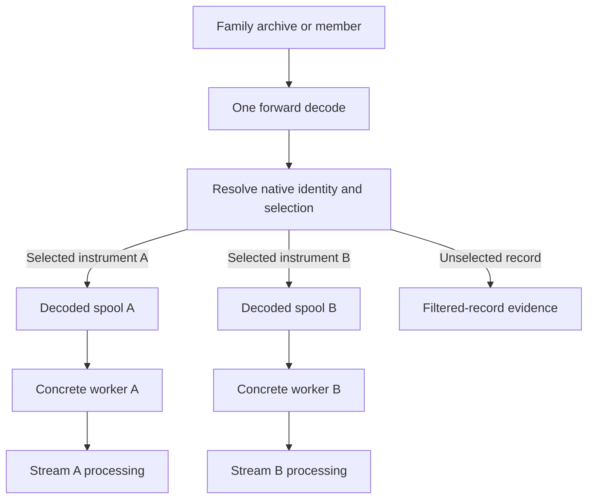
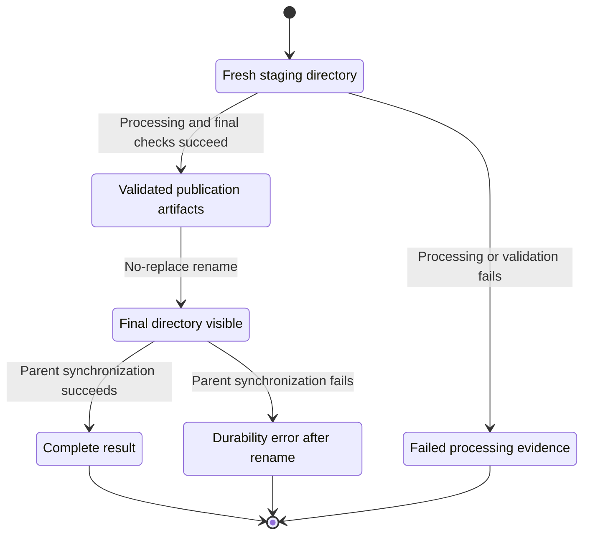

# Normalization Engine architecture



The normalization Engine converts recorded market data into canonical trade or depth publications. It coordinates source interpretation, instrument routing, ordering, reconciliation, resource accounting, output validation, and publication.

The implementation lives in `engine/src/historical/normalize/`, exposed as `crate::historical::normalize`.

The diagram follows one job through publication. A processing session can schedule work from several jobs through shared resource budgets, then finalize each job separately.

This page explains the responsibilities of the normalization components and the boundaries that must be preserved when extending them.

## Scope and relationship to Forge

The normalization package receives resolved `ProcessingJob`, `WorkTask`, and `ProcessingConfig` values. Their preparation and configuration definitions also involve modules outside this package.

Forge selects registered inputs, resolves catalogue evidence, prepares execution documents, invokes the managed executable, and registers verified publications. The normalization package processes the supplied jobs and produces filesystem artifacts and structured results.

Within the Engine, several dependencies are shared:

| Dependency | Responsibility |
|---|---|
| `crate::historical::job` | Processing jobs, source tasks, identities, and structural validation |
| `crate::shared::historical` | Runtime configuration, policies, limits, and resource-accounting primitives |
| `crate::shared::io` | Source containers, readers, and physical record decoding |
| `crate::shared::formats` | Trade and depth interpretation |
| `crate::shared::normalization` | Normalization mappings and target schemas |
| `crate::shared::domain` | Canonical events, order-book state, and boundary models |
| `crate::shared::persistence::parquet` | Arrow schemas, batch builders, Parquet writers, and depth auxiliary formats |

The local `config.rs`, `resources/budget.rs`, and `parquet/mod.rs` files expose shared implementations through compatibility facades.

The `merge` and `convert` exports in `normalize/mod.rs` refer to sibling operations. They do not make merging or conversion stages of normalization.[^module-boundary]

## The execution model

Understanding the distinction between sessions, jobs, tasks, streams, observations, and rows is essential before changing processing behavior.

| Term | Meaning |
|---|---|
| Processing session | A collection of jobs sharing execution resources and scheduling |
| Processing job | Work producing one publication with one canonical content type |
| Source task | A resolved source input, identity, interpretation, and source-ordering contract |
| Stream execution unit | Compatible source tasks that must be processed together |
| Source record | A physical record examined by a decoder |
| Logical observation | An accepted event or assembled depth observation |
| Canonical row | A trade row or depth level-update row written to canonical output |
| Source span | The canonical row ranges attributed to a source task within a stream |

A job can contain many tasks. Several tasks can contribute to the same logical stream. A family input can contain several instruments and produce multiple concrete streams.

A source record and a canonical row are not interchangeable units. A grouped depth snapshot can consume multiple source records, while one accepted depth observation can produce several canonical updates or no updates.

These distinctions affect scheduling, metrics, reconciliation, and publication validation.[^streams][^workers]

## Package map

Paths in this table are relative to `engine/src/historical/normalize/`.

| Module | Responsibility |
|---|---|
| `executor.rs` | Single-job execution, finalization, failure persistence, and directory publication |
| `session.rs` | Multi-job preflight, shared execution resources, result ownership, and per-job finalization |
| `scheduler.rs` | Bounded parallel execution and resource admission |
| `streams.rs` | Stream grouping, execution-path selection, source ownership, and output inventory |
| `streams_depth.rs` | Direct depth execution and persisted depth-evidence validation |
| `family.rs` | Shared decoding and routing of family inputs into concrete instrument streams |
| `preparation.rs` | Bounded parallel source normalization using spare compute capacity |
| `task.rs` | Isolated task execution helpers and worker policy preparation |
| `worker/` | Source processing loops, sinks, ordering checks, and decoded-input handling |
| `reconciled.rs` | Source preparation, canonical spooling, reconciliation dispatch, and staged output |
| `reconcile.rs` | Source observations, identity contracts, and reconciliation proof helpers |
| `reconcile/external.rs` | Disk-backed sorting, identity reconciliation, and validated trade execution paths |
| `reconciled_depth.rs` | Stateful depth selection and replay |
| `depth_partitions.rs` | Checkpointed depth replay for fragmented source ownership |
| `coverage.rs` | Interval ownership used during source selection |
| `reconcile/spool.rs` | Scratch files, framing, quotas, consumption, and cleanup |
| `reconcile/typed.rs`, `typed_depth.rs` | Internal typed scratch payloads |
| `resources/` | Estimates, admission inspection, compute permits, and scratch support |
| `metrics/` | Counters, scoped observations, retained reports, and integrity evaluation |
| `policies.rs` | Processing-quality evidence and job-wide policy evaluation |
| `sequence_policy.rs` | Resolve depth sequence semantics from normalization metadata |
| `boundary/` | Capture initial and final book-state evidence and continuity observations |
| `parquet/` | Adapt shared Parquet writers to normalization sinks |
| `manifest/` | Build, validate, inspect, and persist publication evidence |
| `progress/` | Progress events, diagnostics, and presentation-facing snapshots |
| `result.rs`, `response.rs` | Structured job results and the versioned normalization response |
| `benchmark/` | Trial planning, execution, provenance, verification, and performance comparison |

The package has several levels of execution API. A helper that can process one isolated task is not necessarily the entry point used by a complete production job.

## Public execution entry points

The principal single-job functions are:

- `execute_processing_job()`
- `execute_processing_job_with_progress()`

The `session` module exposes:

- `execute_processing_session()`
- `execute_processing_session_with_progress()`
- `execute_processing_session_reporting()`

The reporting variant accepts a callback for definitive job outcomes. This allows a caller to retain completed results even if a later session operation encounters an error.

Lower-level session and task functions support internal composition and focused execution.

### Result handling

Single-job execution returns `Result<ProcessingResult>`.

An `Ok` value can contain a failed `ProcessingResult`. The outer Rust result and the reported processing status therefore have different meanings.

`ProcessingResult` records the job and dataset identities, complete or failed status, optional manifest and failure-report paths, row and file counts, timestamp boundaries, and structured failure information.

Callers must inspect the processing status rather than treating every `Ok` value as successful publication.[^execution-results]

### Supported job output

The processing executor accepts trade or depth output. It rejects combined output for this operation.

Every task must have normalization mappings matching the job’s target type. Trade tasks require exactly one trade normalization configuration. Depth tasks can carry multiple depth rules.

These checks establish the processing contract before source execution begins.[^executor]

## Job validation and staging

Execution validates the job structure and runtime configuration before processing sources.

Session validation also checks relationships across jobs, including conflicting output paths. Task identities must be unique within their job, and task targets must agree with the job content type.

Final and staging destinations must be fresh. The implementation does not reuse an existing publication directory as a working directory.

### Retained execution provenance

`prepare_staging()` creates the staging directory and writes:

- `processing-job.json`
- `processing-job.sha256`
- `processing-runtime.json`
- `processing-runtime.sha256`

The retained processing job contains the resolved work. Its legacy resource and integrity fields are replaced with the authoritative runtime settings used for execution.

Execution-only tuning and processing policies are retained in runtime provenance.

This distinction matters when adding configuration. A new runtime setting must be represented where execution reads it and where publication evidence records it.[^executor]

### Session preflight

The session performs source and resource preflight before scheduling eligible work.

A job with a preflight failure can retain a failure outcome while other eligible jobs continue. Structural errors affecting the session itself can terminate the call before every requested job has a definitive result.

The result protocol preserves that distinction. It does not invent outcomes for work that could not be reported.[^session][^execution-results]

## Streams are the scheduling boundary

The main execution path schedules `StreamUnit` groups.

`streams::plan()` groups ordinary tasks using a fingerprint of their concrete interpretation. The grouping includes stream and instrument identity, economics, normalization mappings, source ordering, instrument namespace, profile evidence, and source options.

Physical source paths do not define the canonical stream. Multiple archives can contribute to one stream when their identity and interpretation agree.

Family inputs initially use a family-routing key. After routing, processing establishes the concrete instrument streams.

Within a stream unit, source priority and the original task position establish deterministic source order.[^streams]

### Why tasks are grouped

Related sources can overlap or continue one another. Their duplicate identity, source precedence, timestamp policy, and depth state must be assessed together.

Scheduling each archive independently and concatenating its output would bypass those relationships.

The stream owns the relevant processing state and writers until its work is finalized.

### Execution-path selection

The current dispatch in `streams::needs_reconciliation()` selects reconciled execution when:

- The unit contains multiple source tasks.
- The unit contains family inputs.
- The target is trades.
- Depth overlap or timestamp policy requires the reconciled path.

Every trade stream therefore enters reconciled execution, including a single-source trade stream.

The direct depth path applies to strict, single-source, non-family depth.

Trade fast paths are selected later, after source normalization has established the evidence required to use them.

## Session scheduling and resource ownership

`session.rs` creates shared execution resources and schedules stream units through `scheduler::execute_parallel_budgeted_observed()`.

The scheduler estimates each unit before launching workers. It acquires the required reservation before execution and holds that reservation while the unit runs.

Results are restored to input order regardless of worker completion order.

This separates scheduling order from semantic order. A worker finishing earlier does not gain precedence over another source.[^session][^scheduler]

### What the estimates cover

Resource estimates include more than decoder buffers.

Depending on the input and execution path, they account for:

- Decoding and transformation workspace.
- Record-size allowances.
- Book state, snapshots, diffs, and boundary evidence.
- Supported workbook materialization.
- Parquet writer memory.
- Reconciliation buffers.
- Integrity observations and diagnostic samples.
- Retained task results.
- Finalization workspace.
- Open-file requirements.

Source file length is not a reliable estimate of decoded memory.

Admission inspection reports planned reservations. Those figures are not measurements of process RSS and do not establish that every configured worker can run simultaneously.[^resources]

### Retained reports also consume resources

Task completion does not release every object associated with that task.

Metrics and source evidence may remain alive until job finalization or failure-report persistence. The session accounts for retained report state separately and reserves finalization workspace before transferring ownership of the results.

When adding a retained field, consider its full lifetime. A small per-task object can become substantial when accumulated across many tasks.

### Nested compute permits

`resources/compute.rs` provides a session-wide compute budget.

A parent processing unit holds a permit. Nested work can acquire an available spare permit, but it does not wait indefinitely for capacity held by its own parent.

This permits useful overlap without allowing nested parallelism to exceed the intended compute capacity or introduce permit deadlocks.

Resource reservations and compute permits solve different problems: one controls admitted resource footprints; the other controls active computation.

## Family routing

A family archive may interleave records for several instruments.

The family-routing layer decodes the applicable source or archive member once and directs selected records into instrument-specific scratch streams.



Selection is applied before requiring metadata for deliberately unselected instruments. An encountered selected instrument must have the authoritative metadata and supported interpretation needed for processing.

The production routing path uses disk-backed decoded records. The in-memory variants in `worker/decoded.rs` are test support.

Concrete workers consume their routed input through a scoped, one-shot interface. They preserve physical record ordinals and do not reopen the original archive to scan for each instrument.[^family]

### Independent instrument state

Routing separates more than output files.

Each concrete instrument needs its own timestamp domain, book state, sequence interpretation, source evidence, and processing metrics.

Interleaved records for different instruments must not be checked against one shared “previous timestamp” or one shared order book.

### Selection fulfillment

Finalization checks explicit include selections across the applicable sources.

An instrument can be absent from one archive and appear in another. A requested instrument never observed in any applicable selected source fails the selection check.

Observed membership and successful processing are separate assertions. An invalid selected record can establish that the instrument was encountered while still causing a processing failure.

### Extension constraints

The current family-routing implementation supports the relevant CSV and JSONL paths. XLSX family routing is rejected.

A routing extension must preserve:

- One-pass decoding where the existing path provides it.
- Original source ordinals.
- Selection before unnecessary metadata lookup.
- Explicit failures for selected identities that cannot be processed.
- Bounded spool and handle usage.
- Independent concrete stream state.
- Final selection-fulfillment checks.

## Source workers and sink interfaces

Workers connect physical records to shared trade and depth processors.

They own the source-processing loop, instrument matching, error attribution, ordering observations, and submission to a sink.

The semantic processors and physical decoders live in shared modules. A change to field interpretation can therefore require work outside the normalization package.

### Trade processing

`worker/trades.rs` reads CSV records or projects configured JSONL scalar values into the row representation used by the shared trade processor.

The processing loop:

1. Reads or consumes a decoded record.
2. Classifies decoding errors.
3. Checks instrument identity.
4. Calls the shared `TradeProcessor`.
5. Records integrity observations.
6. Checks applicable source ordering.
7. Submits the canonical trade with its source ordinal.

Recoverable record rejection follows the configured integrity policy. Source I/O and decompression failures retain their source-failure meaning.

An instrument identity error must not silently become an unrelated record that can be skipped.[^workers]

### Depth processing

`worker/depth.rs` uses the shared `DepthProcessor` and supported CSV, JSONL, or workbook adapters.

The worker submits a complete `DepthProcessingOutcome`. That outcome contains source-event metadata, the source operation, the initialization or change boundary, and zero or more canonical level updates.

The worker checks the outcome before accepting it, submits the whole outcome to the sink, and then updates accepted-event and boundary evidence.

Preserving the complete outcome is essential. Splitting it into unrelated row writes can lose the relationship between one source observation and the state transition it caused.

### Sinks

`worker/sink.rs` defines two main interfaces:

| Interface | Submission unit |
|---|---|
| `TradeSink` | A canonical trade, with source ordinal when required |
| `DepthSink` | A complete depth outcome, source-record evidence, and boundary evidence |

Workers can submit to canonical spools or shared Parquet writers through these interfaces.

This allows decoding and normalization to remain reusable while reconciliation and publication choose how to consume the results.

An additional sink must preserve the metadata and accounting required by its caller. Accepting the values while dropping source ordinals or depth boundaries is not an equivalent implementation.

## Internal source preparation

`preparation.rs` overlaps source normalization within a stream when spare compute capacity and resource estimates permit it.

This is an execution optimization inside the Rust Engine. It is separate from Forge’s recipe preparation and from profile compilation.

The optimization starts ordinary source workers and transfers owned events through a bounded channel:

- A canonical trade and source ordinal.
- A depth outcome and optional source-record fingerprint.
- Completed depth boundary evidence.

Mutable book state, scratch workspaces, and retained report handles remain with their owning execution context.

The consumer joins the source worker after completion or error. Cancelling a preparation drops the receiving side and joins the producer, allowing blocked submission to terminate cleanly.[^preparation]

### Eligibility and backpressure

The current implementation disables this optimization for family routing and for tasks sharing an input path.

Preparation capacity is constrained by worker count, estimated memory, and available handles. The event channel itself is bounded.

When extending source parallelism, preserve:

- Explicit resource admission.
- A bounded producer–consumer boundary.
- Deterministic consumption order.
- Ownership of mutable state.
- Joining on every completion and failure path.

Increasing the number of spawned threads without accounting for their buffers and retained state changes the resource contract.

## Ordering and sequence semantics

Ordering is checked at several stages because source validity and final publication order are different questions.

`worker/ordering.rs::TimestampOrder` records regressions relative to the previous accepted event and tracks a timestamp high-water mark for processing tolerance.

Equal timestamps are not regressions.

During reconciled trade execution, processing-policy decisions can be deferred until duplicate and identity handling has established the logical event sequence. Raw anomaly evidence is still retained, and immediate integrity checks still apply.[^ordering]

### Depth order

Incremental depth depends on earlier book state. Sorting level updates by timestamp alone cannot establish a valid reconstruction.

The implementation rejects unsupported timestamp-sortable depth paths. Supported workbook handling is a specific source path with its own semantics.

A snapshot establishing a new sequence segment can reset the relevant timestamp-ordering context. That transition must retain its recovery evidence.

### Sequence policy

`sequence_policy.rs` resolves compatible sequence semantics from depth normalization metadata:

- Consecutive.
- Ranged.
- Unsequenced.

Bounded observations do not become consecutive incremental feeds merely because they contain a sequence field.

A sequence extension must define what the values prove. Presence, nondecreasing order, event identity, and continuity are separate claims.

## Trade reconciliation

Trade reconciliation decides how normalized source observations contribute to one canonical stream.

The production reconciled path first completes source normalization and canonical spooling. It then selects a validated publication path.

A fast path therefore bypasses some reconciliation work after evidence has been established; it does not bypass source validation.

### Execution paths

| Path | Required evidence |
|---|---|
| `chronological_append` | Supported strict policies, explicit source-local identity, validated chronology, and strictly disjoint accepted intervals |
| `ordered_run_append` | A validated ordered-run identity domain with compatible native-ID/time ordering and nonoverlapping boundaries |
| `ordered_run_merge` | A validated ordered-run domain with overlapping sources and admitted merge cursors |
| `identity_reconciliation` | General identity and policy processing when a narrower path cannot be established |

Intervals sharing a timestamp boundary do not qualify as strictly disjoint append ranges.

A numeric-looking trade ID does not by itself establish an ordered-run contract.[^trade-reconciliation]

### Duplicate proof

When comparing trades from separately supplied observations, `trade_equivalence()` checks a comparable reliable identity contract, matching canonical identity and native trade ID, and equality of the complete canonical trade.

Matching timestamp, price, size, and side alone does not establish that two executions are the same event.

The implementation also tracks equivalent source selections separately. Source equivalence and event equivalence have different evidence requirements.

Preserve those proof boundaries when adding an optimization.

### General reconciliation

The general path uses bounded external sorting and retained source observations to:

- Establish source ownership and precedence.
- Compare native identities.
- Suppress proven duplicates.
- Apply explicitly permitted exclusions.
- Validate identity-domain assumptions.
- Apply timestamp policy to the surviving logical observations.
- Produce the required output ordering.

Source preference follows validated coverage and stable source identity. Worker completion order does not choose the winning source.

Distinct reliable trade identities remain distinct events even when their timestamps and values match.

Output ordering also depends on policy. A preserve policy can retain native order, so downstream code must read the publication’s ordering evidence rather than assume every trade publication is globally timestamp-sorted.

## Depth reconciliation

Depth reconciliation operates on independent source histories and reconstructed books.

Its unit of reasoning is the logical observation and the state it establishes. Individual level rows do not carry enough context to reconcile histories safely.

### Reconstruct each source history

`reconciled_depth.rs` replays source observations against their own book state while maintaining the selected output state.

Initialization and source-switch boundaries may require complete state comparison. Once equivalence has been established, identical controlled updates can preserve that proof while checking changed levels.

The implementation does not use equality of a book hash as a substitute for exact state equivalence.[^depth-reconciliation]

### Overlap policies

Strict overlap requires sufficient proof to combine the histories. Ambiguous overlap fails.

Snapshot-recovery behavior can preserve independently reconstructable supplied histories while reporting that continuity between them is unproven.

Source-preference behavior computes ownership intervals. Switching histories requires the applicable snapshot or state-and-sequence evidence.

A repeated boundary event requires more than equal reconstructed books. The implementation checks the relevant source event, sequence, timestamps, initialization, and source-record evidence.

### Timestamp recovery

When a policy permits recovery after a timestamp problem, dependent observations may need to be withheld until an actual recovery snapshot appears.

The operation must enforce the configured loss allowance and establish the recovery boundary. If the required snapshot never arrives, the history cannot be treated as recovered.

### Fragmented ownership

A selected history may leave one source, use another source for an interval, and later return to the first.

`depth_partitions.rs` supports this by retaining replay segments and exact checkpoints. A checkpoint includes the book and the sequence, timestamp, recovery, and ordinal state needed to continue correctly.

Checkpoint identity and position are verified during restoration.

This avoids repeatedly reopening archives or replaying a source prefix whenever ownership returns to that source.

### Output accounting can change during replay

A source transition may require a full initialization instead of the original source’s incremental diff.

The replay layer adjusts canonical-row accounting to match the actual emitted representation.

Consequently, the final row count is not necessarily the sum of the originally spooled level-update counts.

## Scratch storage and external processing

Scratch storage is part of the execution and correctness model.

`reconcile/spool.rs::Workspace` owns scratch files, quota accounting, handles, and cleanup. Writes reserve capacity before consuming it.

Frames carry length, checksum, and completion evidence. Readers reject truncated or corrupt frames. A writer that failed during I/O cannot seal incomplete output as a successfully completed spool.[^scratch]

### External sorting

`reconcile/external.rs` uses bounded resident chunks, sorted runs, and multi-pass merging.

Merge fan-in is constrained by configuration, admitted memory, and available handles. The final merge can feed its consumer without materializing another complete in-memory collection.

Spare compute permits can support selected sorting work while scratch ownership and resource leases remain controlled.

Disk-backed processing still has finite memory, disk, record-size, and handle limits.

### Internal codecs

`reconcile/typed.rs` and `typed_depth.rs` provide typed payload representations for scratch work.

They preserve canonical value information, including decimal representation and optional fields. Framing and compression remain responsibilities of the spool layer.

These codecs are internal execution formats. Public dataset compatibility is defined by the publication and canonical persistence contracts.

A codec change should demonstrate equivalent records, ordering, error behavior, and completion checks across the affected execution paths.

### Quota scope

The reconciliation scratch pool coordinates concurrent work within the process for a canonical scratch root.

It is not a machine-wide quota shared automatically with unrelated processes.

Likewise, accounted memory reservations do not impose an operating-system RSS ceiling. Diagnostics can report actual memory observations separately.

## Metrics, integrity, and processing quality

The metrics subsystem separates mutable processing state from persisted evidence.

| Type | Responsibility |
|---|---|
| `TaskMetrics` | Live counters and observations for processing a task |
| `TaskMetricsReport` | Retained task evidence, including source observations and failure |
| `ProcessingMetricsReport` | Aggregated job evidence |

Aggregation checks task identity and arithmetic before committing changes to the aggregate report.[^metrics]

### Counters have explicit units

Physical records, logical observations, and canonical rows must remain distinct.

The canonical-row accounting relationship is:

```text
events_normalized
    = events_written
    + rows_suppressed
    + rows_unpublished
```

The `events_*` names refer to canonical rows.

For depth, an accepted observation may generate many rows or zero rows. Separate accepted-observation and event-index evidence preserves that distinction.

In reconciled execution, successful submission to a spool is an intermediate state. Accounting is transferred as surviving rows reach the staged writer and suppressed or unpublished rows are identified.

A staged row count is not evidence that the dataset has been committed.

### Integrity observations

Integrity accounting retains category totals and scoped observations while keeping diagnostic samples bounded.

A full diagnostic sample does not stop counters increasing.

Evidence can be attributed globally, to a source or file, and to hourly or daily windows. Missing trusted timestamps can prevent a requested event-time policy from being evaluated successfully.

When adding an integrity category or observation, define its eligible population, violation count, attribution, and aggregation behavior.

### Immediate and final evaluation

Workers apply immediate failure semantics and record observations.

For the normal aggregated path, `worker_integrity_policy()` removes aggregate count, rate, and window thresholds from worker-local policy copies. Final evaluation uses the complete job evidence.

This prevents individual sources from independently deciding a job-wide allowance.

### Processing quality is separate

`policies.rs` records processing effects such as:

- Verified duplicates.
- Known-unique or unverified exclusions.
- Timestamp anomalies.
- Recovery segments.
- Source switches.
- Output ordering decisions.

Its loss budgets operate on logical observations with the relevant duplicate adjustment, rather than on expanded depth rows.

Permission to degrade integrity, permission to exclude observations, reconstruction validity, and publication eligibility remain separate checks.

Disabling an integrity rule does not make a structurally invalid book or incomplete submission publishable.

### Retaining detailed observations

`metrics/retained.rs` can spill immutable detailed observations after their attribution is stable.

Resident maps are cleared only after the retained spool has completed successfully. If persistence fails, the resident evidence remains authoritative.

Mutable canonical-output accounting stays with the task until its ownership is settled.

This distinction is important when adding metrics: decide whether a value is immutable evidence that can be spilled or live state that later processing must update.

## Canonical output and depth evidence

The normalization package adapts shared Parquet writers through `TradeSink` and `DepthSink`.

The physical schemas, builders, and writers are implemented under `crate::shared::persistence::parquet`.

Normal stream output is organized under stream directories, with canonical `part-*.parquet` files and the required auxiliary evidence.

Isolated task helpers in `task.rs` can write task-oriented layouts. They are useful execution helpers, but the main job/session path uses stream execution.[^persistence]

### Depth auxiliary artifacts

| Artifact | Purpose |
|---|---|
| `events.parquet` | Index logical observations and their canonical row spans |
| `segments.json` | Describe reconstruction segments |
| `boundary.json` | Retain source boundary and book-state evidence |

An event-index entry can refer to an empty canonical span. This preserves an accepted observation that changed no levels.

Source-local ordinals and stream-level canonical offsets have different scopes. Both must remain consistent across part boundaries.

Trade `sources.jsonl` evidence is conditional on the processing behavior that requires it; it is not a universal file present in every trade publication.

### Boundary evidence

`DepthBoundaryTracker` records accepted source messages, the first initialization, discontinuities, and the final reconstructed state.

Continuity is classified from available sequence and boundary evidence.

A bounded snapshot can establish the supplied book coverage without establishing complete market history. Likewise, a final book state does not prove that every intermediate observation was received.

Contributors changing depth output should inspect both the writer and `streams_depth::validate()`, which checks persisted offsets, source attribution, initialization segments, and row/event totals.

## Finalization and publication

A completed writer is one prerequisite for publication.

`executor::finalize_processing_job_with_progress()` performs the job-level checks and constructs the publication evidence.

The sequence is:

1. Check the number and identities of task outcomes.
2. Aggregate task reports and preserve failures.
3. Reject failed or unattempted work.
4. Reject unresolved records and unpublished canonical submissions.
5. Validate family selection and counter relationships.
6. Evaluate processing policies and final integrity.
7. Build and validate the manifest against staged files.
8. Write the manifest.
9. Write publication checksums and synchronize the relevant artifacts.
10. Rename staging to the fresh final destination.
11. Synchronize the destination’s parent directory.
12. Return a completed result.

A failure before these checks finish cannot be treated as a completed publication merely because Parquet files exist.[^publication]

### Manifest consistency

The manifest builder checks the relationship between:

- Submitted tasks.
- Task reports.
- Stream ownership.
- Source contribution ranges.
- Primary-file row counts.
- Depth event and boundary evidence.
- Instrument namespaces.
- Resolved instrument metadata.
- Integrity and processing-quality results.

Manifest versions are selected according to the evidence needed to describe the publication. The current code supports the base format and the later ownership and processing-policy extensions.

Do not assume that every successful normalization run writes the same manifest version.

### Publication boundary



`commit_dataset()` uses a same-filesystem rename with no replacement of an existing destination. There is no copy fallback.

The parent-directory synchronization happens after the rename. An error at that point can occur after the final directory has become visible.

Recovery and orchestration code must therefore inspect retained evidence and the actual publication state. An error result does not universally prove that the final directory is absent.

This filesystem publication boundary does not include Forge’s later PostgreSQL registration.

## Failure attribution and result reporting

`persist_processing_failure()` preserves the processing failure and attempts to write `failure.json` with available metrics and integrity evidence.

Staged rows that were not committed are reflected in unpublished accounting.

If writing the failure report also fails, the original processing failure remains the primary outcome. The failure-report path is optional.

The implementation distinguishes a failed task from `NotAttempted` work. A task skipped because its stream could not continue should not be reported as another corrupt source.[^failures]

### Independent result contracts

`response.rs` defines the versioned normalization response containing:

- Requested job count.
- Definitive job results.
- Completed and failed job counts.
- Jobs without a reported outcome.
- An optional top-level error.

Batch input, processing results, publication manifests, and the normalization response have separate version boundaries.

Changes to one contract should not silently alter another.

When adding failure handling, preserve structured identity and the primary cause wherever available. This allows Forge and other callers to distinguish invalid input, source failure, resource exhaustion, output failure, and unreported work.

## Progress and diagnostics

Progress reporting observes execution. Authoritative processing evidence remains in task reports, integrity evaluation, publication artifacts, and structured results.

`ProgressReporter` supports coalesced state updates so dashboards can observe phases and counters without receiving one event per source record.

Different counters describe different work: routing records, canonical spool submissions, writer rows, and completed publications are not interchangeable progress units.[^progress]

### Preparation and rendering

Preparation I/O and decoding remain on execution workers. Rendering consumes progress snapshots.

A dashboard should not trigger archive discovery or alter processing decisions while drawing a frame.

### Optional diagnostics

`progress/diagnostics.rs` writes periodic snapshots and performance evidence on a separate diagnostic thread.

Diagnostic output failures are reported without becoming normalization failures.

Actual RSS observations, where supported, remain separate from accounted reservations. Inclusive phase timings can overlap, so adding them together does not produce a meaningful total CPU measurement.

When extending telemetry, preserve bounded buffering and keep slow consumers from controlling the processing result.

## Benchmark architecture

`benchmark/` is an implemented client of the production execution path.

It separates:

- Trial planning.
- Input and environment provenance.
- Isolated subprocess execution.
- Resource and timing measurements.
- Output verification.
- Statistical summaries.
- Comparisons and reports.

Trials invoke the production single-job or session execution functions.

Output verification checks job identity and publication evidence. Semantic digests preserve types and record order while allowing comparison across physical batch boundaries. Depth verification includes event offsets and zero-row observations.[^benchmark]

A performance optimization should be assessed against both measurements and semantic equivalence.

Useful comparisons keep the workload, relevant configuration, source evidence, and correctness checks explicit. Changing a scratch codec or merge strategy must not silently change duplicate handling, ordering, depth reconstruction, or failure classification.

## Extending normalization

### Add a source representation

Locate the shared container reader or decoder and the trade or depth adapter using it.

Then trace the representation through:

- Source error classification.
- Physical record ordinals.
- Instrument matching.
- Resource estimation.
- Family routing, where applicable.
- Canonical normalization.
- Sink submission.
- Relevant diagnostics and tests.

A decoder extension is incomplete if it works only in an isolated worker but cannot satisfy the production routing or resource contract.

### Add normalization semantics

Change the appropriate shared trade or depth processor and its validated mapping contract.

Preserve canonical precision, identity, source metadata, and failure categories.

For depth, keep one accepted observation represented as one complete outcome, including initialization and source-operation evidence.

### Add or change reconciliation

Identify the proof that authorizes the behavior.

For trades, this may involve an identity domain, complete canonical equality, validated native order, or accepted interval boundaries.

For depth, it may involve initialization, exact reconstructed state, native sequence evidence, and a supported source transition.

Update source observations, processing-quality accounting, ownership ranges, and manifest validation alongside the algorithm.

### Add a fast path

A fast path needs a precise admission condition and a verified fallback.

Document what is checked before entering it, what remains checked during execution, and which failure prevents successful completion.

Compare complete semantic output against the general path, including duplicate cases, boundary timestamps, empty sources, and failures discovered late in a source.

### Change scheduling or resource limits

Inspect `session.rs`, `scheduler.rs`, `resources/`, and the lifetimes of retained reports and writers.

Account for nested work and finalization as well as active decoding.

Preserve permit release, bounded queues, deterministic result attribution, and cleanup after failure.

### Change persistence or publication

Inspect the shared writer, local sink adapter, manifest builder, validators, checksum inventory, and external consumers.

A new auxiliary artifact must have defined ownership and validation and must participate in publication evidence where required.

Test both failures before publication and errors that can occur after the final directory becomes visible.

## Verification by responsibility

The following test areas are present in the normalization package:

| Changed behavior | Relevant source and tests |
|---|---|
| Stream grouping and interpretation identity | Tests in `streams.rs` |
| Family selection and one-pass routing | `family_tests.rs`, tests in `worker/decoded.rs` |
| Parallel source preparation and permit cleanup | Tests in `preparation.rs` and `resources/compute.rs` |
| Admission arithmetic and retained resources | `resources/safety_tests.rs` |
| Trade append admission and fallback equivalence | `reconcile/append_tests.rs` |
| Ordered-run identity and overlap handling | `reconcile/bitget_tests.rs` |
| Scratch limits, failures, and depth evidence | `reconcile/disk_tests.rs` |
| Timestamp policy and depth replay | `reconcile/policy_tests.rs` |
| External sorting and codec equivalence | Tests in `reconcile/external.rs` |
| Scratch corruption and completion checks | Tests in `reconcile/spool.rs` |
| Counter relationships | Tests in `metrics/counters.rs` |
| Integrity thresholds and attribution | Tests in `metrics/policy.rs`, `metrics/windows.rs` |
| Ownership ranges and manifest versions | Tests in `manifest/validation.rs` |
| Coverage ownership | Tests in `coverage.rs` |
| Optional diagnostic failures | Tests in `progress/diagnostics.rs` |
| Publication failure evidence | Tests in `executor.rs` |
| Structured preparation failures | Tests in `response.rs` |
| Benchmark semantic verification | Tests in `benchmark/verification.rs` |

Choose assertions that establish the affected boundary.

A source-format test should verify exact canonical values and source attribution. A reconciliation test should verify identity, ordering, exclusions, and complete reconstructed state where relevant. A resource test should exercise the admission or allocation boundary before uncontrolled growth. A publication test should verify both artifact consistency and the resulting outcome.

The test-only reference reconciler provides an oracle for relevant comparisons. It is not the production strategy for loading complete trade streams into memory.

## Implementation references

[^module-boundary]: [Normalization module exports](https://github.com/flowdrivenml/marketforge/blob/main/engine/src/historical/normalize/mod.rs), [runtime configuration facade](https://github.com/flowdrivenml/marketforge/blob/main/engine/src/historical/normalize/config.rs), and [Parquet facade](https://github.com/flowdrivenml/marketforge/blob/main/engine/src/historical/normalize/parquet/mod.rs).

[^streams]: [Stream planning and dispatch](https://github.com/flowdrivenml/marketforge/blob/main/engine/src/historical/normalize/streams.rs) and [direct depth execution](https://github.com/flowdrivenml/marketforge/blob/main/engine/src/historical/normalize/streams_depth.rs).

[^execution-results]: [Processing results](https://github.com/flowdrivenml/marketforge/blob/main/engine/src/historical/normalize/result.rs) and [normalization response](https://github.com/flowdrivenml/marketforge/blob/main/engine/src/historical/normalize/response.rs).

[^executor]: [Job execution and staging](https://github.com/flowdrivenml/marketforge/blob/main/engine/src/historical/normalize/executor.rs).

[^session]: [Session execution and retained result ownership](https://github.com/flowdrivenml/marketforge/blob/main/engine/src/historical/normalize/session.rs).

[^scheduler]: [Budgeted parallel scheduling](https://github.com/flowdrivenml/marketforge/blob/main/engine/src/historical/normalize/scheduler.rs).

[^resources]: [Resource estimation](https://github.com/flowdrivenml/marketforge/blob/main/engine/src/historical/normalize/resources/estimate.rs), [admission inspection](https://github.com/flowdrivenml/marketforge/blob/main/engine/src/historical/normalize/resources/admission.rs), and [compute permits](https://github.com/flowdrivenml/marketforge/blob/main/engine/src/historical/normalize/resources/compute.rs).

[^family]: [Family routing](https://github.com/flowdrivenml/marketforge/blob/main/engine/src/historical/normalize/family.rs), [one-shot decoded input](https://github.com/flowdrivenml/marketforge/blob/main/engine/src/historical/normalize/worker/decoded.rs), and [family tests](https://github.com/flowdrivenml/marketforge/blob/main/engine/src/historical/normalize/family_tests.rs).

[^workers]: [Trade worker](https://github.com/flowdrivenml/marketforge/blob/main/engine/src/historical/normalize/worker/trades.rs), [depth worker](https://github.com/flowdrivenml/marketforge/blob/main/engine/src/historical/normalize/worker/depth.rs), [sink interfaces](https://github.com/flowdrivenml/marketforge/blob/main/engine/src/historical/normalize/worker/sink.rs), and [worker accounting](https://github.com/flowdrivenml/marketforge/blob/main/engine/src/historical/normalize/worker/mod.rs).

[^preparation]: [Bounded source preparation](https://github.com/flowdrivenml/marketforge/blob/main/engine/src/historical/normalize/preparation.rs) and [preparation admission](https://github.com/flowdrivenml/marketforge/blob/main/engine/src/historical/normalize/streams.rs).

[^ordering]: [Timestamp-order checks](https://github.com/flowdrivenml/marketforge/blob/main/engine/src/historical/normalize/worker/ordering.rs), [sequence-policy resolution](https://github.com/flowdrivenml/marketforge/blob/main/engine/src/historical/normalize/sequence_policy.rs), and [worker integrity attribution](https://github.com/flowdrivenml/marketforge/blob/main/engine/src/historical/normalize/worker/integrity.rs).

[^trade-reconciliation]: [Reconciled execution and trade path selection](https://github.com/flowdrivenml/marketforge/blob/main/engine/src/historical/normalize/reconciled.rs), [identity proof helpers](https://github.com/flowdrivenml/marketforge/blob/main/engine/src/historical/normalize/reconcile.rs), and [external reconciliation](https://github.com/flowdrivenml/marketforge/blob/main/engine/src/historical/normalize/reconcile/external.rs).

[^depth-reconciliation]: [Depth replay](https://github.com/flowdrivenml/marketforge/blob/main/engine/src/historical/normalize/reconciled_depth.rs), [checkpointed source partitions](https://github.com/flowdrivenml/marketforge/blob/main/engine/src/historical/normalize/depth_partitions.rs), and [coverage ownership](https://github.com/flowdrivenml/marketforge/blob/main/engine/src/historical/normalize/coverage.rs).

[^scratch]: [Scratch workspaces and framed spools](https://github.com/flowdrivenml/marketforge/blob/main/engine/src/historical/normalize/reconcile/spool.rs), [external sorting](https://github.com/flowdrivenml/marketforge/blob/main/engine/src/historical/normalize/reconcile/external.rs), [typed trade payloads](https://github.com/flowdrivenml/marketforge/blob/main/engine/src/historical/normalize/reconcile/typed.rs), and [typed depth payloads](https://github.com/flowdrivenml/marketforge/blob/main/engine/src/historical/normalize/reconcile/typed_depth.rs).

[^metrics]: [Processing counters](https://github.com/flowdrivenml/marketforge/blob/main/engine/src/historical/normalize/metrics/counters.rs), [task and job reports](https://github.com/flowdrivenml/marketforge/blob/main/engine/src/historical/normalize/metrics/report.rs), [integrity evaluation](https://github.com/flowdrivenml/marketforge/blob/main/engine/src/historical/normalize/metrics/policy.rs), [retained observations](https://github.com/flowdrivenml/marketforge/blob/main/engine/src/historical/normalize/metrics/retained.rs), and [processing-policy evaluation](https://github.com/flowdrivenml/marketforge/blob/main/engine/src/historical/normalize/policies.rs).

[^persistence]: [Writer adapters](https://github.com/flowdrivenml/marketforge/blob/main/engine/src/historical/normalize/parquet/sinks.rs), [boundary tracking](https://github.com/flowdrivenml/marketforge/blob/main/engine/src/historical/normalize/boundary/tracker.rs), [depth-evidence validation](https://github.com/flowdrivenml/marketforge/blob/main/engine/src/historical/normalize/streams_depth.rs), and [artifact discovery](https://github.com/flowdrivenml/marketforge/blob/main/engine/src/historical/normalize/manifest/discovery.rs).

[^publication]: [Finalization and publication](https://github.com/flowdrivenml/marketforge/blob/main/engine/src/historical/normalize/executor.rs), [manifest construction](https://github.com/flowdrivenml/marketforge/blob/main/engine/src/historical/normalize/manifest/builder.rs), [manifest validation](https://github.com/flowdrivenml/marketforge/blob/main/engine/src/historical/normalize/manifest/validation.rs), and [publication checksums](https://github.com/flowdrivenml/marketforge/blob/main/engine/src/historical/normalize/manifest/checksums.rs).

[^failures]: [Failure persistence](https://github.com/flowdrivenml/marketforge/blob/main/engine/src/historical/normalize/executor.rs), [failure reports](https://github.com/flowdrivenml/marketforge/blob/main/engine/src/historical/normalize/failure.rs), and [structured responses](https://github.com/flowdrivenml/marketforge/blob/main/engine/src/historical/normalize/response.rs).

[^progress]: [Progress reporting](https://github.com/flowdrivenml/marketforge/blob/main/engine/src/historical/normalize/progress/reporter.rs), [preparation progress](https://github.com/flowdrivenml/marketforge/blob/main/engine/src/historical/normalize/progress/preparation.rs), and [diagnostic collection](https://github.com/flowdrivenml/marketforge/blob/main/engine/src/historical/normalize/progress/diagnostics.rs).

[^benchmark]: [Benchmark execution](https://github.com/flowdrivenml/marketforge/blob/main/engine/src/historical/normalize/benchmark/runner.rs), [provenance](https://github.com/flowdrivenml/marketforge/blob/main/engine/src/historical/normalize/benchmark/provenance.rs), [output verification](https://github.com/flowdrivenml/marketforge/blob/main/engine/src/historical/normalize/benchmark/verification.rs), and [comparison](https://github.com/flowdrivenml/marketforge/blob/main/engine/src/historical/normalize/benchmark/comparison.rs).

## Related development paths

- [System architecture](architecture.md) and [operation lifecycles](operations.md) place Normalization Engine in the historical workflow.
- [Prepared contract](../reference/prepared-normalization.md) and [user workflow](../workflows/normalize.md) describe the public handoff.
- [Test selection](testing.md) and [diagnostics](debugging.md) cover verification and inspection.
