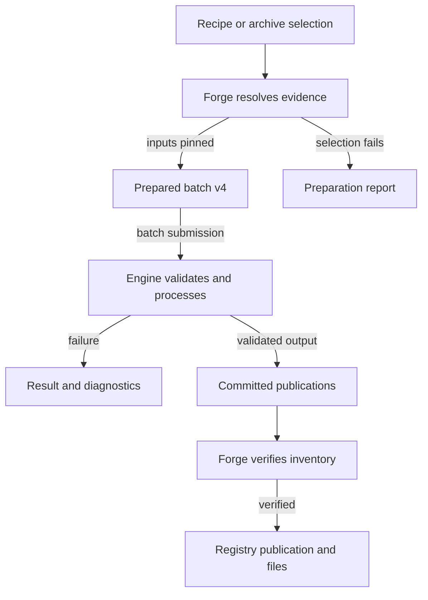
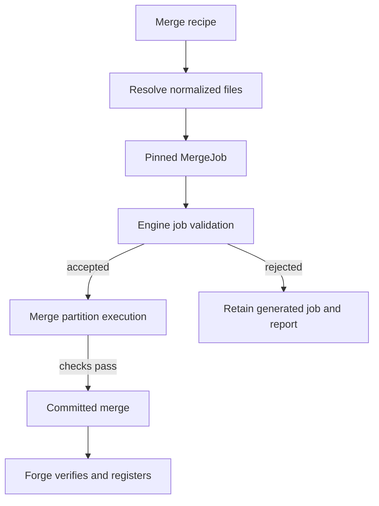
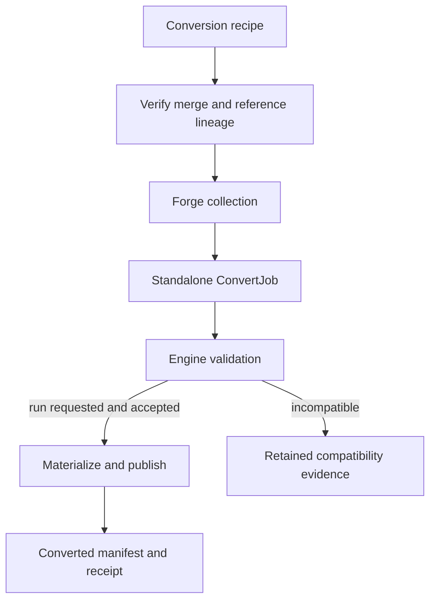
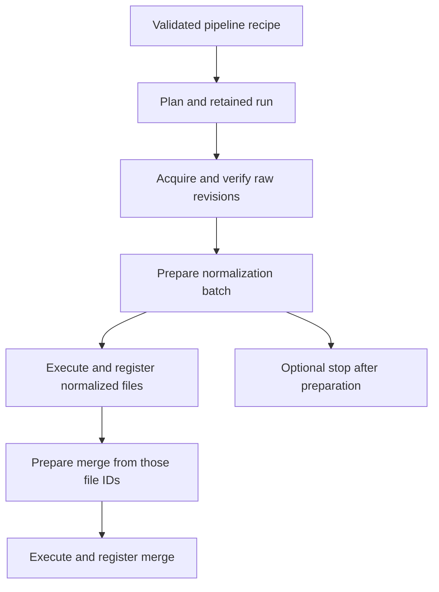

# Historical operation lifecycles

Use this page to follow inputs from source evidence to a publication. The operations use different preparation, execution, and recovery contracts.

## Acquisition and source registration

A data request declares venue, instrument or family scope, feed and nominal interval. `ExchangeSource` validates that scope and returns archive candidates with stable identity and download provenance. A managed acquisition writes the archive copy and records its hash under the managed raw root. Source registration and import cover manually supplied data. A registered object can still need metadata or a profile before it can be normalized. [Acquisition guide](../workflows/acquisition/index.md) · [Registration declarations](../reference/registration.md)

## Normalization

A modern TOML recipe supplies requests and an interval. Forge uses catalogues, rankings where needed, raw archives and historical specification evidence to prepare jobs by content type. Follow `batch.py` from recipe matching to the schema-4 batch and `engine/src/historical/config/batch.rs` from structural validation to resolved tasks and profiles. The managed normalizer runs a batch, and Forge checks its structured outcome against the submitted batch. [Batch producer](https://github.com/flowdrivenml/marketforge/blob/main/forge/historical/normalization/batch.py) · [Engine loader](https://github.com/flowdrivenml/marketforge/blob/main/engine/src/historical/config/batch.rs)

For trade data, follow source decoding, canonical fields, ordering and reconciliation. For depth, follow source observations, initialization, operation semantics, segmentation and canonical level output. Profiles govern fields and interpretation; format readers govern how records get to that interpretation. Committed data includes primary Parquet and manifest-declared auxiliary evidence, plus resolved job and runtime provenance. Forge verifies before registration. Inspect `submitted-batch.json`, `execution-intent.json` and `execution-result.json` under the normalization execution run. Use the documented registration-only recovery for verified committed outputs. A batch can have different outcomes per job. [Normalization workflow](../workflows/normalization/index.md) · [Prepared and publication contracts](../reference/data-formats/prepared.md)

## Merge

A direct selector uses registered **normalized file dataset IDs**. A derived recipe can follow a normalization recipe through retained evidence and registry membership. Forge resolves complete selected files and pins paths, hashes, identities and ranks into one MergeJob. The merger's `--validate-job` verifies the submitted contract against the selected inputs without merging. A job that can be serialized but fails validation can remain in the run directory as generated. [Merge preparation and execution service](https://github.com/flowdrivenml/marketforge/blob/main/forge/historical/merge/service.py) · [Merge workflow](../workflows/merge.md)

Rust produces a physical trades, depth or combined timeline. Chronological physical schema 1 and causal physical schema 2 use the manifest's physical-schema and ordering fields. Causal timeline sequence and reconstruction markers carry information the event timestamp alone cannot express. Registry file memberships and publication-level selected dependencies have different scopes. Use the retained merge execution intent for supported registration-only recovery after verifying the committed output. [Physical manifest validator](https://github.com/flowdrivenml/marketforge/blob/main/engine/src/historical/merge/materialize/publication/manifest.rs) · [Publication formats](../reference/data-formats/publications.md)

## Conversion

Forge accepts derivation from merge, normalization or acquisition TOML, or an exact merged registry publication binding. The selected source still resolves to a complete registered merge publication. Explicit references resolve to trade streams in the source or a supported external trade merge. Reference reachability does not guarantee that an eligible price observation exists before a specific event. [Conversion workflow](../workflows/conversion.md) · [Conversion configuration](../reference/configuration/conversion.md)

Each current Rust job carries schema version 1, prepared publication identity and fingerprints, stream identities and currencies, catalogue fingerprint, conversion policy, resources and Parquet settings. The Forge `convert.json` collection indexes separate job files. The Rust CLI consumes one `--job`, with `--validate` available to check the job and its evidence before execution. Current execution uses embedded metadata. A fixed on-disk instrument catalogue is not required by the Engine; Forge can check one when it exists during preparation. Old jobs from the pre-standalone contract require regeneration. [ConvertJob](https://github.com/flowdrivenml/marketforge/blob/main/engine/src/historical/job/convert.rs) · [Converter entry point](https://github.com/flowdrivenml/marketforge/blob/main/engine/src/bin/marketforge-convert.rs)

Forge's dry run computes proposed jobs without writing or submitting newly planned jobs to the Engine. Reuse checks can invoke Rust validation on an earlier retained job. Regular preparation retains a report whose `compatibility` field records validation separately from generation. Execution submits retained per-job bytes after pin and compatibility checks. The Engine supports causal input through its ordering-aware processing paths. Output has its own conversion manifest and execution receipt. Forge verifies completed output and reports registration as unavailable. A retry validates its pinned inputs, then checks for a recoverable or reusable commit before creating physical output. [Conversion orchestration](https://github.com/flowdrivenml/marketforge/blob/main/forge/historical/conversion/execution.py)

## Managed historical pipeline

Resume reads the retained run state and evidence. The preparation stop retains a batch and allows normalization execution to be resumed. An optional Conversion stage binds the exact registered Merge output and uses the Conversion preparation and execution services. [Pipeline guide](../workflows/pipeline.md) · [Retained artifact contracts](../reference/data-formats/prepared-forge.md)
