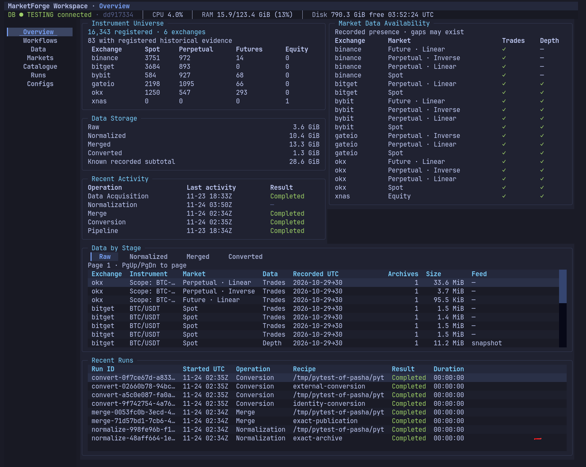

# Quick Start

Run a historical pipeline for Bybit BTCUSDT and inspect the merged dataset in Forge. Choose either the CLI or the interactive workspace to run it.

## 1. Install MarketForge

```bash
git clone https://github.com/flowdrivenml/marketforge.git
cd marketforge
./install.sh
```

Follow the [installation guide](installation.md) for supported platforms and setup options. The steps below assume installation and market initialization completed successfully and that you're running commands from the checkout. Forge uses the production registry by default.

## 2. Load the example recipe

The [canonical pipeline TOML](../examples/bybit/pipeline.toml) requests trades and L2 order-book depth for the Bybit BTCUSDT linear perpetual. It covers October 27, 28, and 29, 2026, in UTC. The end timestamp is exclusive. Forge runs acquisition, normalization, and merge using the installed defaults.

```toml
version = 2

[interval]
start = 2026-10-27T00:00:00Z
end = 2026-10-30T00:00:00Z

[[requests]]
exchange = "bybit"
instrument_type = "perpetual"
market_category = "linear"
data_type = "trades"
scope = { kind = "instrument", identifier = "BTCUSDT" }

[[requests]]
exchange = "bybit"
instrument_type = "perpetual"
market_category = "linear"
data_type = "order_book_l2"
scope = { kind = "instrument", identifier = "BTCUSDT" }
```

Copy the recipe to Forge's managed library. The command reports an existing destination and leaves it in place.

```bash
recipe_dir=data/.config/workflows/data_engineering/pipeline
mkdir -p "$recipe_dir"
recipe="$recipe_dir/bybit_quickstart.toml"
if [ -e "$recipe" ] || [ -L "$recipe" ]; then
  printf 'Recipe already exists: %s\n' "$recipe"
else
  (set -C; cat docs/content/examples/bybit/pipeline.toml > "$recipe")
fi
```

If the recipe already exists, check its contents before using that name.

## 3. Run the pipeline

### CLI

```bash
mf pipeline run bybit_quickstart
```

Forge discovers and downloads the archives, verifies and registers the managed copies, normalizes the data, and merges the outputs. It verifies and registers the merged publication and retains a run report with stage results. Download and processing time and storage requirements depend on archive sizes, network availability, and local hardware.

For an optional preview, use `mf pipeline validate bybit_quickstart` to check the recipe or `mf pipeline plan bybit_quickstart` to see the stages and available registry evidence.

### Interactive Forge workspace

```bash
mf tui
```

1. Open **Workflows → Pipeline** and select **bybit_quickstart**.
2. Choose **Run**, leave **Stop after** unset, and choose **Run pipeline**.
3. Review the recipe and production environment in the confirmation dialog, then choose **Run**. Follow the execution output or find the retained report under **Runs**.



See the [interactive workspace guide](../workflows/forge-tui.md) for execution windows and controls.

### Recover missing specification evidence

If normalization reports `No applicable immutable specification` after acquisition completes, run `mf init --production` and start the same recipe again. Initialization can now use the registered archives to establish the specification's applicability. Forge can reuse the verified raw files. See [historical pipeline troubleshooting](../workflows/pipeline.md#troubleshooting) if the run reports a different blocker.

## 4. Inspect the merged dataset

Use the **Merge registry publication** ID in the pipeline summary or retained run report. In Forge, open **Data → Merged**, select the matching publication, and press **Enter** to inspect its streams, files, and evidence.

From the CLI, substitute the Merge registry publication ID from your run:

```bash
mf datasets show --publication-id MERGED_PUBLICATION_ID
```

The [dataset inspection guide](../workflows/inspection/datasets.md) covers file previews and verification.

## 5. Continue into research

Start with [dataset discovery](../research/discovery.md), then explore the [Python API](../research/python-api.md), [Jupyter notebooks](../research/notebooks.md), or [dataset queries and lazy Polars scans](../research/querying.md#exact-values-and-bounded-execution).
