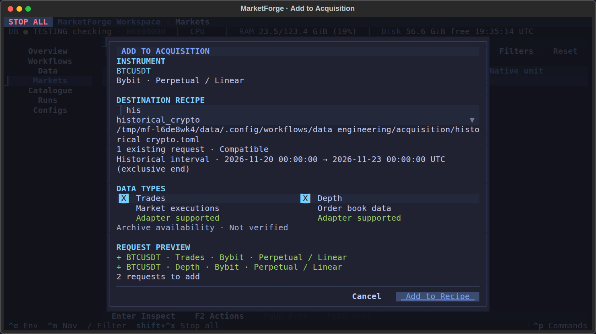

# Interactive Forge workspace

Forge provides a Textual application alongside the direct CLI. Install Forge
with Python 3.12 or newer on Linux or macOS. Textual is included in the Forge
lockfile. Use an interactive terminal. Forge defaults to production and its
workspace header shows the selected environment and verified connectivity. The
application resolves the same project root, settings, and credentials as the CLI.

```bash
mf tui
mf tui --production
mf tui --testing
```

A separate workspace or settings file can be selected with the global options.

```bash
mf --project-root /path/to/marketforge --config /path/to/settings.toml tui --testing
```

Startup reads local workspace evidence. Network acquisition, market refresh,
processing, verification, and storage mutation are explicit actions.

## Navigation

| Area | Contents |
| --- | --- |
| Overview | Catalogue, recorded availability, recent activity, storage, stage inventory, and recent runs |
| Workflows | Pipeline, acquisition, normalization, merge, conversion, and import |
| Data | Raw, Normalized, Merged, and Converted |
| Markets | Instruments, observations, policies, and ranking snapshots |
| Catalogue | Exchanges, Instruments, Specifications, and normalization Profiles |
| Runs | Retained reports, indexed runs, and operations owned by this application |
| Configs | General application settings and Normalize, Merge, Convert, and Pipeline runtime files |

Press Ctrl+P to find actions. Registration commands remain in the palette,
including raw registration and supported recovery. Workflows also has an
Import tab for raw preservation and a Registration tab for verified declarations.

Arrow keys move the cursor and Enter opens details. Double-click a row or
click a recipe name to inspect its source, interval, and configuration path.
Use **F2 → Edit** for the form or **Edit TOML** for a private draft in the
configured editor. Escape returns to the list with its state intact.
Right-click a row, use **F2**, or press Shift+F10 to open its actions.
**F3** opens readable retained evidence. Tab and Shift+Tab move focus.
Use `/` for search, Ctrl+R to reload, Page Up and Page Down to change pages,
and Ctrl+N to toggle navigation.

Use **Filters** for structured constraints and **Reset** to clear them. Click
a supported heading or choose a sort in the filter form. The arrow indicates
direction, and a second click reverses it. Registry sorting and filtering
happen before pagination. Turnover ordering keeps native denominations
separate. Missing numeric and time values sort last. The result strip displays
the current page and applied criteria.

| Inventory | Structured filters |
| --- | --- |
| Merged and Normalized | Publication ID, exchange, instrument identity, instrument type, market, trade or depth content, observed interval |
| Raw | Archive ID, origin and raw source, exchange, type and market, instrument or scope, feed, assets, status, and interval |
| Markets instruments | Exchange and market lists, exact symbol and symbol pattern, base, quote and settlement, instrument type, status, observation availability |
| Ranking snapshots | Comparison currency and complete or partial universe, with policy and snapshot search |
| Converted | Target quote and recorded stream kinds |
| Catalogue instruments | Exchange, symbol, type, market, assets, status |
| Retained runs | Run ID, operation, recipe, recorded state, exchange, scope, started interval, minimum duration, recorded outputs |

Publication member constraints match the same constituent. Retained run
context comes from retained reports and plans. Older records can lack scope
or duration. A recorded running state has unconfirmed liveness.

Forms include selectors and optional Advanced fields. Copy command displays
the equivalent quoted CLI invocation for use outside the app. Copy value
requests clipboard transfer through the terminal. If terminal or tmux clipboard
forwarding is disabled, the displayed text remains selectable.

## Overview

The shared header identifies the active area as **MarketForge Workspace ·
Overview**, **MarketForge Workspace · Configs**, and so on. The monitoring bar
shows registry connectivity and the selected environment, host CPU and RAM,
free space on the data-root filesystem, and UTC time. A successful registry
check verifies identity as well as connectivity. The full verified identity
is available in the monitoring bar’s tooltip. Use **Ctrl+E** to switch environments.

The clock updates every second, host metrics every two seconds, and registry
and disk checks every 20 seconds. Host CPU and available-memory sampling use
Linux host counters. Unsupported metrics show a dash. Narrow layouts show RAM
as a percentage. CPU and RAM at 90% or higher, and disk free space below 10%,
are highlighted in yellow. At wider sizes, Instrument Universe stacks above Data Storage, while Market Data Availability stacks above Recent Activity. Each panel sizes to its own content. At narrow widths, the two stacks flow vertically.

- **Instrument Universe** counts canonical catalogue instruments, including
  instruments without stored history. The historical count uses complete raw
  records with identified instruments and retained processed membership.
  Other instrument types contribute to the headline total.
- **Market Data Availability** shows recorded Trades and Depth for each
  exchange, instrument type, and market category. Presence does not establish
  continuous history, full reconstruction, or independently verified integrity.
- **Recent Activity** shows the latest recorded result for Acquisition,
  Normalization, Merge, Conversion, and Pipeline. Independently timestamped
  pipeline stages can contribute their own evidence. A retained running record
  without a live owned execution has unknown liveness.
- **Data Storage** shows recorded inventory bytes. The known subtotal covers
  recorded managed raw archives, registered physical primary files, and
  committed indexed conversion outputs. Missing sizes remain unknown.
  The subtotal describes recorded inventory, and the monitor separately shows
  filesystem capacity.
- **Data by Stage** pages through Raw, Normalized, Merged, and Converted.
  Raw groups adjacent or overlapping nominal half-open archive intervals for
  the same canonical instrument and data kind. Normalized groups observed
  data by instrument and kind. Merged shows registered publications. Converted
  shows indexed output references, which are separate from registry publication IDs.
- **Recent Runs** shows recent retained and indexed executions with their
  recorded timestamps, recipes, outcomes, and durations.

Focus Data by Stage and use **PgUp/PgDn** to load another page. Press **Enter**
or click the row to open metadata. Click a registry publication ID, converted
output reference, or run ID cell to copy the complete identifier. Raw and
Normalized group inspectors list their constituent identifiers and open the
existing archive and publication inspectors. Those inspectors provide physical
files, partitions where recorded, and available lineage and verification evidence.
Use **Datasets** and **Runs** for deeper inspection.

**Ctrl+R**, entering Overview, and finishing a workspace operation reload the
dashboard. An unavailable registry leaves host monitoring and retained local
run evidence usable. Previously loaded summary values are marked stale after
a failed refresh.

## Pipeline and standalone workflows

Select a saved recipe in **Workflows** to enable the action bar. **Validate**
opens the service result. Planning and preparation display blockers and retained
evidence in the workspace. **Run** and **Download** confirm the target and
environment. When a saved recipe is available, Forge validates it before review
and refuses to dispatch a recipe that changed after review.

| CLI family | Main workflow controls | Other TUI actions and inputs |
| --- | --- | --- |
| Acquisition | Validate, Plan, Map, Download | New, Edit, List, Sources and reviewed deletion are in recipe actions or the command palette. Plan uses cached discovery, with an optional local check and row limit. Map and Download support refresh and a request-rate override. Import and raw registration use their own managed actions. |
| Normalize | Validate, Prepare, Run | New, Edit, List, Show, Execute and Register are available from the palette or recipe/run actions. Prepare supports dry-run and acquisition recipe generation. Run accepts an exact recipe or prepared batch, with optional partial registration. |
| Merge | Validate, Prepare, Run | New, Edit, List, Show and Register are available from the palette or recipe/run actions. Prepare supports dry-run. Run accepts a recipe or pinned job. Use the publication selection action to define generation, interval and timeline ordering. |
| Convert | Validate, Prepare, Run | New, Edit, List and Show are available from the palette or recipe actions. Choose the binding source, target quote and reference trades in the recipe editor. Prepare supports dry-run. Run accepts a recipe or prepared request. Verified results can expose an indexed output reference. |
| Pipeline | Validate, Plan, Run | New and List are available from Workflows or the palette. Edit uses the saved recipe editor. Resume and Status accept a retained pipeline run ID. Run can stop at `normalize.prepare`. |

Registry-backed actions use the selected workspace environment. Runtime
configuration uses **Configs**, and normalization profile actions are available
under **Catalogue → Profiles**. CLI JSON and terminal presentation flags are handled
through retained evidence and the TUI monitor. The **Runs** area provides
status, logs and inspection across operations. Resume applies only where the
underlying service supplies a supported recovery path.

### Execution monitor

Forge starts the operation through its existing service and controller. On a
supported Linux Ghostty desktop it opens a separate Textual monitor without
moving execution ownership out of the main workspace. **Open run in workspace**
and **Logs in workspace** use the run ID supplied by the service. The monitor
shows current phase, available progress, retained results and diagnostics.
Pipeline stages come from the run itself, including Conversion only when
configured. **Stage execution → Window** opts into per-stage terminals in place
of the separate pipeline-level monitor.

With no supported display, or if Ghostty cannot confirm startup, Forge presents
an in-app monitor and explains the fallback. **Close View** returns to the
workspace without interrupting work. **Ctrl+O** reopens the same owned operation.
**Request Stop** asks the controller to interrupt the run and wait for cleanup.
Successful and failed results remain inspectable. Close the main application
only after owned work finishes or after confirming cancellation.

## Author recipes

**New recipe** opens the supported authoring form or asks you to choose a
source route first. Acquisition and Pipeline start with an empty historical
request. Add another entry for each additional scope or data kind. Each
request carries its own exchange, instrument type, market and source scope.

- An asterisk marks required fields. A neutral count shows which required
  fields are blank. Validation checks the values that were supplied.
- Optional fields may be left blank. The form shows model defaults where
  available. A default shown as a hint applies when you omit the field.
- Enable Pipeline conversion to see its target quote and policy. Turning
  conversion off keeps the pending values in the form and omits the stage
  when saving. Advanced Options expands in place.
- Use **Find** to search registered records. Open the result dropdown, type
  to search within the results, then choose **Use selection**. Matching
  instrument symbols are distinguished by venue, type and market. The
  historical request form uses the registered symbol in an explicitly
  selected instrument scope. Other scope kinds use a source identifier.
- Use **Validate** to see configuration issues beside their fields.
  Validation focuses the first affected control when the model identifies
  one. **Review recipe** checks the fields and shows what will be saved.
  Escape from review returns to the populated form. Leaving an edited form
  asks before discarding pending changes.
- Tab and Shift+Tab move between fields, selectors, help and actions.
  Enter confirms an open dropdown selection. Use **?** for field help and
  **Docs** for the workflow documentation.
- Configuration validation, preparation and execution are separate. Use
  **Plan** or **Prepare** to resolve evidence and prerequisites supported by
  the workflow, then review before **Run**. Use **Map** to check historical
  archive availability separately.

Normalization accepts historical requests, acquisition recipes, or exact raw
archive selections in the testing workspace. **Resolve profiles** checks the
selected archives before showing compatible profile choices. Merge accepts a
normalization recipe, explicit file dataset IDs, or selected normalized
publications. The publication route uses the service's observed bounds when
the interval is left blank. Use **Move up** and **Move down** (or Ctrl+Up and
Ctrl+Down) on the stream list to author explicit engine ranks. Keeping the
suggested order preserves the service's implicit ranking.

For Conversion, select **publication** as the source route and use **Find**
to browse registered merged publications, or start from a publication in
the Data workspace. Use **Edit** on the saved recipe to set policy and
select internal reference streams. **Browse external trade references**
checks the source mode and lists reference publications and their trade
streams. Preparation validates the resulting bindings and routes.

In **Markets → Instruments**, right-click a row or press **F2**. Eligible
instruments offer **Add to Acquisition**, **Add to Pipeline**, and **Inspect**
in that order. Use Markets search and filters to browse the registry.
**Refresh Market Observations** and **Synchronize Market Instruments** remain
available in the command palette with their existing environment and
confirmation checks. Rankings show snapshots and offer **View Ranking Results**.
Policies offer inspection, TOML editing, and validation.

Both Add actions open the same dialog with the exact market identity already
filled in. Search for an existing recipe by name and select it to see its path,
current request count, compatibility, and half-open UTC interval. Create a
recipe in **Workflows** first if the library is empty.



Under **Data Types**, select **Trades** (market executions), **Depth** (order
book data), or both. Each kind becomes a separate instrument-scoped request.
The dialog shows source-adapter support. Archive availability for the
selected interval is verified later during discovery or preparation.
Binance historical archives support Trades only. OKX derivatives and Bybit
options require broader scopes and can be configured separately in Workflows.

Opening the menu on a marked row uses the basket in selection order. An
unmarked row targets that row alone. If a data type is unsupported for any
selected instrument, the checkbox is disabled and the dialog names the
affected instruments. To add that kind to a compatible subset, adjust the
Markets selection.

**Request Preview** shows the validated additions and marks exact requests
already included. **Add to Recipe** is enabled when there is at least one new
request. Saving appends only those requests and preserves the interval, comments,
and existing settings, including Pipeline normalization, merge, conversion,
and reference options. If another editor changes the file, clear and reselect
the destination to review the updated recipe. Saving only updates the recipe
file.

Acquisition recipes can seed normalization and conversion. Normalization
recipes can seed merge or conversion, or replace the single source of a
compatible derived merge that has no pinned publication IDs. Merge recipes
can seed conversion. Conversion source routes still resolve committed merge
inputs during preparation. Creating or editing a recipe does not execute it.

## Data and maintenance

Merged lists registered publications. Normalized lists streams within
registered publications. Inspect a publication to see registry and Engine IDs,
stream membership, and paged primary-file identities. A primary-file
verification checks the named file and shared manifest checksum. The result
states its verification scope.
Execution and verification evidence retain original timestamps and units.
Observed event endpoints are inclusive and do not establish continuity for
the requested half-open interval.

Converted browses known commits from the newest 100 converter execution
receipts. Forge reads metadata from their known managed manifests. Missing or
invalid manifests remain identifiable from the retained receipt. This source
does not enumerate every local conversion and does not infer registry
registration. The Overview keeps its separate shorter evidence window.

Raw uses local archive registry identities. Reloading reads retained
metadata. Archive verification and reconciliation can update registry state,
and dataset verification hashes the requested file and shared manifest.
These actions run only when selected.

Review and apply storage cleanup using the saved preview. Forge binds apply
to the displayed preview and revalidates targets before deleting anything.
Ranking deletion also checks reviewed snapshot identities. Database restore
accepts a verified backup and an explicitly named fresh disposable testing
database. Existing storage and database safeguards remain in force.

## Active work and shutdown

Ctrl+O opens the owned operation and its current activity. Pipeline and
acquisition progress comes from their typed snapshots. Processing shows
phases and retained results. Inner-engine throughput, ETA, and row progress
are unavailable in Forge. An open operation gains report, output, and recovery
actions as evidence becomes available. When the operation finishes while you
browse elsewhere, Forge shows a notification and keeps your current view.

Changing screens leaves owned work running. Workspace ownership lasts for
the mutation, including child and reader cleanup. Ctrl+C opens interruption
confirmation. Ctrl+Q with work active offers Back to keep the application
open, or cancellation and graceful exit.

Retained external reports show the last recorded state. They carry no
promise of process liveness, and Forge only cancels operations that it owns.
Pipeline Resume and normalization or merge registration recovery use the
existing service paths. For work that should survive leaving a terminal,
launch Forge inside tmux and detach from the session.

See the [CLI and TUI action inventory](../development/forge-tui.md) for action
classes, service boundaries, and verification coverage.

## Select sources across stages

Use Space on a focused result table or click its leftmost marker to add a row
to the selection. The Actions button shows the number selected. F2 opens the
row menu. Use **Clear selection** from the command palette to empty the
basket. Each view keeps its selection across searches and pages.

- In **Markets → Instruments**, search for BTCUSDT, filter to Bybit perpetual
  instruments, and select the linear contract. Choose **Add to acquisition**,
  select an existing recipe and supported data kinds, then review the exact
  instrument identities and the destination recipe’s interval.
  The saved recipe offers **Validate** and **Plan**. The archive plan describes
  retained discovery evidence. Use **Map** for remote discovery when the cache
  lacks coverage.
- Use **Add to Recipe** on Raw, Normalized, or Merged data to select an
  existing destination. Review the exact sources, validate the draft, and save.
  See [Add to Recipe](#add-to-recipe) for the supported source contracts.
- Use **Validate**, **Prepare** and **Run** from the saved recipe. Conversion
  reports separate execution, verification and indexing outcomes. Open a
  durable output reference in **Data → Converted**, verify files or open the
  producing run. Converted outputs use indexed work references. Registered
  merge and normalization publications use registry publication IDs.
- **Runs → Indexed** uses the selected registry. **Retained** includes local
  evidence. Use F2 on a run to open its report, logs, and attributable
  registry outputs. Event and stream search preserves retained order. **Open
  retained log** offers line ranges, text search, exact severity for event
  logs, the original path and full export to a new file. Export preserves the
  bytes present when the export starts. A range larger than 64,000 bytes
  requires a smaller selection or export.

## Manual registration in Catalogue

**New** opens a declaration form for an exchange, instrument or specification.
Use **Find** for a registered exchange or the exact instrument. Specification
sizing fields depend on the selected instrument and quantity type. Enter
decimals as text to preserve precision and supply either retrieval time or a
complete historical validity interval. **Validate** checks the declaration
model. **Review declaration** runs the registry preview before asking you to
register in the named environment.

Use **Configure profile fields** in the profile draft's actions to edit the
schema groups. Source format determines which fields are offered. Field help
links to the Rust profile field reference. **Validate** compiles the
candidate through the Rust profile validator. **Update validated draft**
updates the workspace draft. Use **Rust validate and review save** to review
installation. Dynamic mappings remain editable as structured TOML, and
individual field editing remains available.


**Catalogue** opens directly to **Exchanges**, **Instruments**, **Specifications**,
and **Profiles**. Search or use the tab’s filters. Enter opens an inspector,
and F2 offers identifier copying, related records, and contextual documentation.
Recipes stay in **Workflows**, including acquisition **Import** and
**Registration**. Ranking policies stay in **Markets → Policies**.

Choose **New Exchange**, **New Instrument**, or **New Specification** to save a
TOML declaration draft. Select a registered exchange for an instrument, or
search for and select the complete instrument reference for a specification.
Use exact decimal strings for values such as tick size and quantity step.
Supply a retrieval timestamp for a current observation or both validity
bounds for a historical declaration. Before registration, the review shows
the declaration, conflict check, selected environment, and registry identity.
Identical declarations can be reused. The catalogue service rejects conflicting
records. See [exchange and instrument registration](catalogue/exchanges-and-instruments.md)
and [specification revisions](catalogue/specifications.md).

**Profiles** shows managed files and their syntax and identity checks. **New
Profile** starts from a trade or depth template. **Clone Profile** starts a
separate draft from an installed definition. Select a schema field to edit
it or open its documentation. **Edit in Neovim** opens a temporary copy for
advanced mappings and validates it before applying the edit to the draft.
**Rust validate and review save** compiles the profile and checks compatibility
with the workspace profile catalogue before confirmation. Decoding a source
archive requires separate compatibility evidence. The registered venue is
checked in the selected registry, and profile files are shared by environments
using the same workspace. The installer rejects changes to the interpretation
of an existing profile ID. See [profile authoring](normalization/author-profile.md)
and the [profile field index](../reference/configuration/profile-fields.md).

## Browse historical data

The **Data** area has four tabs in processing order. The Overview uses the
same inventory in its compact **Data by Stage** panel.

| Tab | What each row shows |
| --- | --- |
| Raw | A managed raw archive or a window of compatible registered archives. |
| Normalized | A logical stream and data kind within an instrument and registry publication. |
| Merged | A registry publication with its exchange, instrument and data-kind summary. |
| Converted | A committed indexed output, including its target quote and output reference. |

Raw windows group compatible archives whose recorded intervals touch or overlap.
A gap starts a new window. The recorded start and exclusive end describe the
archive coverage declarations. Tables show UTC calendar dates, and inspectors
show the retained timestamps. Event continuity is unverified. Scope archives
retain their scope and any known instrument memberships. Open a window to see
its exact archive IDs, source and feed evidence, then choose an individual archive
for its local path, recorded size, state and available integrity evidence.

Normalized publications can contain several instruments. Two trade streams for
BTCUSDT and BTCUSDC can appear on two rows with the same publication ID. Each
row counts its distinct registered primary files. A file shared by multiple
streams can be referenced by each stream. Recorded storage totals count physical
files independently of these membership rows. The observed period comes from
retained event bounds. Publication details preserve the registry and Engine
IDs, and include available generation and integrity evidence.

Open a publication with Enter or a click. **Streams** shows membership and
**Files** opens a registered primary file for schema, verification and sampling.
Use F2 for **Observed timelines**, **Physical partitions**, and **Publication
lineage**. From a partition, inspect schema, row groups, or a bounded query
preview. A physical file and a logical partition have separate identities.

A converted output reference belongs to the conversion index. Open the output
for its source publication, target quote, source streams, physical files, and
conversion evidence. F2 links to partitions, lineage, verification, and the
producing run when recorded.

### Add to Recipe

Right-click a Data row or press **F2**. **Add to Recipe** comes first, followed
by **Inspect**, **Copy Selected Text**, **Copy Row**, **Copy Identifier**, and
**More Actions**. The last menu holds relevant actions such as browsing
normalization profiles, reviewing deduplication, inspecting partitions or
lineage, and verifying indexed outputs.

Select rows with **Space** or the left selection column. The selection stays
with the Data tab across pages. Open the menu on a marked row to use the
selection, or on an unmarked row to act on that row alone. The menu shows the
count for a multi-row selection.

Choose **Create New Recipe** or **Add to Existing Recipe**. The existing recipe
picker searches the managed library for the destination workflow and shows
source information and known blockers. Review registered sources, edit the
draft, validate, and confirm **Save recipe**. Existing settings and supported
TOML comments are preserved. Duplicate sources leave the recipe unchanged.
Preparation, execution, and publication registration each require a separate
action.

| Data tab | Destination and scope |
| --- | --- |
| Raw | Exact-archive **Normalization** in testing. Grouped rows offer a checklist of archive IDs. Forge checks registered revisions and compatible compiled profile fingerprints. |
| Normalized | **Merge**. Forge pins the chosen stream's registered primary-file IDs and exact publication generations. Files with ambiguous stream scope are blocked. |
| Merged | **Conversion**. Forge binds one committed source publication. A replacement requires explicit review, a matching committed interval, and compatible reference streams. |
| Converted | No current recipe consumes an indexed Conversion output. **Add to Recipe** explains the blocker and offers inspection and reference copying. Use **More Actions** for sampling, lineage, and verification. |

### Copy text

Drag along one line in a Data table, then press **Ctrl+Y** or right-click and
choose **Copy Selected Text**. A drag copies the visible passage, including
substrings and any displayed ellipsis. **Copy Identifier** retrieves the full
registered publication ID, archive IDs, or indexed output reference.
**Copy Row** copies the row evidence. Press **y** to open it in a text dialog.

In inspectors, drag to select text in a records table or across lines of a
text summary. Use **Ctrl+Y** or **Copy selection**. In a full-value dialog,
**Copy value** and **Ctrl+Y** copy the highlighted passage or the whole value
when there is no selection. Changing Data tabs, pages, registry environments,
or scrolling a table clears its highlight. Refreshing records or opening
another screen also clears the Data table highlight.

Forge tries the desktop clipboard tools available to the session, then tmux
clipboard forwarding and terminal OSC 52. Transfers are capped at 74,000
bytes. OSC 52 notification confirms that Forge sent a request. The terminal
controls delivery. For terminal-native selection, Ghostty offers a mouse
override, subject to its configuration. In tmux, clipboard forwarding depends
on the server's `set-clipboard` option, the client's `Ms` capability and
terminal clipboard permissions. **Ctrl+C** remains the interrupt shortcut.
See the [Ghostty mouse settings](https://ghostty.org/docs/config/reference#mouse-shift-capture).

## Environment

Press **Ctrl+E** or choose **Switch environment** in the command palette to reconnect
with an empty selection basket. The header shows the selected registry environment.

Open **Configs → General** for Forge application settings, or select **Normalize**,
**Merge**, **Convert**, or **Pipeline** for the corresponding runtime file. Drafts stay with their tabs, and a count shows the
number of changed settings. Expand or collapse the inline groups with a click or **Enter**.
Press **F1** from the editor for field help and **F2**
for configuration actions. Engine management, database commands, and the Forge
application settings editor remain available in the command palette. See the
[Configuration Explorer](../reference/configuration/explorer.md).

Publication or indexed conversion deletion from the Data actions menu saves a testing-only review
plan. Forge offers apply only for plans whose targets pass the ownership and
dependency checks. Run deletion under **Runs → Indexed** offers a
history-only mode that preserves physical evidence.

## Emergency Stop

The red **STOP ALL** control is at the top left. **Ctrl+Shift+X** also opens
its confirmation, including while a form or inspector is open. **Cancel** is
focused first, and Escape returns to the workspace. **STOP ALL & EXIT** stops
new dispatches, requests cancellation through the session's operation controller,
and exits Forge. The confirmation counts active operations and directly
observed managed processes. A stage window's worker and its Engine may be
supervised through the window's private stage connection.

Use **Ctrl+C** for ordinary operation cancellation when Forge can wait for
normal cleanup. Emergency Stop shortens the grace period before escalating.
Only work managed by this Forge session is in scope. An independent Forge
process, an existing terminal or tmux session, and PostgreSQL are outside that
scope.

After an emergency, reopen Forge in the same environment and inspect the run,
its logs, and its retained execution evidence. A forced stop may leave a
partially completed attempt or unconfirmed registration. Use the workflow's
supported resume or registration recovery action once the retained evidence
has been checked. Committed datasets and retained staging are kept.

## Recipe drafts and inspection

When a recipe accepts a historical interval, enter the **Start date**,
**Start time**, **End date**, and **End time** in UTC. Dates use `YYYY-MM-DD`
and both times start at midnight `00:00:00`. Seconds can include fractional
digits if the stored interval has that precision. Start is inclusive and
end is exclusive. Forge checks ordering with the workflow's recipe model.
Some bound publications supply their own read-only interval.

Create or edit a recipe from **Workflows**. The form marks required values
with an asterisk and labels optional settings. Use the stage toggles and
**Advanced Options** for supported policy overrides and resource requests.
Blank optional fields use the recipe or runtime defaults where applicable.
**Validate** checks the draft. **Review recipe** or **Review changes** opens
the confirmation before **Save recipe**.

Use **Add Request** to add ordered acquisition requests in Acquisition,
Normalization, or Pipeline. Select the exchange, instrument type, market,
and scope first. **Find** on an instrument identifier searches the registered
catalogue within that identity. Select the data kind separately. Use the
entry checkboxes to omit requests from the draft.

Right-click a saved recipe or press **F2** for actions such as **Inspect**,
**Edit**, **Validate**, **Plan**, **Prepare**, or **Run**, according to the
workflow. Source actions open a draft. Acquisition offers **Add Instrument**,
Pipeline offers **Add Acquisition Request**, Normalization offers **Select
Sources**, Merge offers **Select Normalized Sources**, Conversion offers
**Select Source Publication** and **Add Reference Streams**, and Import
offers **Add Source Files**. Exact-archive and publication bindings preserve
registry IDs. Import files are selected beneath the recipe's source root.
Save the reviewed draft to apply source changes.

The inspector's **Summary** displays saved recipe state and the main inputs.
**Configuration** displays the complete saved settings, including nested
requests, stage policies, and advanced settings. **Source evidence** displays
available metadata for explicitly configured registry IDs. For a recipe that
refers to an upstream recipe, its current resolved publications require
preparation evidence. **F3 Advanced details** opens the saved configuration
and its evidence, and **Edit TOML** opens a private editable draft. Inspection
uses read-only service calls and displays missing evidence explicitly.

## Inspect evidence in Neovim

In **Runs**, open a run or its report and click **Open** beside the primary
retained file. Select **Artifacts** to choose another report, prepared job,
event log, plan, receipt, or configuration snapshot. From the keyboard, focus the
same button with **Tab** and press **Enter**. The artifact list uses the
references recorded by the run and its attempts. A pointer to a missing
or inaccessible file produces an error in Forge.

For a structured section, click **Open JSON** to read its complete value
as indented JSON. **F3 Evidence** opens the full evidence view, which also
has an editor action when the evidence is structured. Integer identifiers
and nanosecond timestamps keep their exact values, Unicode stays readable,
and typed decimals keep their precision as JSON strings. Arrays, nulls,
and empty collections are included. Forge reports an error if a value
contains protected content or cannot be represented safely as JSON.

**Artifacts** also appears for supported recipe TOML and publication
manifests. The same JSON action is available for structured dataset metadata,
lineage, workflow reports, catalogue records, and normalization profiles.
In **Configs**, use **Open effective** for available validated values.

Forge supports referenced JSON, JSONL, TOML, and retained text logs.
Neovim reads a private byte-for-byte copy of each file. JSON, JSONL, and
TOML use the corresponding syntax highlighting. Large inspection files
prompt before Neovim opens. Binary archives and Parquet remain available
through their dedicated inspection views.

Forge opens read-only Neovim in a separate Ghostty window. The original
Forge screen stays interactive. Closing Neovim removes the private copy.
Use **Edit TOML** to edit a current recipe or configuration.

## Edit TOML in a separate window

In **Workflows**, choose **Edit TOML** from the recipe's actions.
In **Catalogue**, use **Edit in Neovim** on a profile or declaration draft.
In **Configs**, choose **More → Edit TOML draft** for General, Normalize,
Merge, Convert, or Pipeline settings. Forge opens a private draft in a new
Ghostty window with the workspace as its working directory. It uses the
configured editor, then `VISUAL` or `EDITOR`, with `nvim` as the default.
The Forge window remains usable while you edit, including from inside tmux.

Save and quit the editor to validate the draft. Forge reports whether it
found changes and whether validation passed. Use **F9** or
**Editor sessions** in the command palette to see the result. Review the
diff and use **Apply reviewed changes** to accept it. In **Configs** this
loads the validated file into the existing settings form. Use **Review &
apply** there to save settings and acknowledge integrity risks when required.
Catalogue registration and profile installation retain their own review.

An unchanged draft is removed. Invalid drafts stay available to reopen,
copy, or discard. If the authoritative file changes during editing, Forge
blocks the apply and keeps the draft. Use **Compare with current file**
to inspect the conflict before starting again. Different files can have separate windows. Each target has
one active draft per Forge session, including drafts awaiting review.

A supported Linux Ghostty build and an active Wayland or X11 display are
required. If Ghostty is missing or cannot connect to the display, the
session shows the error and offers reopening, copying the draft path, or
discarding the draft. In a restored tmux session, launch Forge with the
current desktop's Wayland or X11 environment. Headless or unsupported
sessions leave Forge running and keep the draft for recovery.

Emergency Stop stops owned processing and exits Forge. Editable windows
that are already open stay open. To recover a draft after Forge exits,
use its buffer path in the editor or the copied draft path. The private
`marketforge-edit-*` directory in the system temporary directory contains
the draft and a `.session.json` file with its target and original checksum.
Recovery lasts while the temporary directory exists.

## Recipe lifecycle

A **recipe definition** is reusable TOML listed in Workflows. An **execution
snapshot** records the configuration and source bindings for one run or attempt.
Edit and save a recipe to change future submissions. Inspect a run to see the
configuration associated with that execution.

### Remove configured inputs

Open the recipe inspector or context menu and choose **Remove from Recipe**.
Pick a configured entry, review the draft, then validate and save. Cancel before
saving to keep the current recipe. Use source selection and instrument handoffs
to add entries.

| Workflow | Removal scope |
| --- | --- |
| Acquisition | One request, including its data kind, or all requests for the same exchange, instrument type, market category and instrument. |
| Normalization | Exact archive pins, manual inputs or configured requests. A dynamic request has no per-archive exclusion list. Edit the request or use an exact archive recipe. |
| Merge | Whole normalized publications, primary files in an explicitly pinned subset, or direct primary-file IDs. Whole-publication removal removes that publication's selected streams from the recipe. |
| Conversion | Explicit reference streams or the external reference publication. Use **Replace Source Publication** for the required merged source. Reference compatibility is checked during review. |
| Pipeline | Acquisition requests and optional Conversion selections. Normalization and Merge are required. |
| Import and Registration | Source files, patterns and Registration input groups. |

Recipe changes apply to shared workspace configuration. Registry-bound source
selections use the selected registry. Recipe edits leave market data and
catalogue records in place.

### Archive and restore recipes

Choose **Delete Recipe** to review the managed path and identified dependencies.
Confirm to archive the original file and remove it from active discovery.
Testing and Production share the workspace recipe. Resolve dependent recipes
or executions listed in the preview before retrying. Workspace ownership
protects files in use by another cooperating Forge process.

Open the Workflows context menu for the recipe family and choose
**Restore Archived Recipe**. Forge restores the original contents and name.
If that name is occupied, both the active recipe and archived copy are preserved.

### Inspect historical configuration

In **Runs**, use the artifact controls to open the original recipe, effective
settings, prepared job or report in the read-only Neovim inspector. Pipeline
retains the submitted TOML and resolved plan at the run root. Stage references
lead to its selected inputs, jobs, Engine receipts and acquisition run.
Pipeline resume verifies and uses retained configuration and stage fingerprints.

Legacy runs may have a submitted job or report but no original recipe snapshot.
Runs displays **Original recipe snapshot unavailable** when this evidence is
missing. Credentials and private environment files are outside the snapshot
contract. Replay also requires the referenced market data and compatible Engine
dependencies.
