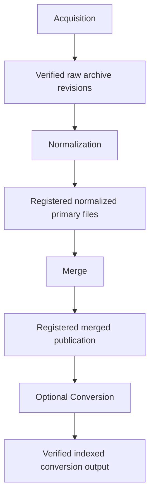

# Historical pipeline

A single Forge recipe acquires and registers raw archives, normalizes them, and
publishes and registers a merged dataset. Add a `[convert]` table to value the
merged output in a target quote and index the verified result.

Start with the [Quick Start](../getting-started/quickstart.md) to run a minimal Bybit recipe.

## Recipe

In **Workflows → Pipeline → New recipe**, enter the UTC interval and add
acquisition requests in the order you want them saved. Normalization and
merge use inherited defaults until you enable a recipe-level override.
Enable Conversion to reveal its target quote and staleness policy. Turning
it off omits the optional stage from the saved recipe. The review displays
the enabled stage sequence before saving.

Save named recipes under `data/.config/workflows/data_engineering/pipeline/`. The version 2 recipe uses
the acquisition request schema and one half-open UTC interval `[start, end)`.
Use the existing scopes and feed options for each exchange. Forge resolves
archive, instrument, job, dataset, and registry identities.

Create a starter with `mf pipeline new bybit_spot` and replace its contents
with the [four-stage example](../reference/configuration/pipeline.md#four-stage-bybit-spot-recipe).
Use the [recipe reference](../reference/configuration/pipeline.md) to customize it.

`[normalize]` and `[merge]` are optional. Normalization defaults to turnover
ranking. Merge accepts `causal` and `chronological`. When omitted, the existing
merge planner picks the ordering required by the selected inputs. It derives
trade, depth, or mixed processing from registered files.

An optional `[convert]` table takes a target quote and conversion policy. The
pipeline uses the exact merge registered by the preceding stage. Install the
managed converter with `mf engine build convert` and configure its base runtime
before running this stage. See [pipeline recipe options](../reference/configuration/pipeline.md#optional-conversion)
and [reference-trade requirements](../concepts/conversion.md#how-references-become-eligible).

The default in version 2 is automatic reference selection. Planning shows the
configured policy. Once Merge registers the source, Conversion discovers trade
streams in that exact publication and retains the selection, ranking evidence,
and Rust validation in the preparation report. An explicit
`convert.reference_stream_ids` array overrides automatic selection. Version 1
recipes keep their existing defaults.

## Inspect and run

Use an initialized registry with current migrations. The commands below use
the testing registry. Omit `--testing` to use the default production registry.
Install the managed normalize and merge engines and use the operation runtime
files, pipeline runtime, and normalization profiles. The catalogue must supply
instrument identity and applicable historical specifications for the requested archives.
Forge reads its ordinary application and HTTP configuration.

```bash
set -o pipefail
mf engine build normalize
mf engine build merge
mf pipeline validate bybit_spot
mf pipeline plan bybit_spot --testing
```

Validation checks recipe structure and options. Planning reads existing
registered evidence and identifies deferred work. It issues no HTTP requests,
allocates no output identities, and writes no recipe, job, or registry rows.
Local archive readiness is confirmed on run.

```bash
mf pipeline run bybit_spot --testing
```

Forge runs processing stages sequentially to preserve their configured engine
budgets. Acquisition uses the usual HTTP concurrency and source rate limits.
Preparation and validation are distinct phases. A processing stage completes
only once Forge verifies and records its required outputs. Normalization and Merge register their publications. Conversion indexes a verified output reference. This can come from a new execution or [verified reuse](../reference/cli/merge.md#completed-work-reuse). Archive discovery, nominal archive intervals, verified
local files, and observed event extents describe different evidence.

Acquisition passes its exact verified local archive IDs, paths, checksums, and
source revision evidence to normalization. Normalization keeps its existing
coverage and readiness checks, and uses only those inputs. After normalization
registers every required publication, merge takes the exact registered
primary-file dataset IDs in that receipt. Engine job and publication IDs stay
distinct from registry publication and primary-file IDs.

## Stage windows

In an interactive Linux desktop session with supported Ghostty, the command
opens a separate window for each stage that executes. The original terminal
keeps the pipeline dashboard and final summary. Acquisition shows discovery
and download progress. Processing windows show the managed Engine monitor
when available, or the Engine's live terminal output. The window closes
after Forge has retained the stage outcome, including failures.

```bash
mf pipeline run bybit_spot --testing --stage-terminal window
mf pipeline run bybit_spot --testing --stage-terminal inline
```

The default `auto` uses inline execution for headless sessions, redirected output,
and JSON. If Ghostty cannot start a worker, an interactive run reports the reason
and continues inline. `window` requires a supported desktop terminal and fails
if a required window cannot start. Use `inline` on macOS or when debugging.
In tmux, Ghostty still opens a desktop window. A restored tmux session needs
access to the current Wayland or X11 display.

Preparation, recovery of a committed output, and completed-work reuse can
finish without opening a processing window. Only stages declared by the recipe
are scheduled. `--tui` explicitly enables the pipeline dashboard in the original
terminal. The window mode enables it automatically when that terminal supports it.

## Inspect a preparation and resume

```bash
mf pipeline run bybit_spot --testing --stop-after normalize.prepare --tui
```

This stops with validated normalization jobs before execution. The command
prints the retained run ID and the resume command.

```bash
set -o pipefail
mf pipeline status RUN_ID
mf --json pipeline status RUN_ID
```

```bash
mf pipeline resume RUN_ID --testing --tui
```

Resume uses the original workspace, storage root and testing registry. It
checks retained TOML, settings, profile and executable hashes, prepared jobs,
and acquisition evidence. Retained jobs preserve the ranking and stream
ordering selected during preparation. Completed acquisition scans and verified
archives from an interrupted acquisition are retained. A request whose
discovery never finished may still need discovery. Changed or missing pinned
inputs require investigation. A new selection belongs to a fresh run.

If processing committed a valid publication but registration failed, resume
verifies that publication and retries registration through the existing
registration service. It keeps failed attempts and any published outputs. A
processing retry allocates fresh output identities. A fresh pipeline run also
allocates fresh outputs and may reuse verified raw archives.

## Progress and reports

Press Ctrl+C in the original terminal to request cancellation. Closing an active
stage window also interrupts its worker. Forge uses the retained result to
decide whether the work completed. If the outcome is uncertain, the pipeline
stops and retains its evidence for reconciliation. Resume the same run to
verify a prior commit before starting more processing.

```bash
mf runs show RUN_ID --testing
mf runs report RUN_ID --testing
```

The parent report lists stage outcomes and relevant publication references.
Acquisition counts during discovery can be provisional. Detailed Engine
throughput, job progress, and diagnostics belong to the stage window or retained
attempt. Use the run report to find the failed stage and its evidence after the
window closes.

Run artifacts live under `<storage>/runs/<run-id>/`. Start with `report.json`
and `events.jsonl`. The run also retains `submitted.toml`,
`resolved-plan.json`, frozen engines, and historical settings and profiles.
`steps/` links execution attempts and stores the exact acquisition selection.
The report points to the existing child preparation, execution, verification,
and registration receipts. Each engine attempt retains separate diagnostic
logs and its structured result when available.

Read the reported child error before retrying. Build missing managed engines,
verify access to the selected registry, and supply missing catalogue or profile
evidence as indicated. Preserve existing outputs and staging when inspecting
interrupted attempts. Use a fresh run when the recipe, data selection, or
interpretation needs to change.

To inspect an indexed conversion result, follow [Conversion output inspection](conversion.md#6-inspect-the-result).

## Data flow and identities



Conversion binds the exact merge from this run using its registry and Engine
publication IDs, registry UUID, committed interval, and retained fingerprints.
The [four-stage Bybit example](../reference/configuration/pipeline.md#four-stage-bybit-spot-recipe)
requests BTCUSDT trades and depth plus BTCUSDC trades. It demonstrates identity
valuation and a possible USDC → BTC → USDT path. Reference availability is
evaluated against the causal timeline during conversion.

## Processing and execution history

Run and status output show the retained processing result and the execution
index separately. A stage can publish verified output before a failure updating
run history. Forge retains the terminal outcome before finalizing its original
PostgreSQL attempt. The outcome includes the attempt, run, registry, resource
identities and a fingerprinted report snapshot. Acquisition has its own
logical child run. Processing stages link their retained Engine executions and
prepared artifacts, even when they have no separate logical child run.

Inspect a run and its outputs using the IDs printed in its summary.

```bash
mf runs list --testing --operation pipeline
mf runs show RUN_ID --testing
mf runs report RUN_ID --testing
mf datasets list --testing --operation merge --view publications
mf datasets list --testing --operation convert --view publications
mf datasets show --publication-id MERGED_PUBLICATION_ID --testing
mf datasets show --output-ref CONVERTED_OUTPUT_REF --testing
```

If processing is complete and the run-history index needs reconciliation,
preview the exact retained attempt, then apply that selection. Verify the
same attempt in `runs show`. Repeated apply reports that the attempt is
already reconciled. This operation never starts an Engine or rewrites outputs.

```bash
mf runs reconcile --run-id RUN_ID --testing
mf runs reconcile --run-id RUN_ID --testing --apply
mf runs show RUN_ID --testing
```

The selected registry needs current Forge schema migrations to index
four-stage resources. Installation or database administrators can check
`mf database status --testing` before applying pending testing migrations.
[Execution and recovery concepts](../concepts/execution.md)

## Troubleshooting

| Observation | What to inspect or do |
| --- | --- |
| TOML invalid or provider rejects a request | Run `pipeline validate` and compare with `acquisition sources`. Fix the scope or feed declaration before starting |
| No registered raw evidence | `pipeline plan` reports recorded local evidence. Discovery and physical readiness are checked in Acquisition |
| Missing profile or historical specification | Inspect normalization preparation diagnostics, the installed profile catalogue and the instrument’s applicable historical specification |
| Missing or incompatible Engine | Check `engine status` and `engine runtime pipeline`. Conversion also requires `engine runtime convert` |
| Merge selection blocked | Inspect the exact upstream file IDs and their publication membership in the normalization receipt. Resolve missing evidence before changing the request |
| Missing reference stream or stale price | Inspect the merged streams and reference decisions in preparation. Confirm the trade stream ID, route, causal eligibility and maximum age |
| Stopped at normalization preparation | Resume the retained run to execute the pinned batch |
| Normalization or Merge published, registration pending | Resume so the stage can verify the preserved commit and retry registration |
| Conversion committed, indexing pending | Resume with the retained converter job and outputs. Forge uses its verification and work-index recovery path. Inspect the report if recovery remains blocked |
| Interrupted or stage window lost | Inspect the retained stage outcome. Resume the same run if the pins and registry identity still match |
| Ghostty unavailable | `auto` can fall back before work starts. Use `inline` for unattended runs. `window` requires a supported graphical terminal |
| Stdout is piped or redirected | The human summary uses the shared theme with plain output under automatic color detection. The CLI regression suite covers the former missing-style failure |
| Processing complete, index incomplete | Inspect the retained result and reconcile the exact run. Preserve the output and attempt evidence |
